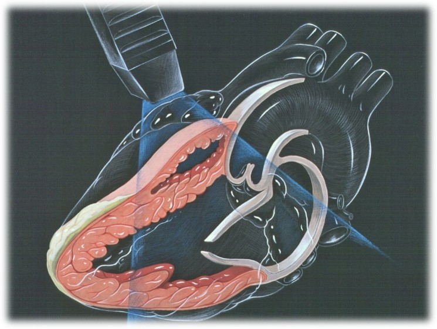

::: {style="text-align: center;"}
<b>Digital recordings of heart sounds in babies during the Newborn Infant Physical Examination: the babyPHONO study</b>

{width="50%" fig-align="center"} {width="50%" fig-align="center"}

{height="200px"}

 
:::

::: {style="text-align: left;"}
We would like to invite you to take part in our research study because you carry out newborn infant physical examinations.  Before you decide, we would like you to understand why the research is being done and what it will involve.    One of our team will go through this information with you and answer any questions you may have.     Ask us if there is anything that is not clear or if you would like more information.  Take time to decide whether or not you want to take part, and speak to others if you wish. Participation is completely voluntary.

<b>Why are we doing this research?</b>

Hearing heart murmurs in babies can be difficult due to the high heart rate, and background breathing sounds. Applying artificial intelligence to analyse heart sound recordings might make detecting problems with the heart easier and more objective. If this study is successful, we hope that it will lead to further studies that in the future help us detect heart problems in babies more effectively.	
:::

::: {style="text-align: center;"}
{width="50%" fig-align="center"}
:::

::: {style="text-align: left;"}
<b>What will you have to do if you take part in this research?</b>

This is a feasibility study aiming to record the heart sounds of babies using a digital stethoscope. We want to find out if it is possible to obtain recordings of good enough quality during the newborn infant physical examination.   

A member of the research team will gain consent from willing mothers/carers on the day of their newborn infant physical examination. A member of the study team will then accompany you for the examination of the first participant, to show you how to use the digital stethoscope and app that allows the recording of the heart sounds.  

After being shown how to use the digital stethoscope, we’d then like you to use it on at least ten more babies to record their heart sounds. We then want to collect your opinion about whether this was difficult, or any ways in which the process could be improved. We will ask you to fill out our online survey. We would also like half of our clinician participants to have an interview with a member of the study team. This interview will be voluntary.  

There is an instruction sheet that the research team will give to you that details how to use the stethoscope and the app. The research is relatively straight forward, but if any mothers or carers have further questions about the research you can ask one of the research team to discuss these with them. Participants can withdraw at any time.  
:::

::: {style="text-align: left;"}
<b>Summary of what happens to participants in this study:</b>
:::

::: {style="text-align: center;"}
{width="80%" fig-align="center"}
:::

::: {style="text-align: left;"}
  <b>What are the risks of this research?</b> 
The digital stethoscope is very similar to a normal stethoscope, and does not pose any risk to the baby. The stethoscope has a digital device attached to its tubing that captures sound. This gets transmitted wirelessly to a mobile phone or tablet. The recording then gets stored online in ‘the cloud’, using a computer server in the United states of America. This device has been approved by the medicines and healthcare products regulatory agency for use in the United Kingdom. Taking part in this research may mean the baby check takes around 2 to 5 minutes longer. Completing the questionnaire/interview will take a small amount of time, but can be done flexibly around clinical commitments. 
:::

::: {style="text-align: center;"}
{width="50%" fig-align="center"}
:::

::: {style="text-align: left;"}
<b>Where and when will the interviews take place?</b>

If you would like to take part in an interview, they will take place in one of the meeting rooms at the Jessop Wing or in the Royal Hallamshire Hospital. We will be flexible around the timing of interviews, to comply with participant availability and clinical commitments.

<b>How long will the interview take, and will it be recorded?</b>

For those who volunteer to have an interview, the interview will last less than 30 minutes. The interview will be recorded via secure Microsoft teams. The interview will then be transcribed by Microsoft co-pilot and pseudonymised (identifiable data removed) by a member of the research team. The recording will then be deleted. You do not have to attend an interview to take part in this study, you can just complete the questionnaire if you wish.

<b>What is the benefit in taking part in this research?</b>

Taking part in the research will not directly benefit the babies or clinicians that take part, but we hope that this research will help babies born in the future. 

::: {style="text-align: center;"}
{width="50%" fig-align="center"}
:::

<b>What will happen to the data from this research?</b>

The recorded heart sounds and information about the age of babies (in hours), along with any future diagnosis of heart problems will be pseudonymised (identifiable data removed). This information may be shared with external researchers or companies in the future to add to other research. Personally identifiable information (including names and dates of birth) will never be shared with anyone outside of the research team or clinicians taking care of you or your baby.

Data from the surveys or interviews completed by the clinicians taking part in the research will be pseudonymised. This will be analysed at the University of Sheffield to understand whether it is feasible to incorporate the recording of heart sounds into the newborn infant physical examination. These results will be shared at research conferences and in journal articles. Results will also be reported on the research study website and on social media. 

<b>What if I do not want to take part in the research?</b>

You do not have to take part if you do not want to. Your rights and employment are not affected if you choose not to take part. You can withdraw from the study at any time, and do not have to give a reason to withdraw.

<b>How will we use information about you?</b>

We will need to use information from you and the babies you examine for this research project. We must only carry out this research on babies that have had consent provided by their carer with parental responsibility.

The information about you will include your name and contact details. People will use this information to do the research or to check your records to make sure that the research is being done properly.

People who do not need to know who you are will not be able to see your name or contact details. Your data will have a code number instead.

The University of Sheffield is the sponsor for this research. The University of Sheffield is responsible for looking after your information. We will share your information related to this research project with the following types of organisations:

• The NHS health provider organisations involved in this research study. 

We will keep all information about you safe and secure by:

• Keeping your name, contact details and hospital numbers in a password protected spreadsheet on the Jessop Wing Hospital secure computer systems, separate from the data collected within the study.

• Only allowing members of the research study team access to the password protected spreadsheet.

•	The comments you provide in any surveys or interviews will be pseudonymised

<b>International transfers</b>

We may share or provide access to data about your baby outside the UK for research related purposes to: The recorded heart sounds and information about how old your baby is, along with any future diagnosis of heart problems will be anonymised.

We may share or provide access to data about you outside the UK for research related purposes to:

• Be used for future research

• Help develop software for medical devices

If this happens, we will only share the data that is needed. We will also make sure you can’t be identified from the data that is shared where possible. If your data is shared outside the UK, it will be with the following sorts of organisations:

• Research organisations

• Medical technology organisations

• Software development organisations

We will make sure your data is protected. Anyone who accesses your data outside the UK must do what we tell them so that your data has a similar level of protection as it does under UK law. We will make sure your data is safe outside the UK by doing the following:

Some of the countries your data will be shared with have an adequacy decision in place. This means that we know their laws offer a similar level of protection to data protection laws in the UK

We use specific contracts approved for use in the UK which give personal data the same level of protection it has in the UK. For further details visit the Information Commissioner’s Office (ICO) website: https://ico.org.uk/for-organisations/uk-gdpr-guidance-and-resources/international-transfers/

We do not allow those who access your data outside the UK to use it for anything other than what our written contract with them says.

We need other organisations to have appropriate security measures to protect your data which are consistent with the data security and confidentiality obligations we have. This includes having appropriate measures to protect your data against accidental loss and unauthorised access, use, changes or sharing.

We have procedures in place to deal with any suspected personal data breach. We will tell you and applicable regulators when there has been a breach of your personal data when this is legally required. For further details about UK breach reporting rules visit the Information Commissioner's Office (ICO) website: https://ico.org.uk/for-organisations/report-a-breach

Names and dates of birth will never be shared with anyone outside of the research team in Sheffield or fellow clinicians at Sheffield Teaching Hospitals.

<b>How will we use information about you after the study ends?</b>

Once we have finished the study, we will keep some of the data so we can check the results. We will write our reports in a way that no-one can work out that you took part in the study.

We will keep personally identifiable study data for a maximum of 12 months after the end of the study. The study data will then be fully pseudonymised and securely archived or destroyed.

<b>What are your choices about how your information is used?</b>

You can stop being part of the study at any time, without giving a reason. We can remove your data if it has not yet been analysed, shared or published. However, we will keep information about any patient participants that you have already examined (including any heart sound recordings that you have already recorded). 

You have the right to ask us to access, remove, change or delete data we hold about you for the purposes of the study. You can also object to our processing of your data. We might not always be able to do this if it means we cannot use your data to do the research. If so, we will tell you why we cannot do this.

If you agree to take part in this study, you will have the option to take part in future research using your data saved from this study.

<b>Where can you find out more about how your information is used?</b>

 You can find out more about how we use your information, including the specific mechanism used by us when transferring your personal data out of the UK: 
 • our leaflet www.hra.nhs.uk/patientdataandresearch 
 • by asking one of the research team 
 • by sending an email to sth.babyphono\@nhs.net, or 
 • by ringing us on +447729849599

<b>What if I have other questions about the research?</b>

If you have any questions about the study, you can get in touch by using the e-mail address or telephone number on the back of this leaflet. Alternatively, you can ask questions to any member of the research team engaged in gaining consent from mothers or carers.

<b>What if I have a questions or complaint about clinical care I have witnessed by others in my team?</b>

Any questionnaire or interview you are asked to complete during this study should not be used to report clinical concerns about patient care. If you have a question or complaint about clinical care in the department, please discuss this with your line manager.

<b>What if I have a complaint about the research? </b>

If you are unhappy and wish to make a complaint, please contact Dr Alys Griffiths (alys.griffiths\@sheffield.ac.uk) in the first instance. If you feel your complaint has not been handled in a satisfactory way you can contact Professor Heather Mortiboys (h.mortiboys\@sheffield.ac.uk) or 0114 222 2290. If the complaint relates to how your personal data has been handled, you can find information about how to raise a complaint in the University’s Privacy Notice: https://www.sheffield.ac.uk/govern/data-protection/privacy/general. 

If you wish to make a report of a concern or incident relating to potential exploitation, abuse or harm resulting from your involvement in this project, please contact the Designated Safeguarding Contact Dr Haris Stavroulakis (t.stavroulakis\@sheffield.ac.uk). If you remain concerned, please contact the Research Ethics & Integrity Manager Lindsay Unwin (l.v.unwin\@sheffield.ac.uk). Has this research been approved by an ethics committee? The research has been reviewed by the South East Scotland Research Ethics Committee 1. The reference number for the research is: 358145.

Thank you for considering taking part in this research.

For further information about this research study, please contact: E-mail:\
[sth.babyphono\@nhs.net](mailto:sth.babyphono@nhs.net){.email} sth.babyphono\@nhs.net\
Study phone number:\
+447729849599

This research study is taking place at: Jessop Wing Hospital Tree Root Walk, Broomhall, Sheffield, S10 2SF  
:::

::: {style="text-align: center;"}
{width="50%" fig-align="center"}
:::

::: {style="text-align: left;"}
    This research study is sponsored by: The University of Sheffield Western Bank, Sheffield, S10 2TN Data protection officer:\
Luke Thompson dataprotection\@sheffield.ac.uk\
+44 114 222 1117  
:::

::: {style="text-align: center;"}
{width="50%" fig-align="center"}  
:::

::: {style="text-align: left;"}
This research study is funded by: Sheffield Children’s Hospital Charity 4 Marlborough Rd, Sheffield, S10 1DB  
:::

::: {style="text-align: center;"}
{width="50%" fig-align="center"}  
:::
