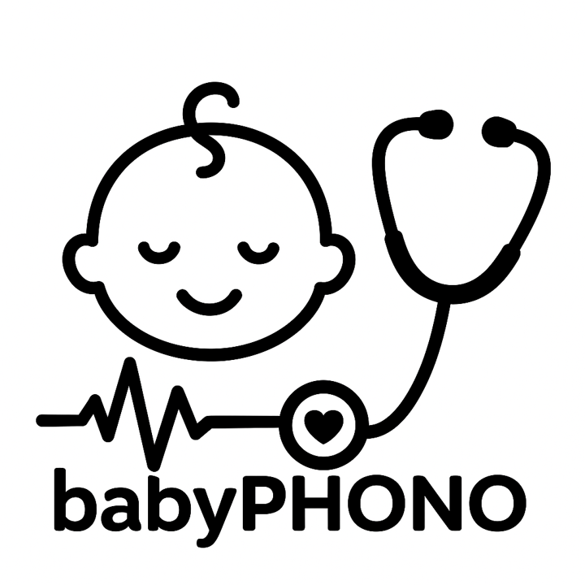
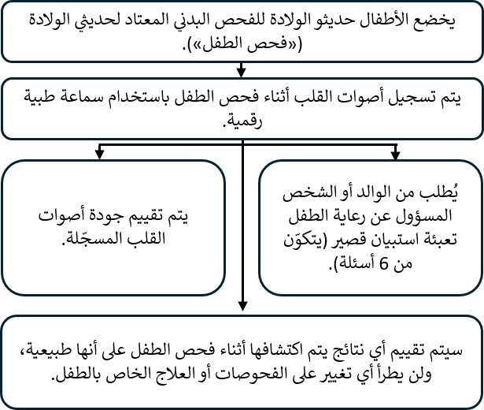

::: {dir="rtl" style="text-align: center;"}
<b>تسجيل أصوات القلب رقمياً لدى الأطفال الرضّع أثناء الفحص البدني لحديثي الولادة: دراسة babyPHONO</b>

  

  

  

  

 
:::

::: {dir="rtl" style="text-align: right;"}
نودّ دعوتكم أنتم وطفلكم للمشاركة في دراستنا البحثية. قبل اتخاذ قراركم، نودّ أن تفهموا سبب إجراء هذا البحث وما الذي ستتضمنه المشاركة فيه.     سيشرح لكم أحد أعضاء فريقنا هذه المعلومات ويجيب عن أي أسئلة لديكم. يُرجى سؤالنا إذا كان هناك أي أمر غير واضح أو إذا كنتم ترغبون في مزيد من المعلومات.     خذوا الوقت الذي تحتاجونه لتقرير ما إذا كنتم ترغبون في مشاركة طفلكم. المشاركة اختيارية تماماً.

<b>لماذا نجري هذا البحث؟</b>

يُعرَض على جميع الأطفال الرضّع إجراء «الفحص البدني لحديثي الولادة»، الذي يُسمّى أحياناً «فحص الطفل». تشرح هذه النشرة بحثاً نجريه لمعرفة ما إذا كان بإمكاننا تحسين قدرة هذا الفحص على اكتشاف مشكلات القلب.     يعاني أقل من طفل واحد من كل 100 طفل من مشكلة في بنية القلب. وإذا اكتشفنا هذه المشكلة مبكراً، فقد نتمكن من علاجها بفاعلية أكبر. نريد معرفة ما إذا كان بإمكاننا تسجيل أصوات قلوب الأطفال الرضّع للمساعدة في اكتشاف مشكلات القلب.     نأمل في إشراك ما لا يقل عن 200 طفل من جناح جيسوب (Jessop Wing) في هذا البحث. وإذا نجحت هذه الدراسة، نأمل أن تؤدي إلى دراسات أخرى تساعدنا مستقبلاً على اكتشاف مشكلات القلب لدى الأطفال الرضّع بفاعلية أكبر.
:::

::: {dir="rtl" style="text-align: center;"}
{width="50%" style="max-width: 650px; height: auto;" fig-align="center"}
:::

::: {dir="rtl" style="text-align: right;"}
<b>هل يتعيّن عليكم المشاركة في هذا البحث؟</b>

لا، قرار المشاركة يعود إليكم، ولن يؤثر عدم المشاركة في الرعاية التي تتلقونها أنتم أو طفلكم. يمكنكم الانسحاب من الدراسة في أي وقت، دون الحاجة إلى تقديم سبب للانسحاب.  
:::

::: {dir="rtl" style="text-align: right;"}
<b>ماذا سيحدث لكم ولطفلكم إذا شاركتم في هذا البحث؟</b>

يهدف هذا البحث إلى تسجيل أصوات قلوب الأطفال الرضّع باستخدام سماعة طبية رقمية، لمعرفة ما إذا كان بإمكاننا استخدام الذكاء الاصطناعي للمساعدة في اكتشاف مشكلات القلب من هذه التسجيلات.

إذا قررتم المشاركة، فسيُطلب منكم التوقيع على نموذج الموافقة. وسيسجّل الشخص الذي يفحص طفلكم أصوات قلبه باستخدام سماعة طبية رقمية، وذلك أثناء الفحص البدني الكامل لحديثي الولادة. وبعد انتهاء الفحص، سيُطلب منكم تعبئة استبيان قصير جداً يتكوّن من 6 أسئلة.

في هذه الدراسة البحثية، لن يؤثر تسجيل أصوات القلب في الإجراءات المتّبعة مع طفلكم. سيظل طفلكم يتلقى الرعاية نفسها وأي فحوصات تصويرية أو علاج يحتاج إليه، كما لو لم يكن مشاركاً في الدراسة البحثية. ولا يحتاج معظم الأطفال إلى أي فحوصات تصويرية أو علاج.
:::

::: {dir="rtl" style="text-align: right;"}
<b>ملخّص لما يحدث للمشاركين في هذه الدراسة:</b>
:::

::: {dir="rtl" style="text-align: center;"}
{width="80%" style="max-width: 650px; height: auto;" fig-align="center"}
:::

::: {dir="rtl" style="text-align: right;"}
  <b>ما مخاطر هذا البحث؟</b> تشبه السماعة الطبية الرقمية السماعة الطبية العادية إلى حدّ كبير، ولا تشكّل أي خطر على طفلكم. ويوجد جهاز رقمي متصل بأنبوب السماعة يلتقط الصوت وينقله لاسلكياً إلى هاتف محمول أو جهاز لوحي. ثم يُحفَظ التسجيل عبر الإنترنت في «السحابة»، على خادم حاسوبي في الولايات المتحدة الأمريكية. وقد وافقت وكالة تنظيم الأدوية ومنتجات الرعاية الصحية (MHRA) على استخدام هذا الجهاز في المملكة المتحدة.

قد تؤدي المشاركة في هذا البحث إلى زيادة مدة فحص الطفل بنحو دقيقتين إلى 5 دقائق. كما أن تعبئة الاستبيان بعد ذلك والردّ على المكالمة الهاتفية بعد عام سيستغرقان قدراً بسيطاً من وقتكم. وهناك احتمال أن يُدخل الأطباء أو غيرهم من الممارسين الصحيين معلومات شخصية عن طريق الخطأ في تطبيق السماعة الطبية الرقمية. وستُراجَع المعلومات الموجودة في هذا التطبيق أسبوعياً، وسيحذف فريق البحث أي بيانات يمكن أن تكشف عن هوية الأشخاص للحدّ من هذا الخطر.
:::

::: {dir="rtl" style="text-align: center;"}
{width="50%" style="max-width: 650px; height: auto;" fig-align="center"}
:::

::: {dir="rtl" style="text-align: right;"}
<b>ما فائدة المشاركة في هذا البحث؟</b>

لن تعود المشاركة في البحث بفائدة مباشرة عليكم أو على طفلكم. ومع ذلك، نأمل أن يساعد هذا البحث الأطفال الذين سيُولدون في المستقبل، من خلال مساعدة الأطباء على اكتشاف مشكلات القلب في وقت أبكر من حياتهم.

<b>كيف سنستخدم المعلومات المتعلقة بكم وبطفلكم؟</b>

سنحتاج إلى استخدام معلومات عنكم وعن طفلكم في هذا المشروع البحثي.

ستشمل هذه المعلومات اسمكم وبيانات الاتصال بكم، كما ستشمل رقم هيئة الخدمات الصحية الوطنية (NHS) ورقم المستشفى الخاصَّين بكم وبطفلكم. وسيستخدم الأشخاص هذه المعلومات لإجراء البحث، أو لمراجعة سجلاتكم للتأكد من إجراء البحث بصورة صحيحة.

لن يتمكن الأشخاص الذين لا يحتاجون إلى معرفة هويتكم من الاطلاع على اسمكم أو بيانات الاتصال بكم. وسيُستخدَم رقم رمزي بدلاً من ذلك في بياناتكم. وستُحفَظ التسجيلات الرقمية لأصوات القلب والصور الناتجة عن أي فحوصات للقلب بالموجات فوق الصوتية دون أسماء، بحيث لا يعرف صاحب هذه التسجيلات أو الصور إلا الأشخاص الذين يعرفون إلى مَن يشير الرقم الرمزي البحثي.

جامعة شيفيلد هي الجهة الراعية لهذا البحث، وهي المسؤولة عن حماية معلوماتكم. وسنشارك معلوماتكم المتعلقة بهذا المشروع البحثي مع الأنواع التالية من المؤسسات:

• مؤسسات تقديم الخدمات الصحية التابعة لهيئة الخدمات الصحية الوطنية (NHS) المشاركة في هذه الدراسة البحثية.

سنحافظ على سلامة جميع المعلومات المتعلقة بكم وأمانها من خلال:

• حفظ اسمكم وبيانات الاتصال بكم وأرقام المستشفى في جدول بيانات محمي بكلمة مرور على الأنظمة الحاسوبية الآمنة بمستشفى جناح جيسوب، بصورة منفصلة عن البيانات التي تُجمَع ضمن الدراسة.

• السماح لأعضاء فريق الدراسة البحثية فقط بالوصول إلى جدول البيانات المحمي بكلمة مرور.

<b>نقل البيانات دولياً</b>

قد نشارك بيانات عن طفلكم خارج المملكة المتحدة أو نتيح الوصول إليها لأغراض متعلقة بالبحث. وستُزال المعلومات التي تكشف عن الهوية من تسجيلات أصوات القلب، والمعلومات المتعلقة بعمر طفلكم، وأي تشخيص مستقبلي لمشكلات القلب.

قد نشارك بيانات عنكم خارج المملكة المتحدة أو نتيح الوصول إليها لأغراض متعلقة بالبحث، من أجل:

• استخدامها في أبحاث مستقبلية.

• المساعدة في تطوير برمجيات للأجهزة الطبية.

إذا شاركنا بيانات من هذا البحث، فلن نشارك إلا البيانات اللازمة. وسنحرص أيضاً، حيثما أمكن، على ألّا يكون من الممكن التعرّف على هوية طفلكم من البيانات التي نشاركها. وقد لا يكون ذلك ممكناً في بعض الظروف؛ فعلى سبيل المثال، إذا كان طفلكم يعاني من مرض نادر، فقد يظل من الممكن التعرّف على هويته. وإذا تمت مشاركة بيانات طفلكم خارج المملكة المتحدة، فستكون مع الأنواع التالية من المؤسسات:

• المؤسسات البحثية.

• مؤسسات التكنولوجيا الطبية.

• مؤسسات تطوير البرمجيات.

سنحرص على حماية بيانات طفلكم. ويجب على أي شخص يصل إلى بيانات طفلكم خارج المملكة المتحدة أن يلتزم بتعليماتنا، حتى تتمتع بيانات طفلكم بمستوى حماية مماثل للمستوى الذي توفره قوانين المملكة المتحدة. وسنضمن سلامة بيانات طفلكم خارج المملكة المتحدة من خلال ما يلي:

تخضع بعض البلدان التي ستُشارَك معها بيانات طفلكم لقرار يعترف بكفاية مستوى حماية البيانات فيها. وهذا يعني أننا نعلم أن قوانينها توفر مستوى حماية مماثلاً لقوانين حماية البيانات في المملكة المتحدة.

نستخدم عقوداً محددة معتمدة للاستخدام في المملكة المتحدة، تمنح البيانات الشخصية مستوى الحماية نفسه الذي تتمتع به في المملكة المتحدة. لمزيد من التفاصيل، يُرجى زيارة الموقع الإلكتروني لمكتب مفوّض المعلومات (ICO): <https://ico.org.uk/for-organisations/uk-gdpr-guidance-and-resources/international-transfers/>

لا نسمح لمن يصلون إلى بيانات طفلكم خارج المملكة المتحدة باستخدامها لأي غرض بخلاف ما ينص عليه عقدنا المكتوب معهم. ونشترط أن تتخذ المؤسسات الأخرى تدابير أمنية مناسبة لحماية بيانات طفلكم، تتوافق مع التزاماتنا بشأن أمن البيانات وسريتها. ويشمل ذلك اتخاذ تدابير مناسبة لحماية بياناتكم من الفقدان العرضي، ومن الوصول إليها أو استخدامها أو تعديلها أو مشاركتها دون تصريح. ولدينا إجراءات للتعامل مع أي خرق مشتبه به للبيانات الشخصية. وسنبلغكم ونبلغ الجهات التنظيمية المختصة عند حدوث خرق لبيانات طفلكم الشخصية عندما يُلزِمنا القانون بذلك. ولمزيد من التفاصيل عن قواعد الإبلاغ عن خروقات البيانات في المملكة المتحدة، يُرجى زيارة الموقع الإلكتروني لمكتب مفوّض المعلومات (ICO): <https://ico.org.uk/for-organisations/report-a-breach>

لن تتم أبداً مشاركة المعلومات التي يمكن أن تكشف عن الهوية، بما فيها الأسماء وتواريخ الميلاد، مع أي شخص خارج فريق البحث في شيفيلد أو الممارسين الصحيين الذين يتولّون رعايتكم أو رعاية طفلكم. ويمكنكم المشاركة في الدراسة حتى إذا رفضتم مشاركة البيانات مع جهات خارجية، وسيُسجَّل هذا القرار بصورة منفصلة في نموذج الموافقة.

<b>كيف سنستخدم المعلومات المتعلقة بكم بعد انتهاء الدراسة؟</b>

بعد انتهاء الدراسة، سنحتفظ ببعض البيانات حتى نتمكن من التحقق من النتائج. وسنكتب تقاريرنا بطريقة لا تمكّن أي شخص من معرفة أن طفلكم شارك في الدراسة. وسنحتفظ ببيانات دراستكم لمدة أقصاها 5 سنوات. وبعد ذلك، ستُزال منها تماماً المعلومات التي تكشف عن الهوية، ثم تُؤرشَف بأمان أو تُتلَف.

<b>ما الخيارات المتاحة لكم بشأن كيفية استخدام معلوماتكم؟</b>

يمكنكم إنهاء مشاركتكم ومشاركة طفلكم في الدراسة في أي وقت، دون تقديم سبب، ولكننا سنحتفظ بالمعلومات المتعلقة بكم التي حصلنا عليها بالفعل. ويحقّ لكم أن تطلبوا منّا إتاحة الاطلاع على البيانات التي نحتفظ بها عنكم لأغراض الدراسة، أو إزالتها أو تعديلها أو حذفها. كما يمكنكم الاعتراض على معالجتنا لبياناتكم. وقد لا نتمكن دائماً من تلبية هذه الطلبات إذا كان ذلك يعني أننا لن نستطيع استخدام بياناتكم لإجراء البحث. وإذا حدث ذلك، فسنوضح لكم السبب. وإذا وافقتم على المشاركة في هذه الدراسة، فسيكون لديكم خيار المشاركة في أبحاث مستقبلية باستخدام بياناتكم المحفوظة من هذه الدراسة.

أين يمكنكم معرفة المزيد عن كيفية استخدام معلوماتكم؟ يمكنكم معرفة المزيد عن كيفية استخدامنا لمعلوماتكم، بما في ذلك الآلية المحددة التي نستخدمها عند نقل بياناتكم الشخصية خارج المملكة المتحدة، من خلال:

• نشرتنا: <https://www.hra.nhs.uk/patientdataandresearch>

• سؤال أحد أعضاء فريق البحث.

• إرسال بريد إلكتروني إلى: [sth.babyphono\@nhs.net](mailto:sth.babyphono@nhs.net){.email dir="ltr"}

• الاتصال بنا على: [+447729849599]{dir="ltr"}

<b>ماذا لو كانت لديّ أسئلة أخرى عن البحث؟</b>

إذا كانت لديكم أي أسئلة عن الدراسة، فيمكنكم التواصل معنا باستخدام عنوان البريد الإلكتروني أو رقم الهاتف الموجودَين على ظهر هذه النشرة. ويمكنكم أيضاً طرح أسئلتكم على الباحث الذي يأتي ليطلب منكم التوقيع على نموذج الموافقة.

<b>ماذا لو كان لديّ سؤال أو شكوى بشأن الرعاية السريرية التي تلقيتها؟</b>

يجب عدم استخدام أي استبيان يُطلب منكم تعبئته خلال هذه الدراسة للإبلاغ عن مخاوف تتعلق برعايتكم السريرية أو رعاية طفلكم. وإذا كان لديكم سؤال أو شكوى بشأن رعايتكم السريرية، فيُرجى التحدث إلى الممارسين الصحيين الذين يتولّون رعايتكم، أو طلب معلومات عن خدمة تقديم المشورة للمرضى والتواصل معهم (PALS).

<b>ماذا لو كانت لديّ شكوى بشأن البحث؟</b>

إذا كنتم غير راضين وترغبون في تقديم شكوى، فيُرجى التواصل أولاً مع الدكتورة أليس غريفيثس (Dr Alys Griffiths) عبر البريد الإلكتروني: [alys.griffiths\@sheffield.ac.uk](mailto:alys.griffiths@sheffield.ac.uk){.email dir="ltr"}. وإذا شعرتم بأن شكواكم لم تُعالَج بصورة مُرضية، فيمكنكم التواصل مع البروفيسورة هيذر مورتيبويز (Professor Heather Mortiboys) عبر البريد الإلكتروني: [h.mortiboys\@sheffield.ac.uk](mailto:h.mortiboys@sheffield.ac.uk){.email dir="ltr"} أو الاتصال على: [0114 222 2290]{dir="ltr"}.

وإذا كانت الشكوى تتعلق بكيفية التعامل مع بياناتكم الشخصية، فيمكنكم الاطلاع على معلومات عن كيفية تقديم شكوى في إشعار الخصوصية الخاص بالجامعة: <https://www.sheffield.ac.uk/govern/data-protection/privacy/general>.

وإذا كنتم ترغبون في الإبلاغ عن مخاوف أو واقعة تتعلق باحتمال حدوث استغلال أو إساءة أو ضرر نتيجة مشاركتكم في هذا المشروع، فيُرجى التواصل مع المسؤول المعيّن للحماية من الأذى، الدكتور هاريس ستافرولاكيس (Dr Haris Stavroulakis)، عبر البريد الإلكتروني: [t.stavroulakis\@sheffield.ac.uk](mailto:t.stavroulakis@sheffield.ac.uk){.email dir="ltr"}. وإذا استمرت مخاوفكم، فيُرجى التواصل مع مديرة أخلاقيات البحث ونزاهته، ليندسي أنوين (Lindsay Unwin)، عبر البريد الإلكتروني: [l.v.unwin\@sheffield.ac.uk](mailto:l.v.unwin@sheffield.ac.uk){.email dir="ltr"}.

<b>هل وافقت لجنة أخلاقيات على هذا البحث؟</b>

راجعت هذا البحث لجنة أخلاقيات البحث في جنوب شرق اسكتلندا رقم 1 (South East Scotland Research Ethics Committee 1). والرقم المرجعي للبحث هو: 358145.

شكراً لكم على التفكير في المشاركة في هذا البحث.

لمزيد من المعلومات عن هذه الدراسة البحثية، يُرجى التواصل عبر:

البريد الإلكتروني:\
[sth.babyphono\@nhs.net](mailto:sth.babyphono@nhs.net){.email dir="ltr"}\
رقم هاتف الدراسة:\
[+447729849599]{dir="ltr"}

تُجرى هذه الدراسة البحثية في: مستشفى جناح جيسوب (Jessop Wing Hospital)، بالعنوان التالي: [Tree Root Walk, Broomhall, Sheffield, S10 2SF]{dir="ltr"}  
:::

::: {dir="rtl" style="text-align: center;"}
{width="50%" style="max-width: 650px; height: auto;" fig-align="center"}
:::

::: {dir="rtl" style="text-align: right;"}
    الجهة الراعية لهذه الدراسة البحثية: جامعة شيفيلد (The University of Sheffield)، بالعنوان التالي: [Western Bank, Sheffield, S10 2TN]{dir="ltr"}

مسؤول حماية البيانات:\
لوك تومبسون (Luke Thompson)\
[dataprotection\@sheffield.ac.uk](mailto:dataprotection@sheffield.ac.uk){.email dir="ltr"}\
[+44 114 222 1117]{dir="ltr"}  
:::

::: {dir="rtl" style="text-align: center;"}
{width="50%" style="max-width: 650px; height: auto;" fig-align="center"}  
:::

::: {dir="rtl" style="text-align: right;"}
الجهة المموّلة لهذه الدراسة البحثية: الجمعية الخيرية لمستشفى شيفيلد للأطفال (Sheffield Children’s Hospital Charity)، بالعنوان التالي: [4 Marlborough Rd, Sheffield, S10 1DB]{dir="ltr"}  
:::

::: {dir="rtl" style="text-align: center;"}
{width="50%" style="max-width: 650px; height: auto;" fig-align="center"}  
:::
