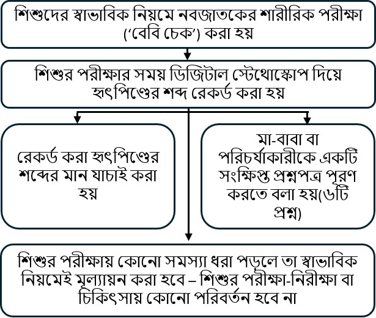

::: {style="text-align: center;"}
<b>নবজাতকের শারীরিক পরীক্ষার সময় শিশুর হৃৎপিণ্ডের শব্দের ডিজিটাল রেকর্ডিং: babyPHONO গবেষণা</b>

{width="50%" fig-align="center"} {width="50%" fig-align="center"}

{height="200px"}

 
:::

::: {style="text-align: left;"}
আমরা আপনাকে ও আপনার শিশুকে আমাদের গবেষণায় অংশ নেওয়ার আমন্ত্রণ জানাতে চাই। সিদ্ধান্ত নেওয়ার আগে আমরা চাই, আপনি বুঝে নিন কেন এই গবেষণা করা হচ্ছে এবং এতে অংশ নিলে কী কী করতে হবে।     আমাদের দলের একজন সদস্য আপনার সঙ্গে এই তথ্যগুলো নিয়ে আলোচনা করবেন এবং আপনার যেকোনো প্রশ্নের উত্তর দেবেন। কোনো বিষয় স্পষ্ট না হলে বা আরও তথ্য জানতে চাইলে আমাদের জিজ্ঞাসা করুন।     আপনার শিশুকে এই গবেষণায় অংশ নিতে দিতে চান কি না, তা সিদ্ধান্ত নেওয়ার জন্য সময় নিন। অংশগ্রহণ সম্পূর্ণ স্বেচ্ছামূলক।

<b>আমরা কেন এই গবেষণা করছি?</b>

সব শিশুর জন্য ‘নবজাতকের শারীরিক পরীক্ষা’ করার সুযোগ দেওয়া হয়, যাকে কখনও কখনও ‘বেবি চেক’ বলা হয়। হৃৎপিণ্ডের সমস্যা শনাক্ত করার ক্ষেত্রে এই পরীক্ষাকে আরও উন্নত করা যায় কি না, তা জানার জন্য আমরা যে গবেষণা করছি, এই তথ্যপত্রে তা ব্যাখ্যা করা হয়েছে।     প্রতি ১০০ জন শিশুর মধ্যে ১ জনেরও কম শিশুর হৃৎপিণ্ডের গঠনে সমস্যা থাকে। সমস্যাটি তাড়াতাড়ি ধরা পড়লে আমরা হয়তো আরও কার্যকরভাবে চিকিৎসা করতে পারব। হৃৎপিণ্ডের সমস্যা খুঁজে পেতে সহায়তা করার জন্য শিশুদের হৃৎপিণ্ডের শব্দ রেকর্ড করা যায় কি না, আমরা তা দেখতে চাই।     আমরা আশা করছি, জেসপ উইং (Jessop Wing) থেকে অন্তত ২০০ জন শিশুকে এই গবেষণায় অন্তর্ভুক্ত করতে পারব। এই গবেষণা সফল হলে আমরা আশা করি, এর ভিত্তিতে আরও গবেষণা হবে, যা ভবিষ্যতে শিশুদের হৃৎপিণ্ডের সমস্যা আরও কার্যকরভাবে শনাক্ত করতে সাহায্য করবে।
:::

::: {style="text-align: center;"}
{width="50%" fig-align="center"}
:::

::: {style="text-align: left;"}
<b>আপনাকে কি এই গবেষণায় অংশ নিতেই হবে?</b>

না। অংশ নেবেন কি না, তা আপনার সিদ্ধান্ত। অংশ না নিলে আপনার বা আপনার শিশুর পরিচর্যায় কোনো প্রভাব পড়বে না। আপনি যেকোনো সময় গবেষণা থেকে সরে যেতে পারেন এবং এর জন্য কোনো কারণ জানাতে হবে না।  
:::

::: {style="text-align: left;"}
<b>এই গবেষণায় অংশ নিলে আপনার ও আপনার শিশুর ক্ষেত্রে কী হবে?</b>

এই গবেষণার উদ্দেশ্য হলো ডিজিটাল স্টেথোস্কোপ দিয়ে শিশুদের হৃৎপিণ্ডের শব্দ রেকর্ড করা। এর মাধ্যমে আমরা জানতে চাই, রেকর্ডিং থেকে হৃৎপিণ্ডের সমস্যা শনাক্ত করতে কৃত্রিম বুদ্ধিমত্তা ব্যবহার করা যায় কি না।

আপনি অংশ নেওয়ার সিদ্ধান্ত নিলে আপনাকে সম্মতিপত্রে স্বাক্ষর করতে বলা হবে। যিনি আপনার শিশুর পরীক্ষা করবেন, তিনি ডিজিটাল স্টেথোস্কোপ দিয়ে শিশুর হৃৎপিণ্ডের শব্দ রেকর্ড করবেন। নবজাতকের সম্পূর্ণ শারীরিক পরীক্ষার সময়ই এটি করা হবে। পরীক্ষা শেষ হলে আপনাকে ৬টি প্রশ্নের একটি খুবই সংক্ষিপ্ত প্রশ্নপত্র পূরণ করতে বলা হবে।

এই গবেষণায় হৃৎপিণ্ডের শব্দ রেকর্ড করার কারণে আপনার শিশুর পরিচর্যার পদ্ধতিতে কোনো পরিবর্তন হবে না। গবেষণায় অংশ না নিলে শিশু যে পরিচর্যা এবং প্রয়োজনীয় স্ক্যান বা চিকিৎসা পেত, এখানেও ঠিক তাই পাবে। অধিকাংশ শিশুর কোনো স্ক্যান বা চিকিৎসার প্রয়োজন হয় না।
:::

::: {style="text-align: left;"}
<b>এই গবেষণায় অংশগ্রহণকারীদের ক্ষেত্রে কী হবে, তার সংক্ষিপ্ত বিবরণ:</b>
:::

::: {style="text-align: center;"}
{width="80%" fig-align="center"}
:::

::: {style="text-align: left;"}
  <b>এই গবেষণার ঝুঁকিগুলো কী?</b> ডিজিটাল স্টেথোস্কোপ সাধারণ স্টেথোস্কোপের মতোই এবং এটি আপনার শিশুর জন্য কোনো ঝুঁকি তৈরি করে না। স্টেথোস্কোপের নলের সঙ্গে একটি ডিজিটাল যন্ত্র লাগানো থাকে, যা শব্দ ধারণ করে। এই শব্দ তারবিহীনভাবে মোবাইল ফোন বা ট্যাবলেটে পাঠানো হয়। এরপর রেকর্ডিংটি মার্কিন যুক্তরাষ্ট্রে থাকা একটি কম্পিউটার সার্ভার ব্যবহার করে অনলাইনে ‘ক্লাউডে’ সংরক্ষণ করা হয়। যুক্তরাজ্যে ব্যবহারের জন্য এই যন্ত্রটি ওষুধ ও স্বাস্থ্যসেবা পণ্য নিয়ন্ত্রক সংস্থা (MHRA) অনুমোদন করেছে।

এই গবেষণায় অংশ নেওয়ার ফলে শিশুর পরীক্ষায় প্রায় ২ থেকে ৫ মিনিট বেশি সময় লাগতে পারে। পরে প্রশ্নপত্র পূরণ করতে এবং এক বছর পর ফোনে কথা বলতেও আপনার অল্প কিছু সময় লাগবে। চিকিৎসক বা অন্য স্বাস্থ্যকর্মীরা ভুল করে ডিজিটাল স্টেথোস্কোপের অ্যাপ্লিকেশনে ব্যক্তিগত তথ্য লিখে ফেলতে পারেন। এই ঝুঁকি প্রতিরোধের জন্য অ্যাপ্লিকেশনের তথ্য প্রতি সপ্তাহে পর্যালোচনা করা হবে এবং কোনো ব্যক্তির পরিচয় শনাক্ত করা যায় এমন তথ্য গবেষণা দল মুছে দেবে।
:::

::: {style="text-align: center;"}
{width="50%" fig-align="center"}
:::

::: {style="text-align: left;"}
<b>এই গবেষণায় অংশ নেওয়ার সুবিধা কী?</b>

এই গবেষণায় অংশ নিলে আপনার বা আপনার শিশুর সরাসরি কোনো উপকার হবে না। তবে আমরা আশা করি, এই গবেষণা চিকিৎসকদের জীবনের আরও শুরুর দিকে হৃৎপিণ্ডের সমস্যা শনাক্ত করতে সাহায্য করবে এবং এর ফলে ভবিষ্যতে জন্ম নেওয়া শিশুরা উপকৃত হবে।

<b>আমরা আপনার ও আপনার শিশুর তথ্য কীভাবে ব্যবহার করব?</b>

এই গবেষণা প্রকল্পের জন্য আমাদের আপনার ও আপনার শিশুর তথ্য ব্যবহার করতে হবে।

এই তথ্যের মধ্যে আপনার নাম ও যোগাযোগের বিবরণ থাকবে। আপনার ও আপনার শিশুর NHS নম্বর এবং হাসপাতালের নম্বরও থাকবে। সংশ্লিষ্ট ব্যক্তিরা গবেষণা পরিচালনা করতে অথবা গবেষণা সঠিকভাবে হচ্ছে কি না নিশ্চিত করার জন্য আপনার নথিপত্র পরীক্ষা করতে এই তথ্য ব্যবহার করবেন।

যাঁদের আপনার পরিচয় জানার প্রয়োজন নেই, তাঁরা আপনার নাম বা যোগাযোগের বিবরণ দেখতে পারবেন না। পরিবর্তে আপনার তথ্য একটি কোড নম্বর দিয়ে চিহ্নিত করা হবে। হৃৎপিণ্ডের শব্দের ডিজিটাল রেকর্ডিং এবং কোনো ইকোকার্ডিওগ্রাম (হৃৎপিণ্ডের আল্ট্রাসাউন্ড পরীক্ষা) করা হলে তার ছবি নাম ছাড়া সংরক্ষণ করা হবে। তাই কেবল যাঁরা জানেন গবেষণার কোড নম্বরটি কার সঙ্গে সম্পর্কিত, তাঁরাই বুঝতে পারবেন রেকর্ডিং ও ছবিগুলো কার।

শেফিল্ড বিশ্ববিদ্যালয় (The University of Sheffield) এই গবেষণার দায়িত্বপ্রাপ্ত প্রতিষ্ঠান বা স্পনসর। আপনার তথ্য সুরক্ষিত রাখার দায়িত্ব শেফিল্ড বিশ্ববিদ্যালয়ের। এই গবেষণা প্রকল্পের সঙ্গে সম্পর্কিত আপনার তথ্য আমরা নিচের ধরনের প্রতিষ্ঠানের সঙ্গে ভাগ করে নেব:

• এই গবেষণায় অংশ নেওয়া NHS-এর স্বাস্থ্যসেবা প্রদানকারী প্রতিষ্ঠানগুলো।

আমরা নিচের উপায়ে আপনার সব তথ্য নিরাপদ ও সুরক্ষিত রাখব:

• আপনার নাম, যোগাযোগের বিবরণ এবং হাসপাতালের নম্বর জেসপ উইং হাসপাতালের সুরক্ষিত কম্পিউটার ব্যবস্থায় পাসওয়ার্ড দিয়ে সুরক্ষিত একটি স্প্রেডশিটে রাখব। গবেষণায় সংগৃহীত তথ্য থেকে এটি আলাদাভাবে রাখা হবে।

• শুধু গবেষণা দলের সদস্যদের ওই পাসওয়ার্ড দিয়ে সুরক্ষিত স্প্রেডশিটে প্রবেশের অনুমতি দেওয়া হবে।

<b>আন্তর্জাতিকভাবে তথ্য স্থানান্তর</b>

গবেষণা-সংশ্লিষ্ট উদ্দেশ্যে আমরা আপনার শিশুর তথ্য যুক্তরাজ্যের বাইরে ভাগ করে নিতে পারি বা সেখানে তথ্য দেখার সুযোগ দিতে পারি। রেকর্ড করা হৃৎপিণ্ডের শব্দ, শিশুর বয়সের তথ্য এবং ভবিষ্যতে হৃৎপিণ্ডের কোনো সমস্যা নির্ণয় হলে সেই তথ্য থেকে পরিচয় শনাক্তকারী বিবরণ সরিয়ে দেওয়া হবে।

গবেষণা-সংশ্লিষ্ট উদ্দেশ্যে আমরা আপনার তথ্য যুক্তরাজ্যের বাইরে ভাগ করে নিতে পারি বা সেখানে তথ্য দেখার সুযোগ দিতে পারি, যাতে:

• ভবিষ্যতের গবেষণায় তা ব্যবহার করা যায়।

• চিকিৎসা-যন্ত্রের সফটওয়্যার তৈরিতে সাহায্য করা যায়।

এই গবেষণার তথ্য ভাগ করে নিলে আমরা শুধু প্রয়োজনীয় তথ্যই দেব। যতটা সম্ভব, আমরা নিশ্চিত করব যাতে দেওয়া তথ্য থেকে আপনার শিশুর পরিচয় শনাক্ত করা না যায়। কিছু পরিস্থিতিতে এটি সম্ভব নাও হতে পারে—যেমন, আপনার শিশুর কোনো বিরল রোগ থাকলে তার পরিচয় শনাক্ত করা সম্ভব হতে পারে। আপনার শিশুর তথ্য যুক্তরাজ্যের বাইরে দেওয়া হলে তা নিচের ধরনের প্রতিষ্ঠানের সঙ্গে ভাগ করা হবে:

• গবেষণা প্রতিষ্ঠান।

• চিকিৎসা প্রযুক্তিবিষয়ক প্রতিষ্ঠান।

• সফটওয়্যার উন্নয়নকারী প্রতিষ্ঠান।

আমরা আপনার শিশুর তথ্যের সুরক্ষা নিশ্চিত করব। যুক্তরাজ্যের বাইরে যাঁরা আপনার শিশুর তথ্য দেখবেন বা ব্যবহার করবেন, তাঁদের অবশ্যই আমাদের নির্দেশনা মেনে চলতে হবে, যাতে তথ্যগুলো যুক্তরাজ্যের আইনে দেওয়া সুরক্ষার কাছাকাছি মানের সুরক্ষা পায়। যুক্তরাজ্যের বাইরে আপনার শিশুর তথ্য নিরাপদ রাখতে আমরা নিচের ব্যবস্থা নেব:

যেসব দেশে আপনার শিশুর তথ্য দেওয়া হবে, সেগুলোর কয়েকটির জন্য তথ্যের সুরক্ষা পর্যাপ্ত বলে আনুষ্ঠানিক স্বীকৃতি রয়েছে (adequacy decision)। এর অর্থ হলো, আমরা জানি যে তাদের আইন যুক্তরাজ্যের তথ্য সুরক্ষা আইনের কাছাকাছি মানের সুরক্ষা দেয়।

আমরা যুক্তরাজ্যে ব্যবহারের জন্য অনুমোদিত নির্দিষ্ট চুক্তি ব্যবহার করি, যা ব্যক্তিগত তথ্যকে যুক্তরাজ্যের সমমানের সুরক্ষা দেয়। আরও বিস্তারিত জানতে ইনফরমেশন কমিশনারস অফিসের (ICO) ওয়েবসাইট দেখুন: <https://ico.org.uk/for-organisations/uk-gdpr-guidance-and-resources/international-transfers/>

যুক্তরাজ্যের বাইরে যাঁরা আপনার শিশুর তথ্য দেখতে বা ব্যবহার করতে পারবেন, তাঁদের সঙ্গে আমাদের লিখিত চুক্তিতে উল্লেখ করা উদ্দেশ্য ছাড়া অন্য কোনো কাজে তা ব্যবহারের অনুমতি দেওয়া হবে না। অন্য প্রতিষ্ঠানগুলোকে আপনার শিশুর তথ্য সুরক্ষিত রাখতে উপযুক্ত নিরাপত্তাব্যবস্থা নিতে হবে, যা তথ্যের নিরাপত্তা ও গোপনীয়তা সম্পর্কে আমাদের দায়বদ্ধতার সঙ্গে সামঞ্জস্যপূর্ণ। এর মধ্যে অনিচ্ছাকৃতভাবে তথ্য হারিয়ে যাওয়া এবং অনুমতি ছাড়া তথ্য দেখা, ব্যবহার, পরিবর্তন বা অন্যের সঙ্গে ভাগ করে নেওয়া প্রতিরোধের উপযুক্ত ব্যবস্থা অন্তর্ভুক্ত। ব্যক্তিগত তথ্যের সুরক্ষা লঙ্ঘিত হয়েছে বলে সন্দেহ হলে তা মোকাবিলার জন্য আমাদের নির্ধারিত পদ্ধতি রয়েছে। আপনার শিশুর ব্যক্তিগত তথ্যের সুরক্ষা লঙ্ঘিত হলে, আইন অনুযায়ী প্রয়োজন হলে আমরা আপনাকে এবং সংশ্লিষ্ট নিয়ন্ত্রক সংস্থাগুলোকে জানাব। যুক্তরাজ্যে এ ধরনের লঙ্ঘনের প্রতিবেদন দেওয়ার নিয়ম সম্পর্কে বিস্তারিত জানতে ইনফরমেশন কমিশনারস অফিসের (ICO) ওয়েবসাইট দেখুন: <https://ico.org.uk/for-organisations/report-a-breach>

ব্যক্তির পরিচয় শনাক্ত করা যায় এমন তথ্য (নাম ও জন্মতারিখসহ) শেফিল্ডের গবেষণা দল এবং আপনার বা আপনার শিশুর পরিচর্যায় নিয়োজিত চিকিৎসক ও স্বাস্থ্যকর্মীদের বাইরে কারও সঙ্গে কখনও ভাগ করা হবে না। তৃতীয় পক্ষের সঙ্গে তথ্য ভাগ করে নিতে আপনি অস্বীকৃতি জানালেও গবেষণায় অংশ নিতে পারবেন। এই সিদ্ধান্ত আপনার সম্মতিপত্রে আলাদাভাবে উল্লেখ করা হবে।

<b>গবেষণা শেষ হওয়ার পর আপনার তথ্য আমরা কীভাবে ব্যবহার করব?</b>

গবেষণা শেষ হলে ফলাফল যাচাই করার জন্য আমরা কিছু তথ্য রেখে দেব। আমরা প্রতিবেদন এমনভাবে লিখব যাতে কেউ বুঝতে না পারেন যে আপনার শিশু এই গবেষণায় অংশ নিয়েছিল। গবেষণার জন্য সংগৃহীত আপনার তথ্য আমরা সর্বোচ্চ ৫ বছর রাখব। এরপর তথ্যগুলো থেকে পরিচয় শনাক্তকারী সব বিবরণ সম্পূর্ণভাবে সরিয়ে নিরাপদে সংরক্ষণ করা হবে অথবা তথ্যগুলো ধ্বংস করা হবে।

<b>আপনার তথ্য কীভাবে ব্যবহার হবে, সে বিষয়ে আপনার কী কী বিকল্প আছে?</b>

আপনি কোনো কারণ না জানিয়ে যেকোনো সময় নিজের ও আপনার শিশুর গবেষণায় অংশগ্রহণ বন্ধ করতে পারেন। তবে আপনার সম্পর্কে ইতিমধ্যে সংগ্রহ করা তথ্য আমরা রেখে দেব। গবেষণার উদ্দেশ্যে আপনার সম্পর্কে আমাদের কাছে থাকা তথ্য দেখতে চাওয়া, সরিয়ে ফেলা, পরিবর্তন করা বা মুছে ফেলার অনুরোধ করার অধিকার আপনার আছে। আমরা আপনার তথ্য যেভাবে প্রক্রিয়াকরণ করি, তার বিরুদ্ধেও আপনি আপত্তি জানাতে পারেন। আপনার অনুরোধ মেনে নিলে যদি আমরা গবেষণায় আপনার তথ্য ব্যবহার করতে না পারি, তাহলে সব সময় অনুরোধটি পূরণ করা সম্ভব নাও হতে পারে। এমন হলে কেন তা করা যাচ্ছে না, আমরা আপনাকে জানাব। এই গবেষণায় অংশ নিতে সম্মত হলে, এই গবেষণা থেকে সংরক্ষিত আপনার তথ্য ব্যবহার করে ভবিষ্যতের গবেষণায় অংশ নেওয়ার সুযোগ আপনার থাকবে।

আপনার তথ্য কীভাবে ব্যবহৃত হয়, সে সম্পর্কে আরও কোথায় জানতে পারবেন? আপনার ব্যক্তিগত তথ্য যুক্তরাজ্যের বাইরে স্থানান্তরের সময় আমরা যে নির্দিষ্ট ব্যবস্থা ব্যবহার করি, তা-সহ আপনার তথ্য ব্যবহারের বিষয়ে আরও জানতে পারবেন:

• আমাদের তথ্যপত্র থেকে: <https://www.hra.nhs.uk/patientdataandresearch>

• গবেষণা দলের কোনো সদস্যকে জিজ্ঞাসা করে।

• এই ঠিকানায় ইমেইল করে: [sth.babyphono\@nhs.net](mailto:sth.babyphono@nhs.net){.email}

• এই নম্বরে ফোন করে: +447729849599

<b>গবেষণা সম্পর্কে আমার আরও প্রশ্ন থাকলে কী করব?</b>

গবেষণা সম্পর্কে কোনো প্রশ্ন থাকলে এই তথ্যপত্রের পেছনে দেওয়া ইমেইল ঠিকানা বা ফোন নম্বর ব্যবহার করে যোগাযোগ করতে পারেন। অথবা যিনি আপনাকে সম্মতিপত্রে স্বাক্ষর করতে বলতে আসবেন, সেই গবেষককে প্রশ্ন করতে পারেন।

<b>আমি যে চিকিৎসাসেবা পেয়েছি, সে সম্পর্কে কোনো প্রশ্ন বা অভিযোগ থাকলে কী করব?</b>

এই গবেষণার সময় আপনাকে যে প্রশ্নপত্রই পূরণ করতে বলা হোক না কেন, তা আপনার বা আপনার শিশুর চিকিৎসাসেবা সম্পর্কে উদ্বেগ জানানোর জন্য ব্যবহার করা উচিত নয়। আপনার চিকিৎসাসেবা সম্পর্কে কোনো প্রশ্ন বা অভিযোগ থাকলে আপনার পরিচর্যায় নিয়োজিত চিকিৎসক বা স্বাস্থ্যকর্মীদের সঙ্গে কথা বলুন, অথবা রোগীদের পরামর্শ ও যোগাযোগ সেবা (PALS) সম্পর্কে বিস্তারিত জানতে চান।

<b>গবেষণা সম্পর্কে আমার অভিযোগ থাকলে কী করব?</b>

আপনি অসন্তুষ্ট হলে এবং অভিযোগ জানাতে চাইলে প্রথমে ড. অ্যালিস গ্রিফিথসের (Dr Alys Griffiths) সঙ্গে যোগাযোগ করুন: [alys.griffiths\@sheffield.ac.uk](mailto:alys.griffiths@sheffield.ac.uk){.email}। আপনার মনে হলে অভিযোগটি সন্তোষজনকভাবে সমাধান করা হয়নি, অধ্যাপক হেদার মর্টিবয়েসের (Professor Heather Mortiboys) সঙ্গে যোগাযোগ করতে পারেন: [h.mortiboys\@sheffield.ac.uk](mailto:h.mortiboys@sheffield.ac.uk){.email}, অথবা ফোন করুন 0114 222 2290 নম্বরে।

আপনার ব্যক্তিগত তথ্য কীভাবে ব্যবস্থাপনা করা হয়েছে, সে বিষয়ে অভিযোগ থাকলে বিশ্ববিদ্যালয়ের গোপনীয়তার বিজ্ঞপ্তিতে অভিযোগ করার পদ্ধতি জানতে পারবেন: <https://www.sheffield.ac.uk/govern/data-protection/privacy/general>।

এই প্রকল্পে অংশ নেওয়ার ফলে সম্ভাব্য শোষণ, নির্যাতন বা ক্ষতির সঙ্গে সম্পর্কিত কোনো উদ্বেগ বা ঘটনার কথা জানাতে চাইলে, সুরক্ষার জন্য নির্ধারিত যোগাযোগ ব্যক্তি ড. হারিস স্টাভরুলাকিসের (Dr Haris Stavroulakis) সঙ্গে যোগাযোগ করুন: [t.stavroulakis\@sheffield.ac.uk](mailto:t.stavroulakis@sheffield.ac.uk){.email}। আপনার উদ্বেগ থেকে গেলে গবেষণার নৈতিকতা ও সততা বিষয়ক ব্যবস্থাপক লিন্ডসে আনউইনের (Lindsay Unwin) সঙ্গে যোগাযোগ করুন: [l.v.unwin\@sheffield.ac.uk](mailto:l.v.unwin@sheffield.ac.uk){.email}।

<b>এই গবেষণা কি কোনো নৈতিকতা কমিটির অনুমোদন পেয়েছে?</b>

দক্ষিণ-পূর্ব স্কটল্যান্ড গবেষণা নৈতিকতা কমিটি ১ (South East Scotland Research Ethics Committee 1) এই গবেষণা পর্যালোচনা করেছে। গবেষণার রেফারেন্স নম্বর: 358145।

এই গবেষণায় অংশ নেওয়ার কথা বিবেচনা করার জন্য ধন্যবাদ।

এই গবেষণা সম্পর্কে আরও তথ্যের জন্য যোগাযোগ করুন:

ইমেইল:\
[sth.babyphono\@nhs.net](mailto:sth.babyphono@nhs.net){.email}\
গবেষণার ফোন নম্বর:\
+447729849599

এই গবেষণা পরিচালিত হচ্ছে জেসপ উইং হাসপাতালে (Jessop Wing Hospital)। ঠিকানা: Tree Root Walk, Broomhall, Sheffield, S10 2SF  
:::

::: {style="text-align: center;"}
{width="50%" fig-align="center"}
:::

::: {style="text-align: left;"}
    এই গবেষণার দায়িত্বপ্রাপ্ত প্রতিষ্ঠান বা স্পনসর: শেফিল্ড বিশ্ববিদ্যালয় (The University of Sheffield)। ঠিকানা: Western Bank, Sheffield, S10 2TN

তথ্য সুরক্ষা কর্মকর্তা:\
লিউক থম্পসন (Luke Thompson)\
[dataprotection\@sheffield.ac.uk](mailto:dataprotection@sheffield.ac.uk){.email}\
+44 114 222 1117  
:::

::: {style="text-align: center;"}
{width="50%" fig-align="center"}  
:::

::: {style="text-align: left;"}
এই গবেষণার অর্থায়ন করছে: শেফিল্ড চিলড্রেনস হসপিটাল চ্যারিটি (Sheffield Children’s Hospital Charity)। ঠিকানা: 4 Marlborough Rd, Sheffield, S10 1DB  
:::

::: {style="text-align: center;"}
{width="50%" fig-align="center"}  
:::
