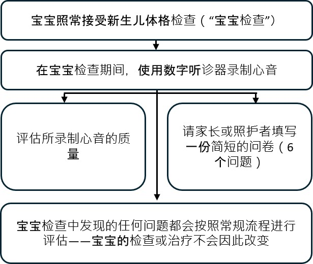

::: {style="text-align: center;"}
<b>在新生儿体格检查期间对婴儿心音进行数字录音：babyPHONO 研究</b>

{width="50%" fig-align="center"} {width="50%" fig-align="center"}

{height="200px"}

 
:::

::: {style="text-align: left;"}
我们诚邀您和您的宝宝参加我们的研究。在您作出决定之前，我们希望您了解开展这项研究的原因，以及参加研究需要做些什么。    我们的一名团队成员会与您一起阅读并讲解这些信息，回答您的任何问题。如果有任何不清楚的地方，或您希望了解更多信息，请向我们咨询。    请充分考虑后，再决定是否让您的孩子参加。参加研究完全自愿。

<b>我们为什么开展这项研究？</b>

所有婴儿均可接受“新生儿体格检查”，有时也称为“宝宝体检”。本说明书介绍了我们正在开展的一项研究，旨在了解能否改进这一检查，使其更好地发现心脏问题。    每 100 名婴儿中，有心脏结构问题的不到 1 名。如果及早发现，我们或许能更有效地治疗。我们希望了解能否通过记录婴儿的心音，帮助发现心脏问题。    我们希望在杰索普产科大楼（Jessop Wing）招募至少 200 名婴儿参加这项研究。如果这项研究取得成功，我们希望由此开展进一步的研究，在未来帮助我们更有效地发现婴儿的心脏问题。
:::

::: {style="text-align: center;"}
{width="50%" fig-align="center"}
:::

::: {style="text-align: left;"}
<b>您必须参加这项研究吗？</b>

不必。是否参加由您决定，不参加不会影响您或宝宝获得的照护。您可以随时退出研究，无须说明退出的原因。 
:::

::: {style="text-align: left;"}
<b>如果参加这项研究，您和宝宝需要做些什么？</b>

这项研究旨在使用数字听诊器记录婴儿的心音，以了解我们能否利用人工智能，根据录音帮助发现心脏问题。

如果您决定参加，我们会请您签署知情同意书。为宝宝做检查的医护人员会在完整的新生儿体格检查期间，使用数字听诊器记录宝宝的心音。检查结束后，我们会请您填写一份非常简短的问卷，共 6 个问题。

在这项研究中，记录心音不会改变宝宝接受的照护。宝宝仍会获得与未参加研究时相同的照护，以及任何必要的影像检查或治疗。大多数宝宝不需要任何影像检查或治疗。
:::

::: {style="text-align: left;"}
<b>本研究参与流程概述：</b>
:::

::: {style="text-align: center;"}
{width="80%" fig-align="center"}
:::

::: {style="text-align: left;"}
  <b>参加这项研究有哪些风险？</b> 数字听诊器与普通听诊器非常相似，不会给宝宝带来任何风险。听诊器的导管上连接着一个用于采集声音的数字设备。声音会无线传输至手机或平板电脑。随后，录音会通过位于美国的计算机服务器，在线存储于“云端”。该设备已获英国药品和医疗产品监管局（MHRA）批准，可在英国使用。

参加这项研究可能会使宝宝的体检延长约 2 至 5 分钟。之后填写问卷，以及在一年后接听电话，也会占用您少量时间。医护人员可能会不小心将个人信息输入数字听诊器应用程序。为防范这一风险，研究团队每周都会检查该应用程序中的信息，并删除任何可识别个人身份的数据。
:::

::: {style="text-align: center;"}
{width="50%" fig-align="center"}
:::

::: {style="text-align: left;"}
<b>参加这项研究有什么益处？</b>

参加这项研究不会直接使您或宝宝受益。但是，我们希望这项研究能够帮助医生在婴儿生命的早期阶段发现心脏问题，从而使未来出生的婴儿受益。

<b>我们将如何使用您和宝宝的信息？</b>

我们需要在这项研究中使用您和宝宝的相关信息。

这些信息包括您的姓名和联系方式，以及您和宝宝的 NHS 号码和医院编号。相关人员会使用这些信息开展研究，或核查您的记录，以确保研究按规定进行。

不需要了解您身份的人员将无法查看您的姓名或联系方式。您的数据会以一个编码代替身份信息。心音数字录音及任何超声心动图检查的图像都将以不附姓名的方式保存，因此，只有知道研究编码对应哪位参与者的人员，才能知道这些录音和图像来自谁。

谢菲尔德大学是这项研究的申办方，负责保护您的信息。我们会与以下类型的机构共享与本研究项目相关的您的信息：

• 参与这项研究的 NHS 医疗服务提供机构。

我们将通过以下措施，妥善保护您的所有信息：

• 将您的姓名、联系方式和医院编号保存在受密码保护的电子表格中。该表格存放于杰索普产科大楼医院的安全计算机系统内，与研究中收集的数据分开保存。

• 仅允许研究团队成员访问这份受密码保护的电子表格。

<b>国际数据传输</b>

出于与研究相关的目的，我们可能会向英国境外共享宝宝的数据，或允许境外人员访问这些数据。所录制的心音、宝宝的年龄信息，以及将来可能作出的任何心脏问题诊断信息，都将作匿名化处理。

出于与研究相关的目的，我们可能会向英国境外共享您的数据，或允许境外人员访问这些数据，用于：

• 未来的研究。

• 帮助开发医疗设备软件。

如果我们共享本研究的数据，只会共享所需的数据。我们也会尽可能确保无法通过所共享的数据识别宝宝的身份。在某些情况下，这可能无法做到。例如，如果宝宝患有罕见疾病，仍有可能被识别出身份。如果宝宝的数据被共享至英国境外，接收方将属于以下类型的机构：

• 研究机构。

• 医疗技术机构。

• 软件开发机构。

我们会确保宝宝的数据受到保护。任何在英国境外访问宝宝数据的人员，都必须遵守我们的要求，使宝宝的数据获得与英国法律规定相近水平的保护。我们将通过以下措施，确保宝宝的数据在英国境外的安全：

宝宝的数据将被共享至的部分国家已获得数据保护充分性认定。这意味着我们确认，这些国家的法律能够提供与英国数据保护法律相近水平的保护。

我们使用获准在英国使用的特定合同，确保个人数据获得与在英国时相同水平的保护。详情请访问英国信息专员办公室（ICO）网站：<https://ico.org.uk/for-organisations/uk-gdpr-guidance-and-resources/international-transfers/>

我们不允许在英国境外访问宝宝数据的人员，将数据用于与我们签订的书面合同所规定用途以外的任何目的。我们要求其他机构采取适当的安全措施保护宝宝的数据，并遵守与我们承担的数据安全及保密义务相一致的要求。这包括采取适当措施，防止数据意外丢失，或被未经授权地访问、使用、更改或共享。我们已制定处理任何疑似个人数据泄露事件的程序。如果宝宝的个人数据发生泄露，在法律要求的情况下，我们会通知您及相关监管机构。有关英国数据泄露报告规定的更多信息，请访问英国信息专员办公室（ICO）网站：<https://ico.org.uk/for-organisations/report-a-breach>

可识别个人身份的信息（包括姓名和出生日期），绝不会与谢菲尔德研究团队或照护您及宝宝的医护人员以外的任何人共享。即使您拒绝与第三方共享数据，您仍然可以参加研究；这一决定将单独记录在您的知情同意书上。

<b>研究结束后，我们将如何使用您的信息？</b>

研究结束后，我们会保留部分数据，以便核查结果。我们的研究报告将以无法让任何人判断出您的宝宝曾参加研究的方式撰写。我们将保留您的研究数据，最长不超过 5 年。之后，这些研究数据将进行完全匿名化处理，并安全归档或销毁。

<b>关于您的信息如何使用，您有哪些选择？</b>

您可以随时终止您和宝宝参与研究，无须说明原因，但我们会保留已经收集到的有关您的信息。您有权要求查阅、移除、更改或删除我们为研究目的而持有的有关您的数据。您也可以反对我们处理您的数据。如果满足这些要求会导致我们无法使用您的数据开展研究，我们可能无法始终照办。如果出现这种情况，我们会向您解释原因。如果您同意参加本研究，您可以选择参加使用本研究所保存的您的数据开展的未来研究。

在哪里可以进一步了解您的信息如何使用？您可以通过以下途径，进一步了解我们如何使用您的信息，包括我们将您的个人数据传输至英国境外时采用的具体机制：

• 阅读我们的说明资料：<https://www.hra.nhs.uk/patientdataandresearch>

• 询问研究团队成员。

• 发送电子邮件至：[sth.babyphono\@nhs.net](mailto:sth.babyphono@nhs.net){.email}

• 致电：+447729849599

<b>如果我对研究还有其他问题，该怎么办？</b>

如果您对研究有任何疑问，可以通过本说明书背面的电子邮件地址或电话号码联系我们。您也可以向前来请您签署知情同意书的研究人员提问。

<b>如果我对所接受的医疗照护有疑问或投诉，该怎么办？</b>

请勿使用本研究期间要求您填写的任何问卷，来反映您或宝宝在医疗照护方面的担忧。如果您对自己的医疗照护有疑问或投诉，请与负责照护您的医护人员交谈，或索取患者咨询与联络服务（PALS）的相关信息。

<b>如果我想投诉这项研究，该怎么办？</b>

如果您感到不满意并希望投诉，请首先联系 Alys Griffiths 博士：[alys.griffiths\@sheffield.ac.uk](mailto:alys.griffiths@sheffield.ac.uk){.email}。如果您认为投诉未得到令人满意的处理，可以联系 Heather Mortiboys 教授：[h.mortiboys\@sheffield.ac.uk](mailto:h.mortiboys@sheffield.ac.uk){.email}，或致电 0114 222 2290。

如果投诉涉及您的个人数据如何被处理，您可以在大学的隐私声明中查阅投诉方式：<https://www.sheffield.ac.uk/govern/data-protection/privacy/general>。

如果您希望报告因参与本项目而可能遭受剥削、虐待或伤害的相关担忧或事件，请联系指定的安全保护联系人 Haris Stavroulakis 博士：[t.stavroulakis\@sheffield.ac.uk](mailto:t.stavroulakis@sheffield.ac.uk){.email}。如果您仍有担忧，请联系研究伦理与诚信经理 Lindsay Unwin：[l.v.unwin\@sheffield.ac.uk](mailto:l.v.unwin@sheffield.ac.uk){.email}。

<b>这项研究是否获得伦理委员会批准？</b>

这项研究已由苏格兰东南部第 1 研究伦理委员会（South East Scotland Research Ethics Committee 1）审查。研究参考编号为：358145。

感谢您考虑参加这项研究。

如需进一步了解这项研究，请通过以下方式联系：

电子邮件：\
[sth.babyphono\@nhs.net](mailto:sth.babyphono@nhs.net){.email}\
研究联系电话：\
+447729849599

研究地点：杰索普产科大楼医院（Jessop Wing Hospital）\
地址：Tree Root Walk, Broomhall, Sheffield, S10 2SF  
:::

::: {style="text-align: center;"}
{width="50%" fig-align="center"}
:::

::: {style="text-align: left;"}
    本研究申办方：谢菲尔德大学（The University of Sheffield）\
地址：Western Bank, Sheffield, S10 2TN

数据保护官：\
Luke Thompson\
[dataprotection\@sheffield.ac.uk](mailto:dataprotection@sheffield.ac.uk){.email}\
+44 114 222 1117  
:::

::: {style="text-align: center;"}
{width="50%" fig-align="center"}  
:::

::: {style="text-align: left;"}
本研究资助方：谢菲尔德儿童医院慈善机构（Sheffield Children’s Hospital Charity）\
地址：4 Marlborough Rd, Sheffield, S10 1DB  
:::

::: {style="text-align: center;"}
{width="50%" fig-align="center"}  
:::
