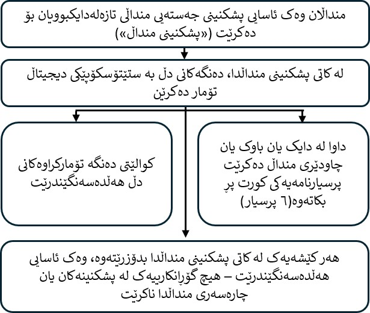

::: {style="text-align: center;"}
<b>تۆمارکردنی دیجیتاڵی دەنگەکانی دڵی منداڵان لە کاتی پشکنینی جەستەیی منداڵی تازەلەدایکبوو: توێژینەوەی babyPHONO</b>

{width="50%" fig-align="center"} {width="50%" fig-align="center"}

{height="200px"}

 
:::

::: {dir="rtl" style="text-align: right;"}
ئێمە دەتەوێت بانگهێشتی ئێوە و منداڵەکەتان بکەین بۆ بەشداریکردن لە توێژینەوەکەمان. پێش ئەوەی بڕیار بدەن، دەتەوێت بزانن بۆچی ئەم توێژینەوەیە ئەنجام دەدرێت و بەشداریکردن چی لەخۆ دەگرێت.     یەکێک لە ئەندامانی تیمەکەمان ئەم زانیارییانە لەگەڵتان دەخوێنێتەوە و وەڵامی هەر پرسیارێکتان دەداتەوە. ئەگەر شتێک ڕوون نییە یان زانیاری زیاتر دەوێت، لێمان بپرسن.     کاتی خۆتان وەربگرن بۆ بڕیاردان لەسەر ئەوەی ئایا دەتانەوێت منداڵەکەتان بەشدار بێت یان نا. بەشداریکردن بە تەواوی ئارەزوومەندانەیە.

<b>بۆچی ئەم توێژینەوەیە ئەنجام دەدەین؟</b>

پشکنینی جەستەیی منداڵی تازەلەدایکبوو بۆ هەموو منداڵان پێشنیار دەکرێت، کە هەندێک جار پێی دەوترێت «پشکنینی منداڵ». ئەم نامیلکەیە توێژینەوەیەک ڕوون دەکاتەوە کە ئەنجامی دەدەین بۆ ئەوەی بزانین ئایا دەتوانین ئەم پشکنینە لە دۆزینەوەی کێشەکانی دڵدا باشتر بکەین.     لە هەر ١٠٠ منداڵێک، کەمتر لە یەک منداڵ کێشەیەکی لە پێکهاتەی دڵدا هەیە. ئەگەر زوو ئەمە بدۆزینەوە، لەوانەیە بتوانین بە شێوەیەکی کاریگەرتر چارەسەری بکەین. دەتەوێت بزانین ئایا دەتوانین دەنگەکانی دڵی منداڵان تۆمار بکەین بۆ یارمەتیدان بە دۆزینەوەی کێشەکانی دڵ.     هیوادارین لانیکەم ٢٠٠ منداڵ لە بەشی جێسۆپ وینگ (Jessop Wing) بەشداری ئەم توێژینەوەیە بکەن. ئەگەر ئەم توێژینەوەیە سەرکەوتوو بێت، هیوادارین ببێتە هۆی توێژینەوەی زیاتر کە لە داهاتوودا یارمەتیمان بدات کێشەکانی دڵی منداڵان بە شێوەیەکی کاریگەرتر بدۆزینەوە.
:::

::: {style="text-align: center;"}
{width="50%" fig-align="center"}
:::

::: {dir="rtl" style="text-align: right;"}
<b>ئایا پێویستە بەشداری ئەم توێژینەوەیە بکەن؟</b>

نەخێر، بەشداریکردن بڕیاری خۆتانە، و بەشدارینەکردن هیچ کاریگەرییەکی لەسەر چاودێری ئێوە یان منداڵەکەتان نابێت. دەتوانن هەر کاتێک بتانەوێت لە توێژینەوەکە بکشێنەوە، و پێویست ناکات هۆکارێک بۆ کشانەوە بدەن.  
:::

::: {dir="rtl" style="text-align: right;"}
<b>ئەگەر بەشداری ئەم توێژینەوەیە بکەن، چی بۆ ئێوە و منداڵەکەتان ڕوودەدات؟</b>

ئامانجی ئەم توێژینەوەیە تۆمارکردنی دەنگەکانی دڵی منداڵانە بە بەکارهێنانی ستێتۆسکۆپێکی دیجیتاڵی. ئەمە بۆ ئەوەیە بزانین ئایا دەتوانین زیرەکی دەستکرد بەکاربهێنین بۆ یارمەتیدان بە دۆزینەوەی کێشەکانی دڵ لە ڕێگەی تۆمارەکانەوە.

ئەگەر بڕیار بدەن بەشدار بن، داواتان لێ دەکرێت فۆڕمی ڕەزامەندی واژۆ بکەن. ئەو کەسەی منداڵەکەتان دەپشکنێت، بە بەکارهێنانی ستێتۆسکۆپێکی دیجیتاڵی دەنگەکانی دڵی تۆمار دەکات. ئەمە لە کاتی پشکنینی تەواوی جەستەیی منداڵی تازەلەدایکبوودا ئەنجام دەدرێت. پاش تەواوبوونی پشکنینەکە، داواتان لێ دەکرێت ڕاپرسییەکی زۆر کورت پڕ بکەنەوە کە ٦ پرسیاری تێدایە.

لە ئەم توێژینەوەیەدا، تۆمارکردنی دەنگەکانی دڵ هیچ گۆڕانکارییەک لەوەدا دروست ناکات کە بۆ منداڵەکەتان ئەنجام دەدرێت. هەمان چاودێری و هەر سکان یان چارەسەرێکی پێویستی بۆ دەکرێت کە ئەگەر بەشداری توێژینەوەکەش نەبووایە، بۆی دەکرا. زۆربەی منداڵان پێویستیان بە هیچ سکان یان چارەسەرێک نییە.
:::

::: {dir="rtl" style="text-align: right;"}
<b>پوختەی ئەوەی بۆ بەشداربووانی ئەم توێژینەوەیە ڕوودەدات:</b>
:::

::: {style="text-align: center;"}
{width="80%" fig-align="center"}
:::

::: {dir="rtl" style="text-align: right;"}
  <b>مەترسییەکانی ئەم توێژینەوەیە چین؟</b>

ستێتۆسکۆپی دیجیتاڵی زۆر لە ستێتۆسکۆپی ئاسایی دەچێت و هیچ مەترسییەک بۆ منداڵەکەتان دروست ناکات. ئامێرێکی دیجیتاڵی بە بۆڕییەکەی ستێتۆسکۆپەکەوە بەستراوەتەوە کە دەنگ تۆمار دەکات. دەنگەکە بەبێ وایەر بۆ مۆبایل یان تابلێتێک دەنێردرێت. پاشان تۆمارەکە لە ئینتەرنێتدا، لە «هەور»دا، بە بەکارهێنانی ڕاژەکارێکی کۆمپیوتەری لە ویلایەتە یەکگرتووەکانی ئەمریکا هەڵدەگیرێت. ئەم ئامێرە لەلایەن دەزگای ڕێکخستنی دەرمان و بەرهەمەکانی چاودێری تەندروستی (MHRA) بۆ بەکارهێنان لە شانشینی یەکگرتوو پەسەند کراوە.

بەشداریکردن لەم توێژینەوەیەدا لەوانەیە ببێتە هۆی ئەوەی پشکنینی منداڵ نزیکەی ٢ بۆ ٥ خولەک زیاتر بخایەنێت. پڕکردنەوەی پرسیارنامەکە لە دوای پشکنین و وەڵامدانەوەی پەیوەندییەکی تەلەفۆنی دوای یەک ساڵ، کاتێکی کەمتان دەبات. مەترسیی ئەوە هەیە کە کارمەندانی کلینیکی بە هەڵە زانیاری کەسی بخەنە ناو بەرنامەی ستێتۆسکۆپە دیجیتاڵییەکە. بۆ ڕێگریکردن لەم مەترسییە، زانیارییەکانی ناو ئەم بەرنامەیە هەفتانە پێداچوونەوەیان بۆ دەکرێت، و تیمی توێژینەوەکە هەر زانیارییەک کە بتوانرێت کەسێکی پێ بناسرێتەوە، دەسڕێتەوە.
:::

::: {style="text-align: center;"}
{width="50%" fig-align="center"}
:::

::: {dir="rtl" style="text-align: right;"}
<b>سوودی بەشداریکردن لەم توێژینەوەیەدا چییە؟</b>

بەشداریکردن لە توێژینەوەکە سوودێکی ڕاستەوخۆ بۆ ئێوە یان منداڵەکەتان نابێت. بەڵام هیوادارین ئەم توێژینەوەیە یارمەتی ئەو منداڵانە بدات کە لە داهاتوودا لەدایک دەبن، بەوەی یارمەتی پزیشکان بدات کێشەکانی دڵ لە سەرەتای ژیاندا زووتر بدۆزنەوە.

<b>چۆن زانیارییەکانی ئێوە و منداڵەکەتان بەکار دەهێنین؟</b>

بۆ ئەم پڕۆژەی توێژینەوەیە پێویستمان بە بەکارهێنانی زانیارییەکانی ئێوە و منداڵەکەتان هەیە.

ئەم زانیارییانە ناو و وردەکارییەکانی پەیوەندیکردن پێوەتان لەخۆ دەگرێت. هەروەها ژمارەی NHS و ژمارەی نەخۆشخانەی ئێوە و منداڵەکەتان لەخۆ دەگرێت. کەسانێک ئەم زانیارییانە بەکار دەهێنن بۆ ئەنجامدانی توێژینەوەکە، یان بۆ پشکنینی تۆمارەکانتان بۆ دڵنیابوون لەوەی توێژینەوەکە بە دروستی ئەنجام دەدرێت.

ئەو کەسانەی پێویست ناکات بزانن ئێوە کێن، ناتوانن ناو یان وردەکارییەکانی پەیوەندیکردن پێوەتان ببینن. لەبری ئەوە، زانیارییەکانتان ژمارەیەکی کۆدیان دەبێت. تۆمارە دیجیتاڵییەکانی دەنگی دڵ و وێنەکانی هەر ئەکۆکاردیۆگرامێک، واتە سکانی دڵ بە شەپۆلی دەنگ، بەبێ ناو هەڵدەگیرێن. بەم شێوەیە تەنها ئەو کەسانەی دەزانن کۆدی توێژینەوەکە بۆ کێیە، دەزانن ئەو تۆمار و وێنانە هی کام کەسن.

زانکۆی شێفیڵد سپۆنسەری ئەم توێژینەوەیەیە. زانکۆی شێفیڵد بەرپرسیارە لە پاراستنی زانیارییەکانتان. زانیارییە پەیوەندیدارەکانی ئێوە بە ئەم پڕۆژەی توێژینەوەیە لەگەڵ ئەم جۆرە ڕێکخراوانە هاوبەش دەکەین:

• ڕێکخراوەکانی دابینکردنی خزمەتگوزاری تەندروستی NHS کە بەشداری ئەم توێژینەوەیەن.

هەموو زانیارییەکانی ئێوە بە شێوەیەکی پارێزراو و ئاسایشدار هەڵدەگرین بە:

• هەڵگرتنی ناو، وردەکارییەکانی پەیوەندیکردن و ژمارەکانی نەخۆشخانەتان لە خشتەیەکی ئەلیکترۆنیدا کە بە وشەی نهێنی پارێزراوە، لەسەر سیستەمە کۆمپیوتەرییە پارێزراوەکانی نەخۆشخانەی جێسۆپ وینگ، بە جیا لەو زانیارییانەی لە توێژینەوەکەدا کۆ دەکرێنەوە.

• ڕێگەدان تەنها بە ئەندامانی تیمی توێژینەوەکە بۆ دەستگەیشتن بەو خشتە ئەلیکترۆنییەی بە وشەی نهێنی پارێزراوە.

<b>گواستنەوەی نێودەوڵەتیی زانیاری</b>

لەوانەیە بۆ مەبەستی پەیوەندیدار بە توێژینەوە، زانیارییەکانی منداڵەکەتان لە دەرەوەی شانشینی یەکگرتوو هاوبەش بکەین یان دەستگەیشتنیان پێ بدەین. ناسنامە لە تۆمارەکانی دەنگی دڵ، زانیارییەکانی تەمەنی منداڵەکەتان و هەر دەستنیشانکردنێکی داهاتووی کێشەکانی دڵ دەسڕدرێتەوە.

لەوانەیە بۆ مەبەستی پەیوەندیدار بە توێژینەوە، زانیارییەکانی ئێوە لە دەرەوەی شانشینی یەکگرتوو هاوبەش بکەین یان دەستگەیشتنیان پێ بدەین بۆ:

• بەکارهێنان لە توێژینەوەکانی داهاتوودا.

• یارمەتیدان بە پەرەپێدانی نەرمەکاڵا بۆ ئامێرە پزیشکییەکان.

ئەگەر زانیارییەکانی ئەم توێژینەوەیە هاوبەش بکەین، تەنها ئەو زانیارییانە هاوبەش دەکەین کە پێویستن. هەروەها تا ئەو ڕادەیەی بکرێت، دڵنیا دەبینەوە کە نەتوانرێت منداڵەکەتان لە ڕێگەی زانیارییە هاوبەشکراوەکانەوە بناسرێتەوە. لە هەندێک بارودۆخدا ئەمە لەوانەیە نەکرێت؛ بۆ نموونە، ئەگەر منداڵەکەتان نەخۆشییەکی دەگمەنی هەبێت، لەوانەیە هێشتا بتوانرێت بناسرێتەوە. ئەگەر زانیارییەکانی منداڵەکەتان لە دەرەوەی شانشینی یەکگرتوو هاوبەش بکرێن، لەگەڵ ئەم جۆرە ڕێکخراوانە دەبێت:

• ڕێکخراوەکانی توێژینەوە.

• ڕێکخراوەکانی تەکنەلۆژیای پزیشکی.

• ڕێکخراوەکانی پەرەپێدانی نەرمەکاڵا.

دڵنیا دەبینەوە کە زانیارییەکانی منداڵەکەتان پارێزراون. هەر کەسێک لە دەرەوەی شانشینی یەکگرتوو دەستی بە زانیارییەکانی منداڵەکەتان دەگات، پێویستە پابەندی ڕێنماییەکانی ئێمە بێت، بۆ ئەوەی زانیارییەکان ئاستێکی پاراستنی هاوشێوەی ئەوەیان هەبێت کە لە ژێر یاسای شانشینی یەکگرتوودا هەیانە. بەم ڕێگایانە دڵنیا دەبینەوە کە زانیارییەکانی منداڵەکەتان لە دەرەوەی شانشینی یەکگرتوو پارێزراون:

هەندێک لەو وڵاتانەی زانیارییەکانی منداڵەکەتان لەگەڵیان هاوبەش دەکرێت، بڕیاری «بەسەندەبوونی پاراستنی زانیاری»یان بۆ دەرچووە. ئەمە واتە دەزانین یاساکانیان ئاستێکی پاراستنی هاوشێوەی یاساکانی پاراستنی زانیاری لە شانشینی یەکگرتوو دابین دەکەن.

ئێمە گرێبەستی دیاریکراو بەکار دەهێنین کە بۆ بەکارهێنان لە شانشینی یەکگرتوو پەسەند کراون و هەمان ئاستی پاراستن بۆ زانیارییە کەسییەکان دابین دەکەن کە لە شانشینی یەکگرتوو هەیانە. بۆ وردەکاری زیاتر، سەردانی ماڵپەڕی نووسینگەی کۆمیسیۆنەری زانیاری (ICO) بکەن:

https://ico.org.uk/for-organisations/uk-gdpr-guidance-and-resources/international-transfers/

ڕێگە بەو کەسانە نادەین کە لە دەرەوەی شانشینی یەکگرتوو دەستیان بە زانیارییەکانی منداڵەکەتان دەگات، ئەو زانیارییانە بۆ هیچ مەبەستێک بەکار بهێنن جگە لەوەی لە گرێبەستی نووسراومان لەگەڵیاندا دیاری کراوە. پێویستە ڕێکخراوەکانی تر ڕێوشوێنی ئاسایشی گونجاویان هەبێت بۆ پاراستنی زانیارییەکانی منداڵەکەتان، کە لەگەڵ پابەندییەکانی ئێمە دەربارەی ئاسایشی زانیاری و نهێنیپارێزی بگونجێت. ئەمە ڕێوشوێنی گونجاو بۆ پاراستنی زانیارییەکانتان لە ونبوونی بە هەڵە و دەستگەیشتن، بەکارهێنان، گۆڕین یان هاوبەشکردنی بێ مۆڵەت لەخۆ دەگرێت.

ڕێکارمان هەیە بۆ مامەڵەکردن لەگەڵ هەر گومانێک بە پێشێلکردنی ئاسایشی زانیارییە کەسییەکان. ئەگەر ئاسایشی زانیارییە کەسییەکانی منداڵەکەتان پێشێل بکرێت، کاتێک یاسا پێویستی بکات، ئێوە و دەزگا چاودێرییە پەیوەندیدارەکان ئاگادار دەکەینەوە. بۆ وردەکاری زیاتر دەربارەی ڕێساکانی ڕاپۆرتکردنی پێشێلکردنی ئاسایشی زانیاری لە شانشینی یەکگرتوو، سەردانی ماڵپەڕی نووسینگەی کۆمیسیۆنەری زانیاری (ICO) بکەن:

https://ico.org.uk/for-organisations/report-a-breach

زانیارییەکانی ناساندنی کەس، لەوانە ناو و بەرواری لەدایکبوون، هەرگیز لەگەڵ هیچ کەسێک لە دەرەوەی تیمی توێژینەوەکە لە شێفیڵد یان کارمەندانی کلینیکیی چاودێریکاری ئێوە یان منداڵەکەتان هاوبەش ناکرێن. ئەگەر ڕازی نەبن زانیارییەکانتان لەگەڵ لایەنی سێیەم هاوبەش بکرێن، هێشتا دەتوانن بەشداری توێژینەوەکە بکەن. ئەمە بە جیا لە فۆڕمی ڕەزامەندیتاندا دیاری دەکرێت.

<b>دوای کۆتاییهاتنی توێژینەوەکە، چۆن زانیارییەکانتان بەکار دەهێنین؟</b>

دوای تەواوبوونی توێژینەوەکە، هەندێک لە زانیارییەکان هەڵدەگرین بۆ ئەوەی بتوانین ئەنجامەکان بپشکنین. ڕاپۆرتەکانمان بە شێوەیەک دەنووسین کە هیچ کەسێک نەتوانێت بزانێت منداڵەکەتان بەشداری توێژینەوەکە بووە. زانیارییەکانی توێژینەوەکەتان بۆ ماوەیەکی زۆرترین ٥ ساڵ هەڵدەگرین. پاشان ناسنامە بە تەواوی لە زانیارییەکانی توێژینەوەکە دەسڕدرێتەوە و بە شێوەیەکی پارێزراو ئەرشیف دەکرێن یان لەناو دەبرێن.

<b>دەربارەی چۆنیەتی بەکارهێنانی زانیارییەکانتان، چ هەڵبژاردەیەکتان هەیە؟</b>

دەتوانن هەر کاتێک، بەبێ دانانی هۆکار، بەشداریکردنی خۆتان و منداڵەکەتان لە توێژینەوەکە بوەستێنن، بەڵام ئەو زانیارییانەی پێشتر دەربارەی ئێوەمان کۆ کردووەتەوە، هەڵدەگرین. مافی ئەوەتان هەیە داوامان لێ بکەن دەستتان بەو زانیارییانە بگات کە بۆ مەبەستی توێژینەوەکە دەربارەی ئێوە هەڵمانگرتوون، یان داوای لابردن، گۆڕین یان سڕینەوەیان بکەن. هەروەها دەتوانن ناڕەزایی دەرببڕن بەرامبەر بە پرۆسەکردنی زانیارییەکانتان لەلایەن ئێمەوە. لەوانەیە هەمیشە نەتوانین داواکە جێبەجێ بکەین، ئەگەر ئەمە ببێتە هۆی ئەوەی نەتوانین زانیارییەکانتان بۆ توێژینەوەکە بەکار بهێنین. ئەگەر وا بێت، هۆکارەکەتان پێ دەڵێین. ئەگەر ڕازی بن بەشداری ئەم توێژینەوەیە بکەن، هەڵبژاردەی بەشداریکردنتان لە توێژینەوەکانی داهاتوودا دەبێت، بە بەکارهێنانی ئەو زانیارییانەی لەم توێژینەوەیە هەڵگیراون.

<b>لە کوێ دەتوانن زانیاری زیاتر دەربارەی چۆنیەتی بەکارهێنانی زانیارییەکانتان بدۆزنەوە؟</b>

دەتوانن زانیاری زیاتر دەربارەی چۆنیەتی بەکارهێنانی زانیارییەکانتان، لەوانە ئەو ڕێکارە دیاریکراوەی بەکاری دەهێنین کاتێک زانیارییە کەسییەکانتان بۆ دەرەوەی شانشینی یەکگرتوو دەگوازینەوە، لەم ڕێگایانەوە بەدەست بهێنن:

• نامیلکەکەمان: www.hra.nhs.uk/patientdataandresearch

• پرسیارکردن لە یەکێک لە ئەندامانی تیمی توێژینەوەکە.

• ناردنی ئیمەیڵ بۆ sth.babyphono\@nhs.net.

• پەیوەندیکردن بە ژمارەی +447729849599.

<b>ئەگەر پرسیاری تریشم دەربارەی توێژینەوەکە هەبێت چی بکەم؟</b>

ئەگەر هەر پرسیارێکتان دەربارەی توێژینەوەکە هەیە، دەتوانن بە بەکارهێنانی ناونیشانی ئیمەیڵ یان ژمارەی تەلەفۆنی پشت ئەم نامیلکەیە پەیوەندیمان پێوە بکەن. هەروەها دەتوانن پرسیارەکانتان لەو توێژەرە بکەن کە دێت داواتان لێ بکات فۆڕمی ڕەزامەندی واژۆ بکەن.

<b>ئەگەر پرسیار یان سکاڵام دەربارەی ئەو چاودێرییە کلینیکییە هەبێت کە وەرمگرتووە، چی بکەم؟</b>

هەر پرسیارنامەیەک کە لە ماوەی ئەم توێژینەوەیەدا داواتان لێ دەکرێت پڕی بکەنەوە، نابێت بۆ ڕاپۆرتکردنی نیگەرانییە کلینیکییەکان دەربارەی چاودێری خۆتان یان منداڵەکەتان بەکار بهێنرێت. ئەگەر پرسیار یان سکاڵایەکتان دەربارەی چاودێرییە کلینیکییەکەتان هەیە، تکایە لەگەڵ کارمەندانی کلینیکیی چاودێریکارتان قسە بکەن، یان داوای وردەکاری دەربارەی خزمەتگوزاری ڕاوێژ و پەیوەندیی نەخۆشان (PALS) بکەن.

<b>ئەگەر سکاڵام دەربارەی توێژینەوەکە هەبێت چی بکەم؟</b>

ئەگەر ناڕازین و دەتانەوێت سکاڵا بکەن، تکایە سەرەتا پەیوەندی بە دکتۆر Alys Griffiths بکەن:
alys.griffiths\@sheffield.ac.uk

ئەگەر پێتان وایە سکاڵاکەتان بە شێوەیەکی ڕازیكەر چارەسەر نەکراوە، دەتوانن پەیوەندی بە پرۆفیسۆر Heather Mortiboys بکەن:
h.mortiboys\@sheffield.ac.uk
یان بە ژمارەی 0114 222 2290.

ئەگەر سکاڵاکە پەیوەندی بە چۆنیەتی مامەڵەکردن لەگەڵ زانیارییە کەسییەکانتانەوە هەبێت، دەتوانن زانیاری دەربارەی چۆنیەتی پێشکەشکردنی سکاڵا لە ئاگادارنامەی تایبەتمەندیی زانکۆکەدا بدۆزنەوە:

https://www.sheffield.ac.uk/govern/data-protection/privacy/general

ئەگەر دەتانەوێت نیگەرانی یان ڕووداوێک ڕاپۆرت بکەن کە پەیوەندی بە ئەگەری چەوساندنەوە، خراپ مامەڵەکردن یان زیانەوە هەیە کە لە ئەنجامی بەشداریکردنتان لەم پڕۆژەیەدا دروست بووبێت، تکایە پەیوەندی بە بەرپرسی دیاریکراوی پاراستن لە زیان، دکتۆر Haris Stavroulakis بکەن:
t.stavroulakis\@sheffield.ac.uk

ئەگەر هێشتا نیگەرانن، تکایە پەیوەندی بە بەڕێوەبەری ئەخلاق و دەستپاکیی توێژینەوە، Lindsay Unwin بکەن:
l.v.unwin\@sheffield.ac.uk

<b>ئایا ئەم توێژینەوەیە لەلایەن لیژنەیەکی ئەخلاقییەوە پەسەند کراوە؟</b>

ئەم توێژینەوەیە لەلایەن لیژنەی یەکەمی ئەخلاقی توێژینەوەی باشووری ڕۆژهەڵاتی سکۆتلەندا (South East Scotland Research Ethics Committee 1) پێداچوونەوەی بۆ کراوە. ژمارەی سەرچاوەی توێژینەوەکە بریتییە لە: 358145.

سوپاس بۆ ئەوەی بیر لە بەشداریکردن لەم توێژینەوەیە دەکەنەوە.

بۆ زانیاری زیاتر دەربارەی ئەم توێژینەوەیە، تکایە پەیوەندی بکەن: ئیمەیڵ:\
[sth.babyphono\@nhs.net](mailto:sth.babyphono@nhs.net){.email}\
ژمارەی تەلەفۆنی توێژینەوەکە:\
+447729849599

ئەم توێژینەوەیە لەم شوێنە ئەنجام دەدرێت: نەخۆشخانەی جێسۆپ وینگ:  
Jessop Wing Hospital, Tree Root Walk, Broomhall, Sheffield, S10 2SF  
:::

::: {style="text-align: center;"}
{width="50%" fig-align="center"}
:::

::: {dir="rtl" style="text-align: right;"}
    سپۆنسەری ئەم توێژینەوەیە: زانکۆی شێفیڵد  
The University of Sheffield, Western Bank, Sheffield, S10 2TN

بەرپرسی پاراستنی زانیاری:\
Luke Thompson\
dataprotection\@sheffield.ac.uk\
+44 114 222 1117  
:::

::: {style="text-align: center;"}
{width="50%" fig-align="center"}  
:::

::: {dir="rtl" style="text-align: right;"}
بودجەی ئەم توێژینەوەیە لەلایەن ڕێکخراوی خێرخوازیی نەخۆشخانەی منداڵانی شێفیڵدەوە دابین دەکرێت:  
Sheffield Children’s Hospital Charity, 4 Marlborough Rd, Sheffield, S10 1DB  
:::

::: {style="text-align: center;"}
{width="50%" fig-align="center"}  
:::