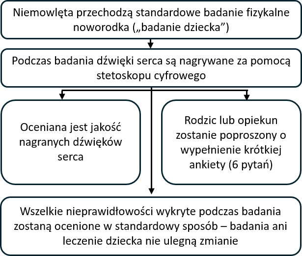

::: {style="text-align: center;"}
<b>Cyfrowe nagrywanie dźwięków serca u niemowląt podczas badania fizykalnego noworodka: badanie babyPHONO</b>

{width="50%" fig-align="center"} {width="50%" fig-align="center"}

{height="200px"}

 
:::

::: {style="text-align: left;"}
Chcielibyśmy zaprosić Państwa i Państwa dziecko do udziału w naszym badaniu naukowym. Zanim podejmą Państwo decyzję, chcielibyśmy wyjaśnić, dlaczego prowadzimy to badanie i na czym będzie polegał udział w nim.     Członek naszego zespołu omówi z Państwem te informacje i odpowie na wszelkie pytania. Jeśli coś jest niejasne lub chcieliby Państwo uzyskać więcej informacji, prosimy nas o to zapytać.     Prosimy poświęcić tyle czasu, ile potrzeba, aby zdecydować, czy chcą Państwo, by dziecko wzięło udział w badaniu. Udział jest całkowicie dobrowolny.

<b>Dlaczego prowadzimy to badanie?</b>

Wszystkim niemowlętom proponuje się „badanie fizykalne noworodka”, nazywane czasem „badaniem dziecka”. Ta ulotka opisuje badanie naukowe, które prowadzimy, aby sprawdzić, czy możemy poprawić skuteczność wykrywania problemów z sercem podczas tego badania.     Mniej niż 1 na 100 niemowląt ma problem z budową serca. Jeśli wykryjemy go wcześnie, być może będziemy mogli skuteczniej go leczyć. Chcemy sprawdzić, czy możemy nagrywać dźwięki serca niemowląt, aby pomóc w wykrywaniu problemów z sercem.     Mamy nadzieję włączyć do badania co najmniej 200 niemowląt z Jessop Wing. Jeśli badanie zakończy się powodzeniem, mamy nadzieję, że doprowadzi do dalszych badań, które w przyszłości pomogą nam skuteczniej wykrywać problemy z sercem u niemowląt.
:::

::: {style="text-align: center;"}
{width="50%" fig-align="center"}
:::

::: {style="text-align: left;"}
<b>Czy muszą Państwo wziąć udział w tym badaniu?</b>

Nie. Decyzja o udziale należy do Państwa, a odmowa nie wpłynie na opiekę nad Państwem ani dzieckiem. Mogą Państwo wycofać się z badania w dowolnym momencie, bez podawania przyczyny.  
:::

::: {style="text-align: left;"}
<b>Co będzie się działo z Państwem i dzieckiem, jeśli wezmą Państwo udział w badaniu?</b>

Celem tego badania jest nagrywanie dźwięków serca niemowląt za pomocą stetoskopu cyfrowego. Chcemy sprawdzić, czy możemy wykorzystać sztuczną inteligencję do pomocy w wykrywaniu problemów z sercem na podstawie nagrań.

Jeśli zdecydują się Państwo na udział, poprosimy o podpisanie formularza świadomej zgody. Osoba badająca dziecko nagra dźwięki jego serca za pomocą stetoskopu cyfrowego. Zrobi to podczas pełnego badania fizykalnego noworodka. Po jego zakończeniu poprosimy Państwa o wypełnienie bardzo krótkiej ankiety składającej się z 6 pytań.

W tym badaniu naukowym nagrywanie dźwięków serca nie zmieni postępowania wobec dziecka. Dziecko nadal będzie otrzymywało taką samą opiekę oraz wszelkie niezbędne badania obrazowe lub leczenie, jakie otrzymałoby, gdyby nie uczestniczyło w badaniu naukowym. Większość niemowląt nie wymaga żadnych badań obrazowych ani leczenia.
:::

::: {style="text-align: left;"}
<b>Podsumowanie przebiegu udziału w badaniu:</b>
:::

::: {style="text-align: center;"}
{width="80%" fig-align="center"}
:::

::: {style="text-align: left;"}
  <b>Jakie ryzyko wiąże się z tym badaniem?</b> Stetoskop cyfrowy jest bardzo podobny do zwykłego stetoskopu i nie stwarza żadnego zagrożenia dla dziecka. Do przewodu stetoskopu przymocowane jest urządzenie cyfrowe, które rejestruje dźwięk. Dźwięk jest przesyłany bezprzewodowo do telefonu komórkowego lub tabletu. Następnie nagranie jest zapisywane online w „chmurze” na serwerze komputerowym w Stanach Zjednoczonych Ameryki. Urządzenie zostało dopuszczone do użytku w Zjednoczonym Królestwie przez Agencję Regulacji Leków i Produktów Ochrony Zdrowia (MHRA).

Udział w badaniu może wydłużyć badanie dziecka o około 2 do 5 minut. Wypełnienie ankiety po badaniu oraz rozmowa telefoniczna za rok również zajmą Państwu niewiele czasu. Istnieje ryzyko, że personel medyczny przypadkowo wprowadzi dane osobowe do aplikacji stetoskopu cyfrowego. Aby przeciwdziałać temu ryzyku, informacje w aplikacji będą sprawdzane co tydzień, a zespół badawczy usunie wszelkie dane umożliwiające identyfikację osoby.
:::

::: {style="text-align: center;"}
{width="50%" fig-align="center"}
:::

::: {style="text-align: left;"}
<b>Jakie korzyści daje udział w tym badaniu?</b>

Udział w badaniu nie przyniesie bezpośrednich korzyści Państwu ani dziecku. Mamy jednak nadzieję, że badanie pomoże niemowlętom urodzonym w przyszłości, umożliwiając lekarzom wcześniejsze wykrywanie problemów z sercem.

<b>Jak będziemy wykorzystywać informacje o Państwu i dziecku?</b>

Do realizacji tego projektu badawczego będziemy potrzebowali informacji o Państwu i dziecku.

Informacje te obejmą Państwa imię i nazwisko oraz dane kontaktowe. Będą również obejmować Państwa numer NHS i numer identyfikacyjny w szpitalu oraz takie same numery dziecka. Odpowiednie osoby będą wykorzystywać te informacje do prowadzenia badania lub sprawdzania dokumentacji, aby upewnić się, że badanie jest prowadzone prawidłowo.

Osoby, które nie muszą znać Państwa tożsamości, nie będą mogły zobaczyć Państwa imienia i nazwiska ani danych kontaktowych. Zamiast tego dane zostaną oznaczone kodem liczbowym. Cyfrowe nagrania dźwięków serca oraz obrazy z ewentualnych badań echokardiograficznych (USG serca) będą przechowywane bez imion i nazwisk. Tylko osoby, które wiedzą, do kogo przypisany jest dany kod badawczy, będą mogły ustalić, od kogo pochodzą nagrania i obrazy.

Sponsorem tego badania jest Uniwersytet w Sheffield (The University of Sheffield). Uniwersytet w Sheffield odpowiada za ochronę Państwa informacji. Informacje dotyczące Państwa związane z tym projektem badawczym będziemy udostępniać następującym rodzajom organizacji:

• Organizacjom świadczącym usługi zdrowotne w ramach NHS, które uczestniczą w tym badaniu naukowym.

Zapewnimy bezpieczeństwo i ochronę wszystkich informacji o Państwu poprzez:

• Przechowywanie Państwa imienia i nazwiska, danych kontaktowych oraz numerów identyfikacyjnych w szpitalu w arkuszu kalkulacyjnym chronionym hasłem, w bezpiecznych systemach komputerowych szpitala Jessop Wing, oddzielnie od danych zebranych w ramach badania.

• Umożliwienie dostępu do arkusza chronionego hasłem wyłącznie członkom zespołu badawczego.

<b>Międzynarodowe przekazywanie danych</b>

Możemy udostępniać dane o dziecku poza Zjednoczonym Królestwem lub umożliwiać dostęp do nich z zagranicy w celach związanych z badaniami naukowymi. Nagrania dźwięków serca, informacje o wieku dziecka oraz wszelkie przyszłe rozpoznania problemów z sercem zostaną zanonimizowane.

Możemy udostępniać dane o Państwu poza Zjednoczonym Królestwem lub umożliwiać dostęp do nich z zagranicy w celach związanych z badaniami naukowymi, aby:

• Wykorzystać je w przyszłych badaniach.

• Pomóc w opracowywaniu oprogramowania do wyrobów medycznych.

Jeśli będziemy udostępniać dane z tego badania, przekażemy tylko te, które są potrzebne. W miarę możliwości zadbamy również o to, aby na podstawie udostępnianych danych nie można było ustalić tożsamości dziecka. W niektórych okolicznościach może to być niemożliwe — na przykład jeśli dziecko ma rzadką chorobę, nadal może istnieć możliwość ustalenia jego tożsamości. Jeśli dane dziecka zostaną udostępnione poza Zjednoczonym Królestwem, odbiorcami będą następujące rodzaje organizacji:

• Organizacje badawcze.

• Organizacje zajmujące się technologiami medycznymi.

• Organizacje zajmujące się tworzeniem oprogramowania.

Zapewnimy ochronę danych dziecka. Każda osoba uzyskująca dostęp do danych dziecka poza Zjednoczonym Królestwem musi przestrzegać naszych poleceń, aby dane były objęte poziomem ochrony podobnym do tego, jaki zapewnia prawo Zjednoczonego Królestwa. Bezpieczeństwo danych dziecka poza Zjednoczonym Królestwem zapewnimy w następujący sposób:

W odniesieniu do niektórych krajów, do których będą przekazywane dane dziecka, obowiązuje decyzja stwierdzająca odpowiedni stopień ochrony danych. Oznacza to, że wiemy, iż ich przepisy zapewniają poziom ochrony podobny do przepisów o ochronie danych w Zjednoczonym Królestwie.

Stosujemy określone umowy zatwierdzone do stosowania w Zjednoczonym Królestwie, które zapewniają danym osobowym taki sam poziom ochrony, jaki mają w Zjednoczonym Królestwie. Więcej informacji można znaleźć na stronie Biura Komisarza ds. Informacji (ICO): <https://ico.org.uk/for-organisations/uk-gdpr-guidance-and-resources/international-transfers/>

Nie zezwalamy osobom uzyskującym dostęp do danych dziecka poza Zjednoczonym Królestwem na wykorzystywanie ich w celach innych niż określone w naszej pisemnej umowie z tymi osobami lub organizacjami. Wymagamy od innych organizacji odpowiednich środków bezpieczeństwa chroniących dane dziecka, zgodnych z naszymi zobowiązaniami dotyczącymi bezpieczeństwa i poufności danych. Obejmuje to odpowiednie zabezpieczenia przed przypadkową utratą danych oraz nieuprawnionym dostępem, wykorzystaniem, zmianą lub udostępnieniem. Mamy procedury postępowania w przypadku podejrzenia naruszenia ochrony danych osobowych. W razie naruszenia ochrony danych osobowych dziecka poinformujemy Państwa i właściwe organy nadzorcze, jeśli będzie tego wymagało prawo. Więcej informacji o zasadach zgłaszania naruszeń w Zjednoczonym Królestwie można znaleźć na stronie Biura Komisarza ds. Informacji (ICO): <https://ico.org.uk/for-organisations/report-a-breach>

Informacje umożliwiające identyfikację osoby (w tym imiona, nazwiska i daty urodzenia) nigdy nie będą udostępniane nikomu poza zespołem badawczym w Sheffield lub personelem medycznym opiekującym się Państwem bądź dzieckiem. Nadal mogą Państwo uczestniczyć w badaniu, jeśli odmówią Państwo udostępniania danych podmiotom trzecim. Decyzja ta zostanie odnotowana oddzielnie w formularzu zgody.

<b>Jak będziemy wykorzystywać informacje o Państwu po zakończeniu badania?</b>

Po zakończeniu badania zachowamy część danych, aby móc sprawdzić wyniki. Nasze raporty napiszemy w taki sposób, aby nikt nie mógł ustalić, że Państwa dziecko uczestniczyło w badaniu. Dane z badania dotyczące Państwa będziemy przechowywać przez maksymalnie 5 lat. Następnie zostaną one w pełni zanonimizowane i bezpiecznie zarchiwizowane lub zniszczone.

<b>Jakie mają Państwo możliwości wyboru dotyczące wykorzystywania informacji?</b>

Mogą Państwo w dowolnym momencie zakończyć swój udział i udział dziecka w badaniu, bez podawania przyczyny, ale zachowamy informacje o Państwu, które już posiadamy. Mają Państwo prawo poprosić nas o dostęp do danych, które przechowujemy o Państwu na potrzeby badania, oraz o ich usunięcie lub zmianę. Mogą Państwo również sprzeciwić się przetwarzaniu swoich danych. Nie zawsze będziemy mogli spełnić taką prośbę, jeśli oznaczałoby to, że nie możemy wykorzystać Państwa danych do prowadzenia badania. W takim przypadku wyjaśnimy powód. Jeśli wyrażą Państwo zgodę na udział w tym badaniu, będą mieli Państwo możliwość udziału w przyszłych badaniach z wykorzystaniem danych zachowanych z tego badania.

Gdzie można dowiedzieć się więcej o sposobie wykorzystywania informacji? Więcej informacji o tym, jak wykorzystujemy Państwa dane, w tym o konkretnym mechanizmie stosowanym przy przekazywaniu danych osobowych poza Zjednoczone Królestwo, można uzyskać:

• W naszej ulotce: <https://www.hra.nhs.uk/patientdataandresearch>

• Pytając członka zespołu badawczego.

• Wysyłając e-mail na adres [sth.babyphono\@nhs.net](mailto:sth.babyphono@nhs.net){.email}.

• Dzwoniąc pod numer +447729849599.

<b>Co zrobić, jeśli mam inne pytania dotyczące badania?</b>

Jeśli mają Państwo jakiekolwiek pytania dotyczące badania, można skontaktować się z nami, korzystając z adresu e-mail lub numeru telefonu podanego na odwrocie tej ulotki. Można również zadać pytania badaczowi, który przyjdzie poprosić Państwa o podpisanie formularza zgody.

<b>Co zrobić, jeśli mam pytanie lub skargę dotyczącą otrzymanej opieki medycznej?</b>

Żadna ankieta, o której wypełnienie zostaną Państwo poproszeni podczas badania, nie powinna służyć do zgłaszania obaw dotyczących opieki medycznej nad Państwem lub dzieckiem. Jeśli mają Państwo pytanie lub skargę dotyczącą swojej opieki medycznej, prosimy porozmawiać z personelem sprawującym opiekę lub poprosić o informacje na temat służby doradztwa i kontaktu z pacjentami (PALS).

<b>Co zrobić, jeśli mam skargę dotyczącą badania naukowego?</b>

Jeśli są Państwo niezadowoleni i chcą złożyć skargę, prosimy w pierwszej kolejności skontaktować się z dr Alys Griffiths ([alys.griffiths\@sheffield.ac.uk](mailto:alys.griffiths@sheffield.ac.uk){.email}). Jeśli uważają Państwo, że skarga nie została rozpatrzona w zadowalający sposób, można skontaktować się z prof. Heather Mortiboys pod adresem [h.mortiboys\@sheffield.ac.uk](mailto:h.mortiboys@sheffield.ac.uk){.email} lub numerem 0114 222 2290.

Jeśli skarga dotyczy sposobu postępowania z Państwa danymi osobowymi, informacje o jej złożeniu można znaleźć w informacji o prywatności Uniwersytetu: <https://www.sheffield.ac.uk/govern/data-protection/privacy/general>.

Jeśli chcą Państwo zgłosić obawę lub zdarzenie dotyczące potencjalnego wyzysku, przemocy lub krzywdy wynikających z udziału w tym projekcie, prosimy skontaktować się z wyznaczoną osobą ds. ochrony przed krzywdzeniem, dr. Harisem Stavroulakisem ([t.stavroulakis\@sheffield.ac.uk](mailto:t.stavroulakis@sheffield.ac.uk){.email}). Jeśli obawy się utrzymują, prosimy skontaktować się z kierowniczką ds. etyki i rzetelności badań, Lindsay Unwin ([l.v.unwin\@sheffield.ac.uk](mailto:l.v.unwin@sheffield.ac.uk){.email}).

<b>Czy to badanie zostało zatwierdzone przez komisję etyczną?</b>

Badanie zostało ocenione przez Komisję Etyczną ds. Badań w Południowo-Wschodniej Szkocji nr 1 (South East Scotland Research Ethics Committee 1). Numer referencyjny badania: 358145.

Dziękujemy za rozważenie udziału w tym badaniu.

Aby uzyskać więcej informacji o tym badaniu naukowym, prosimy o kontakt:

E-mail:\
[sth.babyphono\@nhs.net](mailto:sth.babyphono@nhs.net){.email}\
Numer telefonu badania:\
+447729849599

Badanie odbywa się w szpitalu Jessop Wing Hospital, pod adresem Tree Root Walk, Broomhall, Sheffield, S10 2SF.  
:::

::: {style="text-align: center;"}
{width="50%" fig-align="center"}
:::

::: {style="text-align: left;"}
    Sponsorem tego badania naukowego jest: Uniwersytet w Sheffield (The University of Sheffield), Western Bank, Sheffield, S10 2TN.

Inspektor ochrony danych:\
Luke Thompson\
[dataprotection\@sheffield.ac.uk](mailto:dataprotection@sheffield.ac.uk){.email}\
+44 114 222 1117  
:::

::: {style="text-align: center;"}
{width="50%" fig-align="center"}  
:::

::: {style="text-align: left;"}
Badanie naukowe jest finansowane przez: organizację charytatywną Sheffield Children’s Hospital Charity, 4 Marlborough Rd, Sheffield, S10 1DB.  
:::

::: {style="text-align: center;"}
{width="50%" fig-align="center"}  
:::
