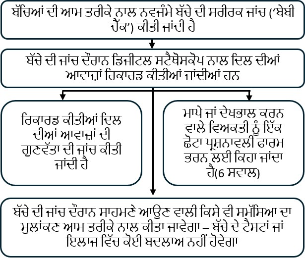

::: {style="text-align: center;"}
<b>ਨਵਜੰਮੇ ਬੱਚੇ ਦੀ ਸਰੀਰਕ ਜਾਂਚ ਦੌਰਾਨ ਬੱਚਿਆਂ ਦੇ ਦਿਲ ਦੀਆਂ ਆਵਾਜ਼ਾਂ ਦੀ ਡਿਜੀਟਲ ਰਿਕਾਰਡਿੰਗ: babyPHONO ਅਧਿਐਨ</b>

  

  

  

  

 
:::

::: {style="text-align: left;"}
ਅਸੀਂ ਤੁਹਾਨੂੰ ਅਤੇ ਤੁਹਾਡੇ ਬੱਚੇ ਨੂੰ ਆਪਣੇ ਖੋਜ ਅਧਿਐਨ ਵਿੱਚ ਹਿੱਸਾ ਲੈਣ ਲਈ ਸੱਦਾ ਦੇਣਾ ਚਾਹੁੰਦੇ ਹਾਂ। ਫ਼ੈਸਲਾ ਕਰਨ ਤੋਂ ਪਹਿਲਾਂ ਅਸੀਂ ਚਾਹੁੰਦੇ ਹਾਂ ਕਿ ਤੁਸੀਂ ਸਮਝ ਲਵੋ ਕਿ ਇਹ ਖੋਜ ਕਿਉਂ ਕੀਤੀ ਜਾ ਰਹੀ ਹੈ ਅਤੇ ਇਸ ਵਿੱਚ ਕੀ ਕੁਝ ਸ਼ਾਮਲ ਹੋਵੇਗਾ।     ਸਾਡੀ ਟੀਮ ਦਾ ਇੱਕ ਮੈਂਬਰ ਤੁਹਾਡੇ ਨਾਲ ਇਹ ਜਾਣਕਾਰੀ ਸਮਝਾਵੇਗਾ ਅਤੇ ਤੁਹਾਡੇ ਸਵਾਲਾਂ ਦੇ ਜਵਾਬ ਦੇਵੇਗਾ। ਜੇ ਕੋਈ ਗੱਲ ਸਪੱਸ਼ਟ ਨਾ ਹੋਵੇ ਜਾਂ ਤੁਸੀਂ ਹੋਰ ਜਾਣਕਾਰੀ ਚਾਹੁੰਦੇ ਹੋ ਤਾਂ ਸਾਨੂੰ ਪੁੱਛੋ।     ਇਹ ਫ਼ੈਸਲਾ ਕਰਨ ਲਈ ਸਮਾਂ ਲਵੋ ਕਿ ਤੁਸੀਂ ਆਪਣੇ ਬੱਚੇ ਨੂੰ ਇਸ ਅਧਿਐਨ ਵਿੱਚ ਸ਼ਾਮਲ ਕਰਨਾ ਚਾਹੁੰਦੇ ਹੋ ਜਾਂ ਨਹੀਂ। ਹਿੱਸਾ ਲੈਣਾ ਪੂਰੀ ਤਰ੍ਹਾਂ ਆਪਣੀ ਮਰਜ਼ੀ ਉੱਤੇ ਨਿਰਭਰ ਹੈ।

<b>ਅਸੀਂ ਇਹ ਖੋਜ ਕਿਉਂ ਕਰ ਰਹੇ ਹਾਂ?</b>

ਸਾਰੇ ਬੱਚਿਆਂ ਲਈ ‘ਨਵਜੰਮੇ ਬੱਚੇ ਦੀ ਸਰੀਰਕ ਜਾਂਚ’ ਦੀ ਪੇਸ਼ਕਸ਼ ਕੀਤੀ ਜਾਂਦੀ ਹੈ, ਜਿਸ ਨੂੰ ਕਈ ਵਾਰ ‘ਬੇਬੀ ਚੈੱਕ’ ਕਿਹਾ ਜਾਂਦਾ ਹੈ। ਇਸ ਜਾਣਕਾਰੀ ਪੱਤਰ ਵਿੱਚ ਉਸ ਖੋਜ ਬਾਰੇ ਦੱਸਿਆ ਗਿਆ ਹੈ ਜੋ ਅਸੀਂ ਇਹ ਜਾਣਨ ਲਈ ਕਰ ਰਹੇ ਹਾਂ ਕਿ ਕੀ ਇਸ ਜਾਂਚ ਨੂੰ ਦਿਲ ਦੀਆਂ ਸਮੱਸਿਆਵਾਂ ਲੱਭਣ ਵਿੱਚ ਹੋਰ ਬਿਹਤਰ ਬਣਾਇਆ ਜਾ ਸਕਦਾ ਹੈ।     ਹਰ 100 ਬੱਚਿਆਂ ਵਿੱਚੋਂ 1 ਤੋਂ ਵੀ ਘੱਟ ਬੱਚੇ ਨੂੰ ਦਿਲ ਦੀ ਬਣਤਰ ਵਿੱਚ ਕੋਈ ਸਮੱਸਿਆ ਹੁੰਦੀ ਹੈ। ਜੇ ਅਸੀਂ ਇਸ ਦਾ ਜਲਦੀ ਪਤਾ ਲਗਾ ਲਈਏ ਤਾਂ ਸ਼ਾਇਦ ਇਸ ਦਾ ਹੋਰ ਪ੍ਰਭਾਵਸ਼ਾਲੀ ਢੰਗ ਨਾਲ ਇਲਾਜ ਕਰ ਸਕੀਏ। ਅਸੀਂ ਇਹ ਦੇਖਣਾ ਚਾਹੁੰਦੇ ਹਾਂ ਕਿ ਕੀ ਬੱਚਿਆਂ ਦੇ ਦਿਲ ਦੀਆਂ ਆਵਾਜ਼ਾਂ ਰਿਕਾਰਡ ਕਰਕੇ ਦਿਲ ਦੀਆਂ ਸਮੱਸਿਆਵਾਂ ਲੱਭਣ ਵਿੱਚ ਮਦਦ ਮਿਲ ਸਕਦੀ ਹੈ।     ਸਾਨੂੰ ਉਮੀਦ ਹੈ ਕਿ ਜੈਸਪ ਵਿੰਗ (Jessop Wing) ਤੋਂ ਘੱਟੋ-ਘੱਟ 200 ਬੱਚੇ ਇਸ ਖੋਜ ਵਿੱਚ ਸ਼ਾਮਲ ਹੋਣਗੇ। ਜੇ ਇਹ ਅਧਿਐਨ ਸਫ਼ਲ ਰਿਹਾ ਤਾਂ ਸਾਨੂੰ ਉਮੀਦ ਹੈ ਕਿ ਇਸ ਦੇ ਆਧਾਰ ’ਤੇ ਹੋਰ ਅਧਿਐਨ ਕੀਤੇ ਜਾਣਗੇ, ਜੋ ਭਵਿੱਖ ਵਿੱਚ ਬੱਚਿਆਂ ਦੇ ਦਿਲ ਦੀਆਂ ਸਮੱਸਿਆਵਾਂ ਹੋਰ ਪ੍ਰਭਾਵਸ਼ਾਲੀ ਢੰਗ ਨਾਲ ਲੱਭਣ ਵਿੱਚ ਮਦਦ ਕਰਨਗੇ।
:::

::: {style="text-align: center;"}
{width="50%" style="max-width: 650px; height: auto;" fig-align="center"}
:::

::: {style="text-align: left;"}
<b>ਕੀ ਤੁਹਾਡੇ ਲਈ ਇਸ ਖੋਜ ਵਿੱਚ ਹਿੱਸਾ ਲੈਣਾ ਲਾਜ਼ਮੀ ਹੈ?</b>

ਨਹੀਂ। ਹਿੱਸਾ ਲੈਣ ਦਾ ਫ਼ੈਸਲਾ ਤੁਹਾਡਾ ਹੈ ਅਤੇ ਹਿੱਸਾ ਨਾ ਲੈਣ ਨਾਲ ਤੁਹਾਡੀ ਜਾਂ ਤੁਹਾਡੇ ਬੱਚੇ ਦੀ ਦੇਖਭਾਲ ’ਤੇ ਕੋਈ ਅਸਰ ਨਹੀਂ ਪਵੇਗਾ। ਤੁਸੀਂ ਕਿਸੇ ਵੀ ਸਮੇਂ ਅਧਿਐਨ ਤੋਂ ਹਟ ਸਕਦੇ ਹੋ ਅਤੇ ਇਸ ਲਈ ਕੋਈ ਕਾਰਨ ਦੱਸਣ ਦੀ ਲੋੜ ਨਹੀਂ ਹੈ।  
:::

::: {style="text-align: left;"}
<b>ਜੇ ਤੁਸੀਂ ਇਸ ਖੋਜ ਵਿੱਚ ਹਿੱਸਾ ਲੈਂਦੇ ਹੋ ਤਾਂ ਤੁਹਾਡੇ ਅਤੇ ਤੁਹਾਡੇ ਬੱਚੇ ਨਾਲ ਕੀ ਹੋਵੇਗਾ?</b>

ਇਸ ਖੋਜ ਦਾ ਉਦੇਸ਼ ਡਿਜੀਟਲ ਸਟੈਥੋਸਕੋਪ ਦੀ ਵਰਤੋਂ ਕਰਕੇ ਬੱਚਿਆਂ ਦੇ ਦਿਲ ਦੀਆਂ ਆਵਾਜ਼ਾਂ ਰਿਕਾਰਡ ਕਰਨਾ ਹੈ। ਇਸ ਰਾਹੀਂ ਅਸੀਂ ਇਹ ਜਾਣਨਾ ਚਾਹੁੰਦੇ ਹਾਂ ਕਿ ਕੀ ਰਿਕਾਰਡਿੰਗਾਂ ਤੋਂ ਦਿਲ ਦੀਆਂ ਸਮੱਸਿਆਵਾਂ ਲੱਭਣ ਵਿੱਚ ਮਦਦ ਲਈ ਕ੍ਰਿਤ੍ਰਿਮ ਬੁੱਧੀ (ਆਰਟੀਫ਼ੀਸ਼ਲ ਇੰਟੈਲੀਜੈਂਸ) ਦੀ ਵਰਤੋਂ ਕੀਤੀ ਜਾ ਸਕਦੀ ਹੈ।

ਜੇ ਤੁਸੀਂ ਹਿੱਸਾ ਲੈਣ ਦਾ ਫ਼ੈਸਲਾ ਕਰਦੇ ਹੋ ਤਾਂ ਤੁਹਾਨੂੰ ਸਹਿਮਤੀ ਫਾਰਮ ’ਤੇ ਦਸਤਖ਼ਤ ਕਰਨ ਲਈ ਕਿਹਾ ਜਾਵੇਗਾ। ਤੁਹਾਡੇ ਬੱਚੇ ਦੀ ਜਾਂਚ ਕਰਨ ਵਾਲਾ ਵਿਅਕਤੀ ਡਿਜੀਟਲ ਸਟੈਥੋਸਕੋਪ ਨਾਲ ਦਿਲ ਦੀਆਂ ਆਵਾਜ਼ਾਂ ਰਿਕਾਰਡ ਕਰੇਗਾ। ਇਹ ਨਵਜੰਮੇ ਬੱਚੇ ਦੀ ਪੂਰੀ ਸਰੀਰਕ ਜਾਂਚ ਦੌਰਾਨ ਕੀਤਾ ਜਾਵੇਗਾ। ਜਾਂਚ ਪੂਰੀ ਹੋਣ ਤੋਂ ਬਾਅਦ ਤੁਹਾਨੂੰ 6 ਸਵਾਲਾਂ ਵਾਲੀ ਇੱਕ ਬਹੁਤ ਛੋਟੀ ਪ੍ਰਸ਼ਨਾਵਲੀ ਭਰਨ ਲਈ ਕਿਹਾ ਜਾਵੇਗਾ।

ਇਸ ਖੋਜ ਅਧਿਐਨ ਵਿੱਚ ਦਿਲ ਦੀਆਂ ਆਵਾਜ਼ਾਂ ਰਿਕਾਰਡ ਕਰਨ ਨਾਲ ਤੁਹਾਡੇ ਬੱਚੇ ਦੀ ਦੇਖਭਾਲ ਦੇ ਤਰੀਕੇ ਵਿੱਚ ਕੋਈ ਬਦਲਾਅ ਨਹੀਂ ਹੋਵੇਗਾ। ਬੱਚੇ ਨੂੰ ਉਹੀ ਦੇਖਭਾਲ ਅਤੇ ਲੋੜ ਅਨੁਸਾਰ ਉਹੀ ਸਕੈਨ ਜਾਂ ਇਲਾਜ ਮਿਲਣਗੇ ਜੋ ਉਸ ਨੂੰ ਇਸ ਅਧਿਐਨ ਵਿੱਚ ਸ਼ਾਮਲ ਨਾ ਹੋਣ ਦੀ ਸੂਰਤ ਵਿੱਚ ਮਿਲਦੇ। ਜ਼ਿਆਦਾਤਰ ਬੱਚਿਆਂ ਨੂੰ ਕਿਸੇ ਸਕੈਨ ਜਾਂ ਇਲਾਜ ਦੀ ਲੋੜ ਨਹੀਂ ਹੁੰਦੀ।
:::

::: {style="text-align: left;"}
<b>ਇਸ ਅਧਿਐਨ ਵਿੱਚ ਹਿੱਸਾ ਲੈਣ ਵਾਲਿਆਂ ਨਾਲ ਕੀ ਹੁੰਦਾ ਹੈ, ਉਸ ਦਾ ਸਾਰ:</b>
:::

::: {style="text-align: center;"}
{width="80%" style="max-width: 650px; height: auto;" fig-align="center"}
:::

::: {style="text-align: left;"}
  <b>ਇਸ ਖੋਜ ਦੇ ਕੀ ਖ਼ਤਰੇ ਹਨ?</b> ਡਿਜੀਟਲ ਸਟੈਥੋਸਕੋਪ ਆਮ ਸਟੈਥੋਸਕੋਪ ਵਰਗਾ ਹੀ ਹੁੰਦਾ ਹੈ ਅਤੇ ਤੁਹਾਡੇ ਬੱਚੇ ਲਈ ਕੋਈ ਖ਼ਤਰਾ ਪੈਦਾ ਨਹੀਂ ਕਰਦਾ। ਸਟੈਥੋਸਕੋਪ ਦੀ ਨਲੀ ਨਾਲ ਇੱਕ ਡਿਜੀਟਲ ਯੰਤਰ ਲੱਗਿਆ ਹੁੰਦਾ ਹੈ ਜੋ ਆਵਾਜ਼ ਨੂੰ ਰਿਕਾਰਡ ਕਰਦਾ ਹੈ। ਇਹ ਆਵਾਜ਼ ਬਿਨਾਂ ਤਾਰ ਦੇ ਮੋਬਾਈਲ ਫ਼ੋਨ ਜਾਂ ਟੈਬਲੈੱਟ ’ਤੇ ਭੇਜੀ ਜਾਂਦੀ ਹੈ। ਫਿਰ ਇਹ ਰਿਕਾਰਡਿੰਗ ਸੰਯੁਕਤ ਰਾਜ ਅਮਰੀਕਾ ਵਿੱਚ ਮੌਜੂਦ ਕੰਪਿਊਟਰ ਸਰਵਰ ਦੀ ਮਦਦ ਨਾਲ ਆਨਲਾਈਨ ‘ਕਲਾਊਡ’ ਵਿੱਚ ਸੰਭਾਲੀ ਜਾਂਦੀ ਹੈ। ਦਵਾਈਆਂ ਅਤੇ ਸਿਹਤ ਸੰਭਾਲ ਉਤਪਾਦਾਂ ਦੀ ਨਿਯੰਤਰਕ ਏਜੰਸੀ (MHRA) ਨੇ ਇਸ ਯੰਤਰ ਨੂੰ ਯੂਨਾਈਟਿਡ ਕਿੰਗਡਮ (ਯੂਕੇ) ਵਿੱਚ ਵਰਤੋਂ ਲਈ ਮਨਜ਼ੂਰੀ ਦਿੱਤੀ ਹੈ।

ਇਸ ਖੋਜ ਵਿੱਚ ਹਿੱਸਾ ਲੈਣ ਕਾਰਨ ਬੱਚੇ ਦੀ ਜਾਂਚ ਵਿੱਚ ਲਗਭਗ 2 ਤੋਂ 5 ਮਿੰਟ ਵਾਧੂ ਲੱਗ ਸਕਦੇ ਹਨ। ਬਾਅਦ ਵਿੱਚ ਪ੍ਰਸ਼ਨਾਵਲੀ ਭਰਨ ਅਤੇ ਇੱਕ ਸਾਲ ਬਾਅਦ ਫ਼ੋਨ ’ਤੇ ਗੱਲ ਕਰਨ ਵਿੱਚ ਵੀ ਤੁਹਾਡਾ ਥੋੜ੍ਹਾ ਸਮਾਂ ਲੱਗੇਗਾ। ਇਹ ਖ਼ਤਰਾ ਹੈ ਕਿ ਡਾਕਟਰ ਜਾਂ ਹੋਰ ਸਿਹਤ ਕਰਮਚਾਰੀ ਗ਼ਲਤੀ ਨਾਲ ਡਿਜੀਟਲ ਸਟੈਥੋਸਕੋਪ ਦੀ ਐਪ ਵਿੱਚ ਨਿੱਜੀ ਜਾਣਕਾਰੀ ਦਰਜ ਕਰ ਦੇਣ। ਇਸ ਖ਼ਤਰੇ ਤੋਂ ਬਚਾਅ ਲਈ ਐਪ ਵਿੱਚ ਮੌਜੂਦ ਜਾਣਕਾਰੀ ਦੀ ਹਰ ਹਫ਼ਤੇ ਜਾਂਚ ਕੀਤੀ ਜਾਵੇਗੀ ਅਤੇ ਖੋਜ ਟੀਮ ਅਜਿਹਾ ਕੋਈ ਵੀ ਡਾਟਾ ਮਿਟਾ ਦੇਵੇਗੀ ਜਿਸ ਨਾਲ ਕਿਸੇ ਵਿਅਕਤੀ ਦੀ ਪਛਾਣ ਹੋ ਸਕਦੀ ਹੋਵੇ।
:::

::: {style="text-align: center;"}
{width="50%" style="max-width: 650px; height: auto;" fig-align="center"}
:::

::: {style="text-align: left;"}
<b>ਇਸ ਖੋਜ ਵਿੱਚ ਹਿੱਸਾ ਲੈਣ ਦਾ ਕੀ ਲਾਭ ਹੈ?</b>

ਇਸ ਖੋਜ ਵਿੱਚ ਹਿੱਸਾ ਲੈਣ ਨਾਲ ਤੁਹਾਨੂੰ ਜਾਂ ਤੁਹਾਡੇ ਬੱਚੇ ਨੂੰ ਸਿੱਧਾ ਕੋਈ ਲਾਭ ਨਹੀਂ ਹੋਵੇਗਾ। ਪਰ ਸਾਨੂੰ ਉਮੀਦ ਹੈ ਕਿ ਇਹ ਖੋਜ ਡਾਕਟਰਾਂ ਨੂੰ ਜੀਵਨ ਦੇ ਸ਼ੁਰੂਆਤੀ ਸਮੇਂ ਵਿੱਚ ਦਿਲ ਦੀਆਂ ਸਮੱਸਿਆਵਾਂ ਲੱਭਣ ਵਿੱਚ ਮਦਦ ਕਰੇਗੀ ਅਤੇ ਇਸ ਤਰ੍ਹਾਂ ਭਵਿੱਖ ਵਿੱਚ ਜਨਮ ਲੈਣ ਵਾਲੇ ਬੱਚਿਆਂ ਨੂੰ ਲਾਭ ਹੋਵੇਗਾ।

<b>ਅਸੀਂ ਤੁਹਾਡੇ ਅਤੇ ਤੁਹਾਡੇ ਬੱਚੇ ਬਾਰੇ ਜਾਣਕਾਰੀ ਕਿਵੇਂ ਵਰਤਾਂਗੇ?</b>

ਇਸ ਖੋਜ ਪ੍ਰੋਜੈਕਟ ਲਈ ਸਾਨੂੰ ਤੁਹਾਡੇ ਅਤੇ ਤੁਹਾਡੇ ਬੱਚੇ ਬਾਰੇ ਜਾਣਕਾਰੀ ਵਰਤਣ ਦੀ ਲੋੜ ਹੋਵੇਗੀ।

ਇਸ ਜਾਣਕਾਰੀ ਵਿੱਚ ਤੁਹਾਡਾ ਨਾਮ ਅਤੇ ਸੰਪਰਕ ਵੇਰਵੇ ਸ਼ਾਮਲ ਹੋਣਗੇ। ਇਸ ਵਿੱਚ ਤੁਹਾਡੇ ਅਤੇ ਤੁਹਾਡੇ ਬੱਚੇ ਦੇ NHS ਨੰਬਰ ਅਤੇ ਹਸਪਤਾਲ ਨੰਬਰ ਵੀ ਸ਼ਾਮਲ ਹੋਣਗੇ। ਸੰਬੰਧਿਤ ਵਿਅਕਤੀ ਇਸ ਜਾਣਕਾਰੀ ਨੂੰ ਖੋਜ ਕਰਨ ਜਾਂ ਤੁਹਾਡੇ ਰਿਕਾਰਡਾਂ ਦੀ ਜਾਂਚ ਕਰਨ ਲਈ ਵਰਤਣਗੇ, ਤਾਂ ਜੋ ਇਹ ਯਕੀਨੀ ਬਣਾਇਆ ਜਾ ਸਕੇ ਕਿ ਖੋਜ ਸਹੀ ਢੰਗ ਨਾਲ ਕੀਤੀ ਜਾ ਰਹੀ ਹੈ।

ਜਿਨ੍ਹਾਂ ਵਿਅਕਤੀਆਂ ਨੂੰ ਤੁਹਾਡੀ ਪਛਾਣ ਜਾਣਨ ਦੀ ਲੋੜ ਨਹੀਂ ਹੈ, ਉਹ ਤੁਹਾਡਾ ਨਾਮ ਜਾਂ ਸੰਪਰਕ ਵੇਰਵੇ ਨਹੀਂ ਦੇਖ ਸਕਣਗੇ। ਇਸ ਦੀ ਥਾਂ ਤੁਹਾਡੇ ਡਾਟਾ ਨੂੰ ਇੱਕ ਕੋਡ ਨੰਬਰ ਦਿੱਤਾ ਜਾਵੇਗਾ। ਦਿਲ ਦੀਆਂ ਆਵਾਜ਼ਾਂ ਦੀਆਂ ਡਿਜੀਟਲ ਰਿਕਾਰਡਿੰਗਾਂ ਅਤੇ ਕਿਸੇ ਵੀ ਇਕੋਕਾਰਡੀਓਗ੍ਰਾਮ (ਦਿਲ ਦੇ ਅਲਟਰਾਸਾਊਂਡ) ਦੀਆਂ ਤਸਵੀਰਾਂ ਨਾਮਾਂ ਤੋਂ ਬਿਨਾਂ ਸੰਭਾਲੀਆਂ ਜਾਣਗੀਆਂ। ਇਸ ਲਈ ਸਿਰਫ਼ ਉਹ ਲੋਕ ਜਾਣ ਸਕਣਗੇ ਕਿ ਇਹ ਕਿਸ ਵਿਅਕਤੀ ਦੀਆਂ ਹਨ, ਜੋ ਜਾਣਦੇ ਹਨ ਕਿ ਖੋਜ ਦਾ ਕੋਡ ਨੰਬਰ ਕਿਸ ਨਾਲ ਸੰਬੰਧਿਤ ਹੈ।

ਸ਼ੈਫ਼ੀਲਡ ਯੂਨੀਵਰਸਿਟੀ (The University of Sheffield) ਇਸ ਖੋਜ ਦੀ ਸਪਾਂਸਰ ਸੰਸਥਾ ਹੈ। ਤੁਹਾਡੀ ਜਾਣਕਾਰੀ ਦੀ ਸੰਭਾਲ ਦੀ ਜ਼ਿੰਮੇਵਾਰੀ ਸ਼ੈਫ਼ੀਲਡ ਯੂਨੀਵਰਸਿਟੀ ਦੀ ਹੈ। ਅਸੀਂ ਇਸ ਖੋਜ ਪ੍ਰੋਜੈਕਟ ਨਾਲ ਸੰਬੰਧਿਤ ਤੁਹਾਡੀ ਜਾਣਕਾਰੀ ਹੇਠਾਂ ਦਿੱਤੀਆਂ ਕਿਸਮਾਂ ਦੀਆਂ ਸੰਸਥਾਵਾਂ ਨਾਲ ਸਾਂਝੀ ਕਰਾਂਗੇ:

• ਇਸ ਖੋਜ ਅਧਿਐਨ ਵਿੱਚ ਸ਼ਾਮਲ NHS ਦੀਆਂ ਸਿਹਤ ਸੇਵਾਵਾਂ ਪ੍ਰਦਾਨ ਕਰਨ ਵਾਲੀਆਂ ਸੰਸਥਾਵਾਂ।

ਅਸੀਂ ਤੁਹਾਡੇ ਬਾਰੇ ਸਾਰੀ ਜਾਣਕਾਰੀ ਹੇਠਾਂ ਦਿੱਤੇ ਤਰੀਕਿਆਂ ਨਾਲ ਸੁਰੱਖਿਅਤ ਰੱਖਾਂਗੇ:

• ਤੁਹਾਡਾ ਨਾਮ, ਸੰਪਰਕ ਵੇਰਵੇ ਅਤੇ ਹਸਪਤਾਲ ਨੰਬਰ ਜੈਸਪ ਵਿੰਗ ਹਸਪਤਾਲ ਦੇ ਸੁਰੱਖਿਅਤ ਕੰਪਿਊਟਰ ਸਿਸਟਮਾਂ ਉੱਤੇ ਪਾਸਵਰਡ ਨਾਲ ਸੁਰੱਖਿਅਤ ਸਪ੍ਰੈੱਡਸ਼ੀਟ ਵਿੱਚ ਰੱਖੇ ਜਾਣਗੇ। ਇਹ ਅਧਿਐਨ ਵਿੱਚ ਇਕੱਠੇ ਕੀਤੇ ਡਾਟਾ ਤੋਂ ਵੱਖ ਰੱਖੇ ਜਾਣਗੇ।

• ਪਾਸਵਰਡ ਨਾਲ ਸੁਰੱਖਿਅਤ ਸਪ੍ਰੈੱਡਸ਼ੀਟ ਤੱਕ ਪਹੁੰਚ ਸਿਰਫ਼ ਖੋਜ ਟੀਮ ਦੇ ਮੈਂਬਰਾਂ ਨੂੰ ਦਿੱਤੀ ਜਾਵੇਗੀ।

<b>ਅੰਤਰਰਾਸ਼ਟਰੀ ਪੱਧਰ ’ਤੇ ਡਾਟਾ ਭੇਜਣਾ</b>

ਖੋਜ ਨਾਲ ਸੰਬੰਧਿਤ ਉਦੇਸ਼ਾਂ ਲਈ ਅਸੀਂ ਤੁਹਾਡੇ ਬੱਚੇ ਦਾ ਡਾਟਾ ਯੂਕੇ ਤੋਂ ਬਾਹਰ ਸਾਂਝਾ ਕਰ ਸਕਦੇ ਹਾਂ ਜਾਂ ਉੱਥੇ ਇਸ ਤੱਕ ਪਹੁੰਚ ਦੇ ਸਕਦੇ ਹਾਂ। ਰਿਕਾਰਡ ਕੀਤੀਆਂ ਦਿਲ ਦੀਆਂ ਆਵਾਜ਼ਾਂ, ਤੁਹਾਡੇ ਬੱਚੇ ਦੀ ਉਮਰ ਬਾਰੇ ਜਾਣਕਾਰੀ ਅਤੇ ਭਵਿੱਖ ਵਿੱਚ ਦਿਲ ਦੀ ਕਿਸੇ ਸਮੱਸਿਆ ਦੀ ਤਸ਼ਖੀਸ ਤੋਂ ਪਛਾਣ ਦੱਸਣ ਵਾਲੇ ਵੇਰਵੇ ਹਟਾ ਦਿੱਤੇ ਜਾਣਗੇ।

ਖੋਜ ਨਾਲ ਸੰਬੰਧਿਤ ਉਦੇਸ਼ਾਂ ਲਈ ਅਸੀਂ ਤੁਹਾਡਾ ਡਾਟਾ ਯੂਕੇ ਤੋਂ ਬਾਹਰ ਸਾਂਝਾ ਕਰ ਸਕਦੇ ਹਾਂ ਜਾਂ ਉੱਥੇ ਇਸ ਤੱਕ ਪਹੁੰਚ ਦੇ ਸਕਦੇ ਹਾਂ, ਤਾਂ ਜੋ:

• ਇਸ ਨੂੰ ਭਵਿੱਖ ਦੀ ਖੋਜ ਲਈ ਵਰਤਿਆ ਜਾ ਸਕੇ।

• ਡਾਕਟਰੀ ਯੰਤਰਾਂ ਲਈ ਸਾਫ਼ਟਵੇਅਰ ਵਿਕਸਿਤ ਕਰਨ ਵਿੱਚ ਮਦਦ ਮਿਲ ਸਕੇ।

ਜੇ ਅਸੀਂ ਇਸ ਖੋਜ ਦਾ ਡਾਟਾ ਸਾਂਝਾ ਕਰਦੇ ਹਾਂ ਤਾਂ ਸਿਰਫ਼ ਲੋੜੀਂਦਾ ਡਾਟਾ ਹੀ ਸਾਂਝਾ ਕਰਾਂਗੇ। ਜਿੱਥੇ ਸੰਭਵ ਹੋਵੇ, ਅਸੀਂ ਇਹ ਵੀ ਯਕੀਨੀ ਬਣਾਵਾਂਗੇ ਕਿ ਸਾਂਝੇ ਕੀਤੇ ਡਾਟਾ ਤੋਂ ਤੁਹਾਡੇ ਬੱਚੇ ਦੀ ਪਛਾਣ ਨਾ ਹੋ ਸਕੇ। ਕੁਝ ਹਾਲਾਤਾਂ ਵਿੱਚ ਇਹ ਸੰਭਵ ਨਹੀਂ ਹੋ ਸਕਦਾ—ਮਿਸਾਲ ਵਜੋਂ, ਜੇ ਤੁਹਾਡੇ ਬੱਚੇ ਨੂੰ ਕੋਈ ਵਿਰਲੀ ਬਿਮਾਰੀ ਹੈ ਤਾਂ ਉਸ ਦੀ ਪਛਾਣ ਕਰਨੀ ਫਿਰ ਵੀ ਸੰਭਵ ਹੋ ਸਕਦੀ ਹੈ। ਜੇ ਤੁਹਾਡੇ ਬੱਚੇ ਦਾ ਡਾਟਾ ਯੂਕੇ ਤੋਂ ਬਾਹਰ ਸਾਂਝਾ ਕੀਤਾ ਜਾਂਦਾ ਹੈ ਤਾਂ ਉਹ ਹੇਠਾਂ ਦਿੱਤੀਆਂ ਕਿਸਮਾਂ ਦੀਆਂ ਸੰਸਥਾਵਾਂ ਨਾਲ ਸਾਂਝਾ ਕੀਤਾ ਜਾਵੇਗਾ:

• ਖੋਜ ਸੰਸਥਾਵਾਂ।

• ਡਾਕਟਰੀ ਤਕਨਾਲੋਜੀ ਸੰਸਥਾਵਾਂ।

• ਸਾਫ਼ਟਵੇਅਰ ਵਿਕਸਿਤ ਕਰਨ ਵਾਲੀਆਂ ਸੰਸਥਾਵਾਂ।

ਅਸੀਂ ਤੁਹਾਡੇ ਬੱਚੇ ਦੇ ਡਾਟਾ ਦੀ ਸੁਰੱਖਿਆ ਯਕੀਨੀ ਬਣਾਵਾਂਗੇ। ਯੂਕੇ ਤੋਂ ਬਾਹਰ ਤੁਹਾਡੇ ਬੱਚੇ ਦੇ ਡਾਟਾ ਤੱਕ ਪਹੁੰਚ ਕਰਨ ਵਾਲੇ ਹਰ ਵਿਅਕਤੀ ਨੂੰ ਸਾਡੀਆਂ ਹਦਾਇਤਾਂ ਦੀ ਪਾਲਣਾ ਕਰਨੀ ਪਵੇਗੀ, ਤਾਂ ਜੋ ਤੁਹਾਡੇ ਬੱਚੇ ਦੇ ਡਾਟਾ ਨੂੰ ਯੂਕੇ ਦੇ ਕਾਨੂੰਨ ਅਧੀਨ ਮਿਲਣ ਵਾਲੀ ਸੁਰੱਖਿਆ ਵਰਗੀ ਸੁਰੱਖਿਆ ਮਿਲੇ। ਯੂਕੇ ਤੋਂ ਬਾਹਰ ਤੁਹਾਡੇ ਬੱਚੇ ਦੇ ਡਾਟਾ ਨੂੰ ਸੁਰੱਖਿਅਤ ਰੱਖਣ ਲਈ ਅਸੀਂ ਹੇਠਾਂ ਦਿੱਤੇ ਕਦਮ ਚੁੱਕਾਂਗੇ:

ਜਿਨ੍ਹਾਂ ਦੇਸ਼ਾਂ ਨਾਲ ਤੁਹਾਡੇ ਬੱਚੇ ਦਾ ਡਾਟਾ ਸਾਂਝਾ ਕੀਤਾ ਜਾਵੇਗਾ, ਉਨ੍ਹਾਂ ਵਿੱਚੋਂ ਕੁਝ ਲਈ ਡਾਟਾ ਦੀ ਸੁਰੱਖਿਆ ਦਾ ਪੱਧਰ ਢੁਕਵਾਂ ਹੋਣ ਬਾਰੇ ਅਧਿਕਾਰਤ ਫ਼ੈਸਲਾ (adequacy decision) ਮੌਜੂਦ ਹੈ। ਇਸ ਦਾ ਮਤਲਬ ਹੈ ਕਿ ਅਸੀਂ ਜਾਣਦੇ ਹਾਂ ਕਿ ਉਨ੍ਹਾਂ ਦੇ ਕਾਨੂੰਨ ਯੂਕੇ ਦੇ ਡਾਟਾ ਸੁਰੱਖਿਆ ਕਾਨੂੰਨਾਂ ਵਰਗੀ ਸੁਰੱਖਿਆ ਦਿੰਦੇ ਹਨ।

ਅਸੀਂ ਯੂਕੇ ਵਿੱਚ ਵਰਤੋਂ ਲਈ ਮਨਜ਼ੂਰਸ਼ੁਦਾ ਖ਼ਾਸ ਇਕਰਾਰਨਾਮੇ ਵਰਤਦੇ ਹਾਂ, ਜੋ ਨਿੱਜੀ ਡਾਟਾ ਨੂੰ ਉਹੀ ਸੁਰੱਖਿਆ ਦਿੰਦੇ ਹਨ ਜੋ ਉਸ ਨੂੰ ਯੂਕੇ ਵਿੱਚ ਮਿਲਦੀ ਹੈ। ਹੋਰ ਵੇਰਵਿਆਂ ਲਈ ਇਨਫ਼ਰਮੇਸ਼ਨ ਕਮਿਸ਼ਨਰਜ਼ ਆਫ਼ਿਸ (ICO) ਦੀ ਵੈੱਬਸਾਈਟ ਦੇਖੋ: <https://ico.org.uk/for-organisations/uk-gdpr-guidance-and-resources/international-transfers/>

ਅਸੀਂ ਯੂਕੇ ਤੋਂ ਬਾਹਰ ਤੁਹਾਡੇ ਬੱਚੇ ਦੇ ਡਾਟਾ ਤੱਕ ਪਹੁੰਚ ਕਰਨ ਵਾਲਿਆਂ ਨੂੰ ਉਸ ਦੀ ਵਰਤੋਂ ਸਾਡੇ ਲਿਖਤੀ ਇਕਰਾਰਨਾਮੇ ਵਿੱਚ ਦਿੱਤੇ ਉਦੇਸ਼ਾਂ ਤੋਂ ਇਲਾਵਾ ਕਿਸੇ ਹੋਰ ਕੰਮ ਲਈ ਕਰਨ ਦੀ ਇਜਾਜ਼ਤ ਨਹੀਂ ਦਿੰਦੇ। ਦੂਜੀਆਂ ਸੰਸਥਾਵਾਂ ਨੂੰ ਤੁਹਾਡੇ ਬੱਚੇ ਦੇ ਡਾਟਾ ਦੀ ਸੁਰੱਖਿਆ ਲਈ ਢੁਕਵੇਂ ਕਦਮ ਚੁੱਕਣੇ ਪੈਣਗੇ, ਜੋ ਡਾਟਾ ਦੀ ਸੁਰੱਖਿਆ ਅਤੇ ਗੁਪਤਤਾ ਬਾਰੇ ਸਾਡੀਆਂ ਜ਼ਿੰਮੇਵਾਰੀਆਂ ਦੇ ਅਨੁਕੂਲ ਹੋਣ। ਇਸ ਵਿੱਚ ਤੁਹਾਡੇ ਡਾਟਾ ਨੂੰ ਅਣਜਾਣੇ ਵਿੱਚ ਗੁੰਮ ਹੋਣ ਅਤੇ ਬਿਨਾਂ ਇਜਾਜ਼ਤ ਇਸ ਤੱਕ ਪਹੁੰਚ, ਵਰਤੋਂ, ਤਬਦੀਲੀ ਜਾਂ ਸਾਂਝਾ ਕੀਤੇ ਜਾਣ ਤੋਂ ਬਚਾਉਣ ਦੇ ਢੁਕਵੇਂ ਉਪਾਅ ਸ਼ਾਮਲ ਹਨ। ਨਿੱਜੀ ਡਾਟਾ ਦੀ ਸੁਰੱਖਿਆ ਦੀ ਕਿਸੇ ਸ਼ੱਕੀ ਉਲੰਘਣਾ ਨਾਲ ਨਜਿੱਠਣ ਲਈ ਸਾਡੇ ਕੋਲ ਤੈਅ ਪ੍ਰਕਿਰਿਆਵਾਂ ਹਨ। ਤੁਹਾਡੇ ਬੱਚੇ ਦੇ ਨਿੱਜੀ ਡਾਟਾ ਦੀ ਸੁਰੱਖਿਆ ਦੀ ਉਲੰਘਣਾ ਹੋਣ ’ਤੇ, ਜਦੋਂ ਕਾਨੂੰਨ ਅਨੁਸਾਰ ਲੋੜ ਹੋਵੇਗੀ, ਅਸੀਂ ਤੁਹਾਨੂੰ ਅਤੇ ਸੰਬੰਧਿਤ ਨਿਯੰਤਰਕ ਅਧਿਕਾਰੀਆਂ ਨੂੰ ਸੂਚਿਤ ਕਰਾਂਗੇ। ਯੂਕੇ ਵਿੱਚ ਅਜਿਹੀਆਂ ਉਲੰਘਣਾਵਾਂ ਦੀ ਸੂਚਨਾ ਦੇਣ ਦੇ ਨਿਯਮਾਂ ਬਾਰੇ ਹੋਰ ਜਾਣਕਾਰੀ ਲਈ ਇਨਫ਼ਰਮੇਸ਼ਨ ਕਮਿਸ਼ਨਰਜ਼ ਆਫ਼ਿਸ (ICO) ਦੀ ਵੈੱਬਸਾਈਟ ਦੇਖੋ: <https://ico.org.uk/for-organisations/report-a-breach>

ਪਛਾਣ ਦੱਸਣ ਵਾਲੀ ਨਿੱਜੀ ਜਾਣਕਾਰੀ (ਨਾਮਾਂ ਅਤੇ ਜਨਮ ਮਿਤੀਆਂ ਸਮੇਤ) ਸ਼ੈਫ਼ੀਲਡ ਦੀ ਖੋਜ ਟੀਮ ਜਾਂ ਤੁਹਾਡੀ ਜਾਂ ਤੁਹਾਡੇ ਬੱਚੇ ਦੀ ਦੇਖਭਾਲ ਕਰਨ ਵਾਲੇ ਡਾਕਟਰਾਂ ਅਤੇ ਹੋਰ ਸਿਹਤ ਕਰਮਚਾਰੀਆਂ ਤੋਂ ਬਾਹਰ ਕਿਸੇ ਨਾਲ ਕਦੇ ਵੀ ਸਾਂਝੀ ਨਹੀਂ ਕੀਤੀ ਜਾਵੇਗੀ। ਜੇ ਤੁਸੀਂ ਤੀਜੀਆਂ ਧਿਰਾਂ ਨਾਲ ਡਾਟਾ ਸਾਂਝਾ ਕਰਨ ਤੋਂ ਇਨਕਾਰ ਕਰਦੇ ਹੋ ਤਾਂ ਵੀ ਤੁਸੀਂ ਅਧਿਐਨ ਵਿੱਚ ਹਿੱਸਾ ਲੈ ਸਕਦੇ ਹੋ। ਇਹ ਫ਼ੈਸਲਾ ਤੁਹਾਡੇ ਸਹਿਮਤੀ ਫਾਰਮ ਵਿੱਚ ਵੱਖਰੇ ਤੌਰ ’ਤੇ ਦਰਜ ਕੀਤਾ ਜਾਵੇਗਾ।

<b>ਅਧਿਐਨ ਖ਼ਤਮ ਹੋਣ ਤੋਂ ਬਾਅਦ ਅਸੀਂ ਤੁਹਾਡੀ ਜਾਣਕਾਰੀ ਕਿਵੇਂ ਵਰਤਾਂਗੇ?</b>

ਅਧਿਐਨ ਖ਼ਤਮ ਹੋਣ ਤੋਂ ਬਾਅਦ ਅਸੀਂ ਕੁਝ ਡਾਟਾ ਆਪਣੇ ਕੋਲ ਰੱਖਾਂਗੇ ਤਾਂ ਜੋ ਨਤੀਜਿਆਂ ਦੀ ਜਾਂਚ ਕਰ ਸਕੀਏ। ਅਸੀਂ ਆਪਣੀਆਂ ਰਿਪੋਰਟਾਂ ਇਸ ਤਰ੍ਹਾਂ ਲਿਖਾਂਗੇ ਕਿ ਕੋਈ ਵੀ ਇਹ ਪਤਾ ਨਾ ਲਗਾ ਸਕੇ ਕਿ ਤੁਹਾਡੇ ਬੱਚੇ ਨੇ ਅਧਿਐਨ ਵਿੱਚ ਹਿੱਸਾ ਲਿਆ ਸੀ। ਅਸੀਂ ਅਧਿਐਨ ਦਾ ਤੁਹਾਡੇ ਨਾਲ ਸੰਬੰਧਿਤ ਡਾਟਾ ਵੱਧ ਤੋਂ ਵੱਧ 5 ਸਾਲ ਤੱਕ ਰੱਖਾਂਗੇ। ਇਸ ਤੋਂ ਬਾਅਦ ਡਾਟਾ ਵਿੱਚੋਂ ਪਛਾਣ ਦੱਸਣ ਵਾਲੇ ਸਾਰੇ ਵੇਰਵੇ ਪੂਰੀ ਤਰ੍ਹਾਂ ਹਟਾ ਦਿੱਤੇ ਜਾਣਗੇ ਅਤੇ ਇਸ ਨੂੰ ਸੁਰੱਖਿਅਤ ਢੰਗ ਨਾਲ ਪੁਰਾਲੇਖ ਵਿੱਚ ਸੰਭਾਲਿਆ ਜਾਵੇਗਾ ਜਾਂ ਨਸ਼ਟ ਕਰ ਦਿੱਤਾ ਜਾਵੇਗਾ।

<b>ਤੁਹਾਡੀ ਜਾਣਕਾਰੀ ਦੀ ਵਰਤੋਂ ਬਾਰੇ ਤੁਹਾਡੇ ਕੋਲ ਕਿਹੜੀਆਂ ਚੋਣਾਂ ਹਨ?</b>

ਤੁਸੀਂ ਕਿਸੇ ਵੀ ਸਮੇਂ, ਬਿਨਾਂ ਕਾਰਨ ਦੱਸੇ, ਆਪਣੀ ਅਤੇ ਆਪਣੇ ਬੱਚੇ ਦੀ ਅਧਿਐਨ ਵਿੱਚ ਭਾਗੀਦਾਰੀ ਬੰਦ ਕਰ ਸਕਦੇ ਹੋ। ਪਰ ਤੁਹਾਡੇ ਬਾਰੇ ਜੋ ਜਾਣਕਾਰੀ ਸਾਡੇ ਕੋਲ ਪਹਿਲਾਂ ਹੀ ਹੈ, ਅਸੀਂ ਉਹ ਰੱਖਾਂਗੇ। ਤੁਹਾਨੂੰ ਹੱਕ ਹੈ ਕਿ ਤੁਸੀਂ ਅਧਿਐਨ ਦੇ ਉਦੇਸ਼ਾਂ ਲਈ ਸਾਡੇ ਕੋਲ ਮੌਜੂਦ ਆਪਣੇ ਡਾਟਾ ਤੱਕ ਪਹੁੰਚ, ਉਸ ਨੂੰ ਹਟਾਉਣ, ਬਦਲਣ ਜਾਂ ਮਿਟਾਉਣ ਲਈ ਕਹਿ ਸਕੋ। ਤੁਸੀਂ ਸਾਡੇ ਵੱਲੋਂ ਆਪਣੇ ਡਾਟਾ ਦੀ ਪ੍ਰਕਿਰਿਆ ਕਰਨ ’ਤੇ ਇਤਰਾਜ਼ ਵੀ ਕਰ ਸਕਦੇ ਹੋ। ਜੇ ਇਸ ਦਾ ਮਤਲਬ ਹੋਵੇ ਕਿ ਅਸੀਂ ਤੁਹਾਡਾ ਡਾਟਾ ਖੋਜ ਲਈ ਨਹੀਂ ਵਰਤ ਸਕਾਂਗੇ ਤਾਂ ਅਸੀਂ ਹਮੇਸ਼ਾ ਤੁਹਾਡੀ ਬੇਨਤੀ ਪੂਰੀ ਨਹੀਂ ਕਰ ਸਕਾਂਗੇ। ਅਜਿਹਾ ਹੋਣ ’ਤੇ ਅਸੀਂ ਤੁਹਾਨੂੰ ਕਾਰਨ ਦੱਸਾਂਗੇ। ਜੇ ਤੁਸੀਂ ਇਸ ਅਧਿਐਨ ਵਿੱਚ ਹਿੱਸਾ ਲੈਣ ਲਈ ਸਹਿਮਤ ਹੁੰਦੇ ਹੋ ਤਾਂ ਤੁਹਾਡੇ ਕੋਲ ਇਸ ਅਧਿਐਨ ਤੋਂ ਸੰਭਾਲੇ ਗਏ ਆਪਣੇ ਡਾਟਾ ਦੀ ਵਰਤੋਂ ਕਰਨ ਵਾਲੀ ਭਵਿੱਖ ਦੀ ਖੋਜ ਵਿੱਚ ਹਿੱਸਾ ਲੈਣ ਦੀ ਚੋਣ ਹੋਵੇਗੀ।

ਤੁਹਾਡੀ ਜਾਣਕਾਰੀ ਕਿਵੇਂ ਵਰਤੀ ਜਾਂਦੀ ਹੈ, ਇਸ ਬਾਰੇ ਹੋਰ ਕਿੱਥੋਂ ਪਤਾ ਲੱਗ ਸਕਦਾ ਹੈ? ਅਸੀਂ ਤੁਹਾਡੀ ਜਾਣਕਾਰੀ ਕਿਵੇਂ ਵਰਤਦੇ ਹਾਂ, ਅਤੇ ਤੁਹਾਡਾ ਨਿੱਜੀ ਡਾਟਾ ਯੂਕੇ ਤੋਂ ਬਾਹਰ ਭੇਜਣ ਵੇਲੇ ਕਿਹੜੀ ਖ਼ਾਸ ਵਿਵਸਥਾ ਵਰਤਦੇ ਹਾਂ, ਇਸ ਬਾਰੇ ਤੁਸੀਂ ਹੋਰ ਜਾਣ ਸਕਦੇ ਹੋ:

• ਸਾਡਾ ਜਾਣਕਾਰੀ ਪੱਤਰ ਪੜ੍ਹ ਕੇ: <https://www.hra.nhs.uk/patientdataandresearch>

• ਖੋਜ ਟੀਮ ਦੇ ਕਿਸੇ ਮੈਂਬਰ ਨੂੰ ਪੁੱਛ ਕੇ।

• ਇਸ ਪਤੇ ’ਤੇ ਈਮੇਲ ਭੇਜ ਕੇ: [sth.babyphono\@nhs.net](mailto:sth.babyphono@nhs.net){.email}

• ਇਸ ਨੰਬਰ ’ਤੇ ਫ਼ੋਨ ਕਰਕੇ: +447729849599

<b>ਜੇ ਮੇਰੇ ਖੋਜ ਬਾਰੇ ਹੋਰ ਸਵਾਲ ਹੋਣ ਤਾਂ ਕੀ ਕਰਾਂ?</b>

ਜੇ ਅਧਿਐਨ ਬਾਰੇ ਤੁਹਾਡੇ ਕੋਈ ਸਵਾਲ ਹਨ ਤਾਂ ਤੁਸੀਂ ਇਸ ਜਾਣਕਾਰੀ ਪੱਤਰ ਦੇ ਪਿਛਲੇ ਪਾਸੇ ਦਿੱਤੇ ਈਮੇਲ ਪਤੇ ਜਾਂ ਫ਼ੋਨ ਨੰਬਰ ਰਾਹੀਂ ਸੰਪਰਕ ਕਰ ਸਕਦੇ ਹੋ। ਤੁਸੀਂ ਉਸ ਖੋਜਕਰਤਾ ਨੂੰ ਵੀ ਸਵਾਲ ਪੁੱਛ ਸਕਦੇ ਹੋ ਜੋ ਤੁਹਾਨੂੰ ਸਹਿਮਤੀ ਫਾਰਮ ’ਤੇ ਦਸਤਖ਼ਤ ਕਰਨ ਲਈ ਕਹਿਣ ਆਉਂਦਾ ਹੈ।

<b>ਜੇ ਮੈਨੂੰ ਮਿਲੀ ਡਾਕਟਰੀ ਦੇਖਭਾਲ ਬਾਰੇ ਕੋਈ ਸਵਾਲ ਜਾਂ ਸ਼ਿਕਾਇਤ ਹੋਵੇ ਤਾਂ ਕੀ ਕਰਾਂ?</b>

ਇਸ ਅਧਿਐਨ ਦੌਰਾਨ ਤੁਹਾਨੂੰ ਭਰਨ ਲਈ ਦਿੱਤੀ ਕੋਈ ਵੀ ਪ੍ਰਸ਼ਨਾਵਲੀ ਤੁਹਾਡੀ ਜਾਂ ਤੁਹਾਡੇ ਬੱਚੇ ਦੀ ਡਾਕਟਰੀ ਦੇਖਭਾਲ ਬਾਰੇ ਚਿੰਤਾਵਾਂ ਦੀ ਸੂਚਨਾ ਦੇਣ ਲਈ ਨਹੀਂ ਵਰਤਣੀ ਚਾਹੀਦੀ। ਜੇ ਤੁਹਾਨੂੰ ਆਪਣੀ ਡਾਕਟਰੀ ਦੇਖਭਾਲ ਬਾਰੇ ਕੋਈ ਸਵਾਲ ਜਾਂ ਸ਼ਿਕਾਇਤ ਹੈ ਤਾਂ ਆਪਣੀ ਦੇਖਭਾਲ ਕਰਨ ਵਾਲੇ ਡਾਕਟਰਾਂ ਜਾਂ ਹੋਰ ਸਿਹਤ ਕਰਮਚਾਰੀਆਂ ਨਾਲ ਗੱਲ ਕਰੋ, ਜਾਂ ਮਰੀਜ਼ਾਂ ਲਈ ਸਲਾਹ ਅਤੇ ਸੰਪਰਕ ਸੇਵਾ (PALS) ਬਾਰੇ ਵੇਰਵੇ ਮੰਗੋ।

<b>ਜੇ ਮੈਨੂੰ ਖੋਜ ਬਾਰੇ ਕੋਈ ਸ਼ਿਕਾਇਤ ਹੋਵੇ ਤਾਂ ਕੀ ਕਰਾਂ?</b>

ਜੇ ਤੁਸੀਂ ਸੰਤੁਸ਼ਟ ਨਹੀਂ ਹੋ ਅਤੇ ਸ਼ਿਕਾਇਤ ਕਰਨਾ ਚਾਹੁੰਦੇ ਹੋ ਤਾਂ ਸਭ ਤੋਂ ਪਹਿਲਾਂ ਡਾ. ਐਲਿਸ ਗ੍ਰਿਫ਼ਿਥਸ (Dr Alys Griffiths) ਨਾਲ ਸੰਪਰਕ ਕਰੋ: [alys.griffiths\@sheffield.ac.uk](mailto:alys.griffiths@sheffield.ac.uk){.email}। ਜੇ ਤੁਹਾਨੂੰ ਲੱਗਦਾ ਹੈ ਕਿ ਤੁਹਾਡੀ ਸ਼ਿਕਾਇਤ ਦਾ ਤਸੱਲੀਬਖ਼ਸ਼ ਢੰਗ ਨਾਲ ਨਿਪਟਾਰਾ ਨਹੀਂ ਹੋਇਆ ਤਾਂ ਪ੍ਰੋਫੈਸਰ ਹੀਦਰ ਮੋਰਟੀਬੌਇਜ਼ (Professor Heather Mortiboys) ਨਾਲ ਸੰਪਰਕ ਕਰ ਸਕਦੇ ਹੋ: [h.mortiboys\@sheffield.ac.uk](mailto:h.mortiboys@sheffield.ac.uk){.email} ਜਾਂ 0114 222 2290 ’ਤੇ ਫ਼ੋਨ ਕਰੋ।

ਜੇ ਸ਼ਿਕਾਇਤ ਤੁਹਾਡੇ ਨਿੱਜੀ ਡਾਟਾ ਦੇ ਪ੍ਰਬੰਧਨ ਨਾਲ ਸੰਬੰਧਿਤ ਹੈ ਤਾਂ ਸ਼ਿਕਾਇਤ ਕਰਨ ਬਾਰੇ ਜਾਣਕਾਰੀ ਯੂਨੀਵਰਸਿਟੀ ਦੇ ਗੋਪਨੀਯਤਾ ਨੋਟਿਸ ਵਿੱਚ ਮਿਲ ਸਕਦੀ ਹੈ: <https://www.sheffield.ac.uk/govern/data-protection/privacy/general>।

ਜੇ ਤੁਸੀਂ ਇਸ ਪ੍ਰੋਜੈਕਟ ਵਿੱਚ ਹਿੱਸਾ ਲੈਣ ਕਾਰਨ ਸੰਭਾਵੀ ਸ਼ੋਸ਼ਣ, ਦੁਰਵਿਵਹਾਰ ਜਾਂ ਨੁਕਸਾਨ ਨਾਲ ਸੰਬੰਧਿਤ ਕਿਸੇ ਚਿੰਤਾ ਜਾਂ ਘਟਨਾ ਦੀ ਸੂਚਨਾ ਦੇਣਾ ਚਾਹੁੰਦੇ ਹੋ ਤਾਂ ਸੁਰੱਖਿਆ ਲਈ ਨਾਮਜ਼ਦ ਸੰਪਰਕ ਵਿਅਕਤੀ ਡਾ. ਹਾਰਿਸ ਸਟਾਵਰੂਲਾਕਿਸ (Dr Haris Stavroulakis) ਨਾਲ ਸੰਪਰਕ ਕਰੋ: [t.stavroulakis\@sheffield.ac.uk](mailto:t.stavroulakis@sheffield.ac.uk){.email}। ਜੇ ਤੁਹਾਡੀ ਚਿੰਤਾ ਬਣੀ ਰਹਿੰਦੀ ਹੈ ਤਾਂ ਖੋਜ ਦੀ ਨੈਤਿਕਤਾ ਅਤੇ ਇਮਾਨਦਾਰੀ ਦੀ ਮੈਨੇਜਰ ਲਿੰਡਸੇ ਅਨਵਿਨ (Lindsay Unwin) ਨਾਲ ਸੰਪਰਕ ਕਰੋ: [l.v.unwin\@sheffield.ac.uk](mailto:l.v.unwin@sheffield.ac.uk){.email}।

<b>ਕੀ ਇਸ ਖੋਜ ਨੂੰ ਨੈਤਿਕਤਾ ਕਮੇਟੀ ਨੇ ਮਨਜ਼ੂਰੀ ਦਿੱਤੀ ਹੈ?</b>

ਇਸ ਖੋਜ ਦੀ ਸਮੀਖਿਆ ਦੱਖਣ-ਪੂਰਬੀ ਸਕਾਟਲੈਂਡ ਖੋਜ ਨੈਤਿਕਤਾ ਕਮੇਟੀ 1 (South East Scotland Research Ethics Committee 1) ਨੇ ਕੀਤੀ ਹੈ। ਖੋਜ ਦਾ ਹਵਾਲਾ ਨੰਬਰ ਹੈ: 358145।

ਇਸ ਖੋਜ ਵਿੱਚ ਹਿੱਸਾ ਲੈਣ ਬਾਰੇ ਵਿਚਾਰ ਕਰਨ ਲਈ ਧੰਨਵਾਦ।

ਇਸ ਖੋਜ ਅਧਿਐਨ ਬਾਰੇ ਹੋਰ ਜਾਣਕਾਰੀ ਲਈ ਸੰਪਰਕ ਕਰੋ:

ਈਮੇਲ:\
[sth.babyphono\@nhs.net](mailto:sth.babyphono@nhs.net){.email}\
ਅਧਿਐਨ ਦਾ ਫ਼ੋਨ ਨੰਬਰ:\
+447729849599

ਇਹ ਖੋਜ ਅਧਿਐਨ ਜੈਸਪ ਵਿੰਗ ਹਸਪਤਾਲ (Jessop Wing Hospital) ਵਿੱਚ ਹੋ ਰਿਹਾ ਹੈ। ਪਤਾ: Tree Root Walk, Broomhall, Sheffield, S10 2SF  
:::

::: {style="text-align: center;"}
{width="50%" style="max-width: 650px; height: auto;" fig-align="center"}
:::

::: {style="text-align: left;"}
    ਇਸ ਖੋਜ ਅਧਿਐਨ ਦੀ ਸਪਾਂਸਰ ਸੰਸਥਾ: ਸ਼ੈਫ਼ੀਲਡ ਯੂਨੀਵਰਸਿਟੀ (The University of Sheffield)। ਪਤਾ: Western Bank, Sheffield, S10 2TN

ਡਾਟਾ ਸੁਰੱਖਿਆ ਅਧਿਕਾਰੀ:\
ਲਿਊਕ ਥੌਮਸਨ (Luke Thompson)\
[dataprotection\@sheffield.ac.uk](mailto:dataprotection@sheffield.ac.uk){.email}\
+44 114 222 1117  
:::

::: {style="text-align: center;"}
{width="50%" style="max-width: 650px; height: auto;" fig-align="center"}  
:::

::: {style="text-align: left;"}
ਇਸ ਖੋਜ ਅਧਿਐਨ ਲਈ ਵਿੱਤੀ ਸਹਾਇਤਾ ਦੇਣ ਵਾਲੀ ਸੰਸਥਾ: ਸ਼ੈਫ਼ੀਲਡ ਚਿਲਡਰਨਜ਼ ਹਸਪਤਾਲ ਚੈਰਿਟੀ (Sheffield Children’s Hospital Charity)। ਪਤਾ: 4 Marlborough Rd, Sheffield, S10 1DB  
:::

::: {style="text-align: center;"}
{width="50%" style="max-width: 650px; height: auto;" fig-align="center"}  
:::
