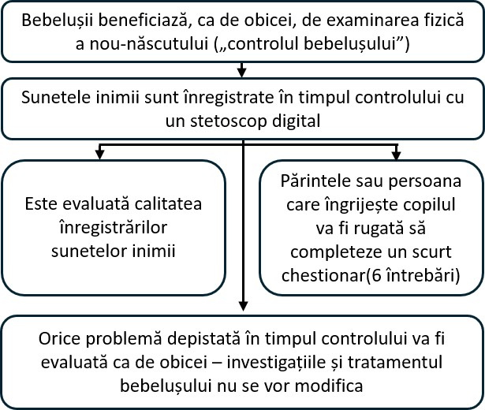

::: {style="text-align: center;"}
<b>Înregistrări digitale ale sunetelor inimii la bebeluși în timpul examinării fizice a nou-născutului: studiul babyPHONO</b>

{width="50%" fig-align="center"} {width="50%" fig-align="center"}

{height="200px"}

 
:::

::: {style="text-align: left;"}
Dorim să vă invităm pe dumneavoastră și pe bebelușul dumneavoastră să participați la studiul nostru de cercetare. Înainte de a lua o decizie, dorim să înțelegeți de ce se desfășoară această cercetare și ce va presupune participarea.     Un membru al echipei noastre va parcurge împreună cu dumneavoastră aceste informații și vă va răspunde la întrebări. Vă rugăm să ne întrebați dacă ceva nu este clar sau dacă doriți mai multe informații.     Luați-vă timpul necesar pentru a decide dacă doriți ca bebelușul dumneavoastră să participe. Participarea este complet voluntară.

<b>De ce desfășurăm această cercetare?</b>

Tuturor bebelușilor li se oferă o „examinare fizică a nou-născutului”, numită uneori „controlul bebelușului”. Această broșură explică cercetarea pe care o desfășurăm pentru a vedea dacă putem îmbunătăți capacitatea acestei examinări de a depista probleme ale inimii.     Mai puțin de 1 din 100 de bebeluși are o problemă de structură a inimii. Dacă o depistăm devreme, este posibil să o putem trata mai eficient. Dorim să vedem dacă putem înregistra sunetele inimii bebelușilor pentru a ajuta la depistarea problemelor cardiace.     Sperăm să includem în această cercetare cel puțin 200 de bebeluși de la Jessop Wing. Dacă acest studiu are succes, sperăm că va conduce la alte studii care, în viitor, ne vor ajuta să depistăm mai eficient problemele cardiace la bebeluși.
:::

::: {style="text-align: center;"}
{width="50%" fig-align="center"}
:::

::: {style="text-align: left;"}
<b>Este obligatoriu să participați la această cercetare?</b>

Nu. Decizia de a participa vă aparține, iar neparticiparea nu va afecta îngrijirea dumneavoastră sau a bebelușului. Vă puteți retrage din studiu în orice moment, fără a fi necesar să precizați un motiv.  
:::

::: {style="text-align: left;"}
<b>Ce se va întâmpla cu dumneavoastră și cu bebelușul dacă participați la această cercetare?</b>

Această cercetare urmărește să înregistreze sunetele inimii bebelușilor folosind un stetoscop digital. Scopul este să aflăm dacă putem utiliza inteligența artificială pentru a ajuta la depistarea problemelor cardiace pe baza înregistrărilor.

Dacă decideți să participați, vi se va cere să semnați formularul de consimțământ. Persoana care vă examinează bebelușul va înregistra sunetele inimii cu un stetoscop digital. Acest lucru se va face în timpul examinării fizice complete a nou-născutului. După încheierea examinării, vi se va cere să completați un chestionar foarte scurt, cu 6 întrebări.

În acest studiu de cercetare, înregistrarea sunetelor inimii nu va schimba modul în care este îngrijit bebelușul. Acesta va primi aceeași îngrijire și toate investigațiile imagistice sau tratamentele necesare pe care le-ar primi dacă nu ar participa la studiu. Majoritatea bebelușilor nu au nevoie de investigații imagistice sau tratament.
:::

::: {style="text-align: left;"}
<b>Rezumatul etapelor parcurse de participanții la acest studiu:</b>
:::

::: {style="text-align: center;"}
{width="80%" fig-align="center"}
:::

::: {style="text-align: left;"}
  <b>Care sunt riscurile acestei cercetări?</b> Stetoscopul digital este foarte asemănător cu un stetoscop obișnuit și nu prezintă niciun risc pentru bebeluș. Stetoscopul are atașat la tub un dispozitiv digital care captează sunetul. Acesta este transmis fără fir către un telefon mobil sau o tabletă. Înregistrarea este apoi stocată online, în „cloud”, folosind un server informatic din Statele Unite ale Americii. Acest dispozitiv a fost aprobat de Agenția de Reglementare a Medicamentelor și Produselor de Îngrijire a Sănătății (MHRA) pentru utilizare în Regatul Unit.

Participarea la această cercetare poate prelungi controlul bebelușului cu aproximativ 2 până la 5 minute. Completarea chestionarului după examinare și convorbirea telefonică de peste un an vă vor ocupa, de asemenea, puțin timp. Există riscul ca personalul medical să introducă din greșeală informații personale în aplicația stetoscopului digital. Pentru a preveni acest risc, informațiile din aplicație vor fi verificate săptămânal, iar echipa de cercetare va șterge orice date care pot permite identificarea unei persoane.
:::

::: {style="text-align: center;"}
{width="50%" fig-align="center"}
:::

::: {style="text-align: left;"}
<b>Care este beneficiul participării la această cercetare?</b>

Participarea la cercetare nu vă va aduce beneficii directe dumneavoastră sau bebelușului. Totuși, sperăm că această cercetare îi va ajuta pe bebelușii care se vor naște în viitor, ajutând medicii să identifice problemele cardiace mai devreme în viață.

<b>Cum vom utiliza informațiile despre dumneavoastră și bebeluș?</b>

Pentru acest proiect de cercetare va trebui să utilizăm informații despre dumneavoastră și bebeluș.

Aceste informații vor include numele și datele dumneavoastră de contact. Vor include, de asemenea, numărul NHS și numărul de identificare din spital, atât ale dumneavoastră, cât și ale bebelușului. Persoanele implicate vor folosi aceste informații pentru a desfășura cercetarea sau pentru a verifica dosarele dumneavoastră, astfel încât să se asigure că cercetarea se desfășoară corect.

Persoanele care nu au nevoie să vă cunoască identitatea nu vor putea vedea numele sau datele dumneavoastră de contact. În schimb, datele dumneavoastră vor fi marcate cu un cod numeric. Înregistrările digitale ale sunetelor inimii și imaginile de la eventualele ecocardiografii (ecografii ale inimii) vor fi păstrate fără nume. Astfel, doar persoanele care știu cui îi corespunde codul de cercetare vor putea ști de la cine provin aceste înregistrări și imagini.

Universitatea din Sheffield (The University of Sheffield) este sponsorul acestei cercetări. Universitatea din Sheffield este responsabilă de protejarea informațiilor dumneavoastră. Vom partaja informațiile dumneavoastră legate de acest proiect de cercetare cu următoarele tipuri de organizații:

• Organizațiile furnizoare de servicii medicale din cadrul NHS care sunt implicate în acest studiu de cercetare.

Vom păstra în siguranță toate informațiile despre dumneavoastră prin următoarele măsuri:

• Păstrarea numelui, a datelor de contact și a numerelor de identificare din spital într-o foaie de calcul protejată prin parolă, pe sistemele informatice securizate ale spitalului Jessop Wing, separat de datele colectate în cadrul studiului.

• Permiterea accesului la foaia de calcul protejată prin parolă numai membrilor echipei de cercetare.

<b>Transferuri internaționale de date</b>

Putem partaja date despre bebeluș în afara Regatului Unit sau putem permite accesul la acestea din afara țării, în scopuri legate de cercetare. Înregistrările sunetelor inimii, informațiile despre vârsta bebelușului și orice diagnostic viitor de probleme cardiace vor fi anonimizate.

Putem partaja date despre dumneavoastră în afara Regatului Unit sau putem permite accesul la acestea din afara țării, în scopuri legate de cercetare, pentru:

• A fi utilizate în cercetări viitoare.

• A contribui la dezvoltarea de software pentru dispozitive medicale.

Dacă partajăm date din această cercetare, vom partaja numai datele necesare. De asemenea, vom face tot posibilul pentru ca bebelușul să nu poată fi identificat din datele partajate. Acest lucru poate să nu fie posibil în anumite situații — de exemplu, dacă bebelușul are o boală rară, ar putea fi în continuare posibilă identificarea sa. Dacă datele bebelușului sunt partajate în afara Regatului Unit, destinatarii vor fi următoarele tipuri de organizații:

• Organizații de cercetare.

• Organizații din domeniul tehnologiei medicale.

• Organizații de dezvoltare software.

Ne vom asigura că datele bebelușului sunt protejate. Orice persoană care accesează datele bebelușului în afara Regatului Unit trebuie să respecte instrucțiunile noastre, astfel încât datele să beneficieze de un nivel de protecție similar celui prevăzut de legislația Regatului Unit. Vom asigura siguranța datelor bebelușului în afara Regatului Unit prin următoarele măsuri:

Pentru unele dintre țările în care vor fi partajate datele bebelușului există o decizie privind caracterul adecvat al nivelului de protecție a datelor. Aceasta înseamnă că știm că legile lor oferă un nivel de protecție similar celui oferit de legislația privind protecția datelor din Regatul Unit.

Utilizăm contracte specifice, aprobate pentru utilizare în Regatul Unit, care oferă datelor cu caracter personal același nivel de protecție ca în Regatul Unit. Pentru mai multe detalii, vizitați site-ul Biroului Comisarului pentru Informații (ICO): <https://ico.org.uk/for-organisations/uk-gdpr-guidance-and-resources/international-transfers/>

Nu le permitem celor care accesează datele bebelușului în afara Regatului Unit să le utilizeze în alte scopuri decât cele prevăzute în contractul nostru scris cu ei. Solicităm celorlalte organizații să aibă măsuri de securitate adecvate pentru protejarea datelor bebelușului, în concordanță cu obligațiile noastre privind securitatea și confidențialitatea datelor. Acestea includ măsuri adecvate pentru protejarea datelor împotriva pierderii accidentale și a accesului, utilizării, modificării sau partajării neautorizate. Avem proceduri pentru gestionarea oricărei suspiciuni de încălcare a securității datelor cu caracter personal. Dacă securitatea datelor cu caracter personal ale bebelușului este încălcată, vă vom informa pe dumneavoastră și autoritățile de reglementare competente atunci când legea impune acest lucru. Pentru mai multe detalii despre regulile de raportare a acestor încălcări în Regatul Unit, vizitați site-ul Biroului Comisarului pentru Informații (ICO): <https://ico.org.uk/for-organisations/report-a-breach>

Informațiile care permit identificarea unei persoane (inclusiv numele și datele de naștere) nu vor fi niciodată partajate cu persoane din afara echipei de cercetare din Sheffield sau a personalului medical care vă îngrijește pe dumneavoastră ori pe bebeluș. Puteți participa la studiu chiar dacă refuzați partajarea datelor cu terți; această decizie va fi consemnată separat în formularul de consimțământ.

<b>Cum vom utiliza informațiile despre dumneavoastră după încheierea studiului?</b>

După încheierea studiului, vom păstra o parte din date pentru a putea verifica rezultatele. Vom redacta rapoartele astfel încât nimeni să nu poată deduce că bebelușul dumneavoastră a participat la studiu. Vom păstra datele dumneavoastră din studiu pentru cel mult 5 ani. Ulterior, datele vor fi complet anonimizate și arhivate în siguranță sau distruse.

<b>Ce opțiuni aveți în privința utilizării informațiilor dumneavoastră?</b>

Puteți înceta în orice moment participarea dumneavoastră și a bebelușului la studiu, fără a oferi un motiv, dar vom păstra informațiile despre dumneavoastră pe care le avem deja. Aveți dreptul să ne solicitați accesul la datele pe care le deținem despre dumneavoastră în scopul studiului, precum și eliminarea, modificarea sau ștergerea acestora. De asemenea, vă puteți opune prelucrării datelor dumneavoastră. Este posibil să nu putem da întotdeauna curs acestor solicitări dacă acest lucru ar însemna că nu mai putem utiliza datele pentru cercetare. În acest caz, vă vom explica motivul. Dacă sunteți de acord să participați la acest studiu, veți avea opțiunea de a participa la cercetări viitoare care utilizează datele dumneavoastră păstrate din acest studiu.

Unde puteți afla mai multe despre modul în care sunt utilizate informațiile dumneavoastră? Puteți afla mai multe despre modul în care folosim informațiile, inclusiv despre mecanismul specific utilizat pentru transferarea datelor dumneavoastră cu caracter personal în afara Regatului Unit:

• Din broșura noastră: <https://www.hra.nhs.uk/patientdataandresearch>

• Întrebând un membru al echipei de cercetare.

• Trimițând un e-mail la [sth.babyphono\@nhs.net](mailto:sth.babyphono@nhs.net){.email}.

• Telefonând la +447729849599.

<b>Ce fac dacă am alte întrebări despre cercetare?</b>

Dacă aveți întrebări despre studiu, ne puteți contacta folosind adresa de e-mail sau numărul de telefon de pe verso-ul acestei broșuri. De asemenea, puteți adresa întrebări cercetătorului care vine să vă solicite semnarea formularului de consimțământ.

<b>Ce fac dacă am o întrebare sau o reclamație despre îngrijirea medicală primită?</b>

Chestionarele pe care vi se cere să le completați în cadrul acestui studiu nu trebuie utilizate pentru a semnala îngrijorări de natură medicală privind îngrijirea dumneavoastră sau a bebelușului. Dacă aveți o întrebare sau o reclamație despre îngrijirea medicală primită, discutați cu personalul medical care vă îngrijește sau solicitați informații despre serviciul de consiliere și legătură cu pacienții (PALS).

<b>Ce fac dacă am o reclamație despre cercetare?</b>

Dacă sunteți nemulțumit(ă) și doriți să faceți o reclamație, vă rugăm să luați mai întâi legătura cu dr. Alys Griffiths ([alys.griffiths\@sheffield.ac.uk](mailto:alys.griffiths@sheffield.ac.uk){.email}). Dacă considerați că reclamația nu a fost soluționată în mod satisfăcător, puteți lua legătura cu prof. Heather Mortiboys la [h.mortiboys\@sheffield.ac.uk](mailto:h.mortiboys@sheffield.ac.uk){.email} sau la 0114 222 2290.

Dacă reclamația privește modul în care au fost gestionate datele dumneavoastră cu caracter personal, puteți găsi informații despre depunerea unei reclamații în notificarea Universității privind confidențialitatea: <https://www.sheffield.ac.uk/govern/data-protection/privacy/general>.

Dacă doriți să raportați o îngrijorare sau un incident legat de o posibilă exploatare, un abuz sau un prejudiciu rezultat din participarea la acest proiect, vă rugăm să contactați persoana desemnată pentru protecția împotriva abuzului și vătămării, dr. Haris Stavroulakis ([t.stavroulakis\@sheffield.ac.uk](mailto:t.stavroulakis@sheffield.ac.uk){.email}). Dacă îngrijorările persistă, vă rugăm să contactați managerul pentru etica și integritatea cercetării, Lindsay Unwin ([l.v.unwin\@sheffield.ac.uk](mailto:l.v.unwin@sheffield.ac.uk){.email}).

<b>A fost această cercetare aprobată de un comitet de etică?</b>

Cercetarea a fost evaluată de Comitetul de Etică a Cercetării din Sud-Estul Scoției 1 (South East Scotland Research Ethics Committee 1). Numărul de referință al cercetării este: 358145.

Vă mulțumim că luați în considerare participarea la această cercetare.

Pentru informații suplimentare despre acest studiu de cercetare, vă rugăm să ne contactați:

E-mail:\
[sth.babyphono\@nhs.net](mailto:sth.babyphono@nhs.net){.email}\
Numărul de telefon al studiului:\
+447729849599

Acest studiu de cercetare se desfășoară la: spitalul Jessop Wing Hospital, Tree Root Walk, Broomhall, Sheffield, S10 2SF.  
:::

::: {style="text-align: center;"}
{width="50%" fig-align="center"}
:::

::: {style="text-align: left;"}
    Sponsorul acestui studiu de cercetare este: Universitatea din Sheffield (The University of Sheffield), Western Bank, Sheffield, S10 2TN.

Responsabil cu protecția datelor:\
Luke Thompson\
[dataprotection\@sheffield.ac.uk](mailto:dataprotection@sheffield.ac.uk){.email}\
+44 114 222 1117  
:::

::: {style="text-align: center;"}
{width="50%" fig-align="center"}  
:::

::: {style="text-align: left;"}
Acest studiu de cercetare este finanțat de: organizația caritabilă Sheffield Children’s Hospital Charity, 4 Marlborough Rd, Sheffield, S10 1DB.  
:::

::: {style="text-align: center;"}
{width="50%" fig-align="center"}  
:::
