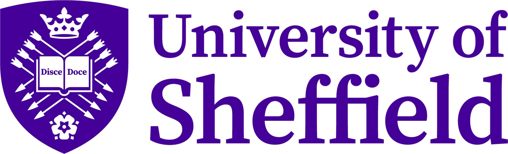
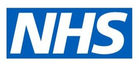
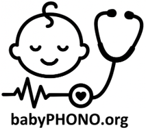
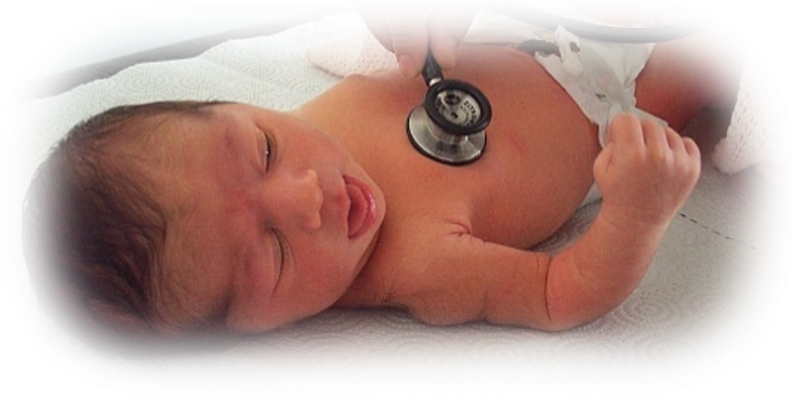
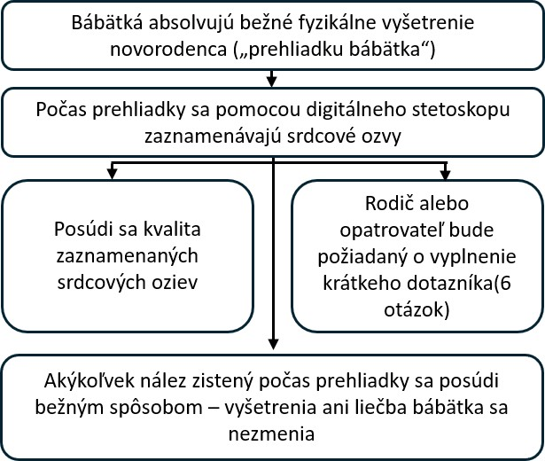
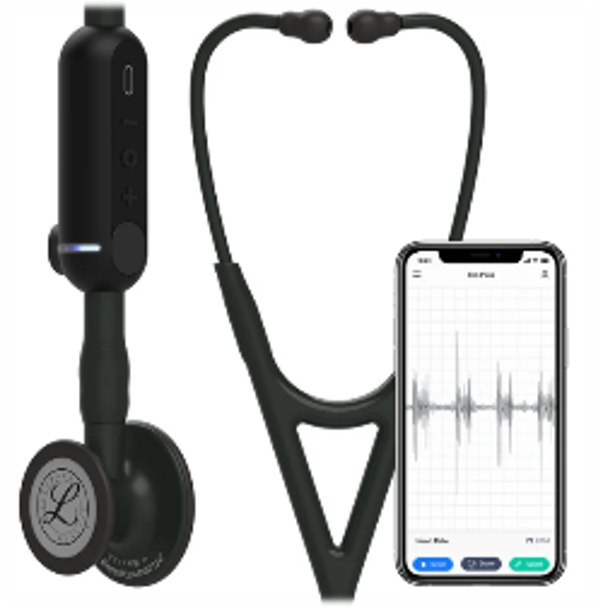
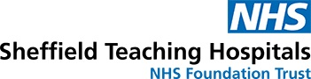
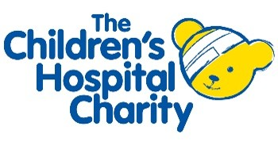

::: {style="text-align: center;"}
<b>Digitálne zaznamenávanie srdcových oziev u bábätiek počas fyzikálneho vyšetrenia novorodenca: štúdia babyPHONO</b>

{width="50%" fig-align="center"} {width="50%" fig-align="center"}

{height="200px"}

 
:::

::: {style="text-align: left;"}
Radi by sme vás a vaše bábätko pozvali na účasť v našej výskumnej štúdii. Skôr než sa rozhodnete, chceme, aby ste porozumeli tomu, prečo sa výskum uskutočňuje a čo bude účasť zahŕňať.     Jeden z členov nášho tímu s vami prejde tieto informácie a odpovie na vaše otázky. Ak vám niečo nie je jasné alebo by ste chceli viac informácií, opýtajte sa nás.     Doprajte si čas na rozhodnutie, či chcete, aby sa vaše dieťa zúčastnilo. Účasť je úplne dobrovoľná.

<b>Prečo robíme tento výskum?</b>

Všetkým bábätkám sa ponúka „fyzikálne vyšetrenie novorodenca“, ktoré sa niekedy nazýva „prehliadka bábätka“. Tento leták vysvetľuje výskum, ktorý robíme, aby sme zistili, či môžeme zlepšiť schopnosť tohto vyšetrenia odhaliť problémy so srdcom.     Menej ako 1 zo 100 bábätiek má problém so stavbou srdca. Ak ho odhalíme včas, možno ho budeme môcť liečiť účinnejšie. Chceme zistiť, či môžeme zaznamenávať srdcové ozvy bábätiek, aby sme pomohli odhaliť problémy so srdcom.     Dúfame, že do výskumu zapojíme aspoň 200 bábätiek z pracoviska Jessop Wing. Ak bude táto štúdia úspešná, dúfame, že povedie k ďalším štúdiám, ktoré nám v budúcnosti pomôžu účinnejšie odhaľovať srdcové problémy u bábätiek.
:::

::: {style="text-align: center;"}
{width="50%" fig-align="center"}
:::

::: {style="text-align: left;"}
<b>Musíte sa zúčastniť tohto výskumu?</b>

Nie. Rozhodnutie o účasti je na vás a neúčasť neovplyvní starostlivosť o vás ani o vaše bábätko. Zo štúdie môžete kedykoľvek odstúpiť a nemusíte uviesť dôvod.  
:::

::: {style="text-align: left;"}
<b>Čo sa bude diať s vami a vaším bábätkom, ak sa zúčastníte tohto výskumu?</b>

Cieľom tohto výskumu je zaznamenať srdcové ozvy bábätiek pomocou digitálneho stetoskopu. Chceme tak zistiť, či môžeme pomocou umelej inteligencie odhaľovať zo záznamov problémy so srdcom.

Ak sa rozhodnete zúčastniť, požiadame vás o podpísanie formulára informovaného súhlasu. Osoba, ktorá vyšetruje vaše bábätko, zaznamená jeho srdcové ozvy pomocou digitálneho stetoskopu. Urobí to počas úplného fyzikálneho vyšetrenia novorodenca. Po skončení vyšetrenia vás požiadame o vyplnenie veľmi krátkeho dotazníka so 6 otázkami.

V tejto výskumnej štúdii zaznamenávanie srdcových oziev nezmení postup starostlivosti o vaše bábätko. Dostane rovnakú starostlivosť a všetky potrebné zobrazovacie vyšetrenia alebo liečbu, ako keby sa štúdie nezúčastnilo. Väčšina bábätiek nepotrebuje žiadne zobrazovacie vyšetrenia ani liečbu.
:::

::: {style="text-align: left;"}
<b>Prehľad toho, čo čaká účastníkov tejto štúdie:</b>
:::

::: {style="text-align: center;"}
{width="80%" fig-align="center"}
:::

::: {style="text-align: left;"}
  <b>Aké sú riziká tohto výskumu?</b> Digitálny stetoskop je veľmi podobný bežnému stetoskopu a nepredstavuje pre vaše bábätko žiadne riziko. Na hadičke stetoskopu je pripevnené digitálne zariadenie, ktoré zachytáva zvuk. Ten sa bezdrôtovo prenáša do mobilného telefónu alebo tabletu. Záznam sa potom uloží online do „cloudu“ pomocou počítačového servera v Spojených štátoch amerických. Toto zariadenie schválila na používanie v Spojenom kráľovstve Agentúra pre reguláciu liekov a zdravotníckych pomôcok (MHRA).

Účasť na tomto výskume môže znamenať, že prehliadka bábätka bude trvať približne o 2 až 5 minút dlhšie. Vyplnenie dotazníka po vyšetrení a telefonický rozhovor o rok vám tiež zaberú trochu času. Existuje riziko, že zdravotnícki pracovníci omylom zadajú osobné údaje do aplikácie digitálneho stetoskopu. Informácie v tejto aplikácii sa budú kontrolovať každý týždeň a výskumný tím vymaže všetky údaje umožňujúce identifikáciu osoby, aby sa predišlo tomuto riziku.
:::

::: {style="text-align: center;"}
{width="50%" fig-align="center"}
:::

::: {style="text-align: left;"}
<b>Aký je prínos účasti na tomto výskume?</b>

Účasť na výskume neprinesie priamy úžitok vám ani vášmu bábätku. Dúfame však, že tento výskum pomôže deťom narodeným v budúcnosti tým, že lekárom umožní odhaliť problémy so srdcom skôr v živote.

<b>Ako budeme používať informácie o vás a vašom bábätku?</b>

Na účely tohto výskumného projektu budeme potrebovať informácie o vás a vašom bábätku.

Tieto informácie budú zahŕňať vaše meno a kontaktné údaje. Budú zahŕňať aj vaše číslo NHS a nemocničné identifikačné číslo, ako aj tieto čísla vášho bábätka. Príslušné osoby použijú tieto informácie na vykonávanie výskumu alebo na kontrolu vašich záznamov, aby sa uistili, že výskum prebieha správne.

Osoby, ktoré nepotrebujú poznať vašu totožnosť, nebudú môcť vidieť vaše meno ani kontaktné údaje. Namiesto toho budú vaše údaje označené číselným kódom. Digitálne záznamy srdcových oziev a snímky z prípadných echokardiografických vyšetrení (ultrazvukových vyšetrení srdca) sa budú uchovávať bez mien. Len osoby, ktoré vedia, ku komu príslušný výskumný kód patrí, tak budú vedieť, od koho tieto záznamy a snímky pochádzajú.

Zadávateľom tohto výskumu je Sheffieldská univerzita (The University of Sheffield). Sheffieldská univerzita zodpovedá za ochranu vašich informácií. Vaše informácie súvisiace s týmto výskumným projektom budeme poskytovať týmto typom organizácií:

• Organizáciám poskytujúcim zdravotnú starostlivosť v rámci NHS, ktoré sa podieľajú na tejto výskumnej štúdii.

Všetky informácie o vás budeme chrániť a zabezpečovať takto:

• Vaše meno, kontaktné údaje a nemocničné identifikačné čísla budeme uchovávať v tabuľkovom súbore chránenom heslom v zabezpečených počítačových systémoch nemocnice Jessop Wing, oddelene od údajov získaných v rámci štúdie.

• Prístup k tabuľkovému súboru chránenému heslom budú mať len členovia výskumného tímu.

<b>Medzinárodné prenosy údajov</b>

Na účely súvisiace s výskumom môžeme údaje o vašom bábätku poskytovať mimo Spojeného kráľovstva alebo k nim umožniť prístup zo zahraničia. Zaznamenané srdcové ozvy, informácie o veku vášho bábätka a prípadné budúce diagnózy srdcových problémov budú anonymizované.

Na účely súvisiace s výskumom môžeme údaje o vás poskytovať mimo Spojeného kráľovstva alebo k nim umožniť prístup zo zahraničia s cieľom:

• Použiť ich v budúcom výskume.

• Pomôcť pri vývoji softvéru pre zdravotnícke pomôcky.

Ak budeme poskytovať údaje z tohto výskumu, poskytneme len tie, ktoré sú potrebné. Zároveň podľa možností zabezpečíme, aby z poskytnutých údajov nebolo možné zistiť totožnosť vášho bábätka. Za určitých okolností to nemusí byť možné – napríklad ak má vaše bábätko zriedkavé ochorenie, stále môže byť možné zistiť jeho totožnosť. Ak budú údaje o vašom bábätku poskytnuté mimo Spojeného kráľovstva, pôjde o tieto typy organizácií:

• Výskumné organizácie.

• Organizácie pôsobiace v oblasti zdravotníckych technológií.

• Organizácie zaoberajúce sa vývojom softvéru.

Zabezpečíme ochranu údajov vášho bábätka. Každý, kto má prístup k údajom vášho bábätka mimo Spojeného kráľovstva, musí dodržiavať naše pokyny, aby tieto údaje mali podobnú úroveň ochrany, akú im poskytuje právo Spojeného kráľovstva. Bezpečnosť údajov vášho bábätka mimo Spojeného kráľovstva zabezpečíme nasledujúcimi opatreniami:

Pre niektoré krajiny, do ktorých budú údaje vášho bábätka poskytnuté, platí rozhodnutie o primeranosti ochrany údajov. To znamená, že vieme, že ich zákony poskytujú podobnú úroveň ochrany ako právne predpisy o ochrane údajov v Spojenom kráľovstve.

Používame osobitné zmluvy schválené na používanie v Spojenom kráľovstve, ktoré osobným údajom zabezpečujú rovnakú úroveň ochrany, akú majú v Spojenom kráľovstve. Ďalšie podrobnosti nájdete na webovej stránke Úradu komisára pre informácie (ICO): <https://ico.org.uk/for-organisations/uk-gdpr-guidance-and-resources/international-transfers/>

Osobám, ktoré majú prístup k údajom vášho bábätka mimo Spojeného kráľovstva, neumožňujeme používať ich na iné účely, než sú uvedené v našej písomnej zmluve s nimi. Od ostatných organizácií vyžadujeme primerané bezpečnostné opatrenia na ochranu údajov vášho bábätka, ktoré sú v súlade s našimi povinnosťami v oblasti bezpečnosti a dôvernosti údajov. Patrí sem aj prijatie primeraných opatrení na ochranu vašich údajov pred náhodnou stratou a neoprávneným prístupom, používaním, zmenami alebo poskytovaním. Máme zavedené postupy na riešenie akéhokoľvek podozrenia na porušenie ochrany osobných údajov. Ak dôjde k porušeniu ochrany osobných údajov vášho bábätka, budeme o tom informovať vás a príslušné dozorné orgány, keď to vyžaduje zákon. Ďalšie podrobnosti o pravidlách oznamovania takýchto porušení v Spojenom kráľovstve nájdete na webovej stránke Úradu komisára pre informácie (ICO): <https://ico.org.uk/for-organisations/report-a-breach>

Informácie umožňujúce identifikáciu osoby (vrátane mien a dátumov narodenia) nikdy neposkytneme nikomu mimo výskumného tímu v Sheffielde alebo zdravotníckych pracovníkov, ktorí sa starajú o vás alebo vaše bábätko. Štúdie sa môžete zúčastniť aj vtedy, ak odmietnete poskytovanie údajov tretím stranám. Toto rozhodnutie bude uvedené samostatne vo vašom formulári súhlasu.

<b>Ako budeme používať informácie o vás po skončení štúdie?</b>

Po skončení štúdie si ponecháme časť údajov, aby sme mohli skontrolovať výsledky. Naše správy napíšeme tak, aby nikto nemohol zistiť, že sa vaše bábätko zúčastnilo štúdie. Vaše údaje zo štúdie budeme uchovávať najviac 5 rokov. Potom budú úplne anonymizované a bezpečne archivované alebo zničené.

<b>Aké máte možnosti pri rozhodovaní o používaní vašich informácií?</b>

Svoju účasť aj účasť vášho bábätka na štúdii môžete kedykoľvek ukončiť bez uvedenia dôvodu, ale informácie o vás, ktoré už máme, si ponecháme. Máte právo požiadať nás o prístup k údajom, ktoré o vás uchovávame na účely štúdie, alebo o ich odstránenie, zmenu či vymazanie. Môžete tiež namietať proti spracúvaniu svojich údajov. Nie vždy však budeme môcť vašej žiadosti vyhovieť, ak by to znamenalo, že vaše údaje nebudeme môcť použiť na výskum. V takom prípade vám vysvetlíme, prečo žiadosti nemôžeme vyhovieť. Ak súhlasíte s účasťou na tejto štúdii, budete mať možnosť zúčastniť sa budúceho výskumu, pri ktorom sa použijú vaše údaje uložené z tejto štúdie.

Kde sa môžete dozvedieť viac o používaní vašich informácií? Viac o tom, ako používame vaše informácie, vrátane konkrétneho mechanizmu, ktorý používame pri prenose vašich osobných údajov mimo Spojeného kráľovstva, sa môžete dozvedieť:

• V našom informačnom letáku: <https://www.hra.nhs.uk/patientdataandresearch>

• Od člena výskumného tímu.

• E-mailom na adrese [sth.babyphono\@nhs.net](mailto:sth.babyphono@nhs.net){.email}.

• Telefonicky na čísle +447729849599.

<b>Čo ak mám ďalšie otázky o výskume?</b>

Ak máte akékoľvek otázky o štúdii, môžete nás kontaktovať prostredníctvom e-mailovej adresy alebo telefónneho čísla na zadnej strane tohto letáka. Otázky môžete položiť aj výskumníkovi, ktorý vás príde požiadať o podpísanie formulára súhlasu.

<b>Čo ak mám otázku alebo sťažnosť týkajúcu sa poskytnutej zdravotnej starostlivosti?</b>

Žiadny dotazník, ktorý budete počas štúdie vypĺňať, by sa nemal používať na oznamovanie obáv týkajúcich sa zdravotnej starostlivosti o vás alebo vaše bábätko. Ak máte otázku alebo sťažnosť týkajúcu sa vašej zdravotnej starostlivosti, obráťte sa na zdravotníckych pracovníkov, ktorí sa o vás starajú, alebo požiadajte o informácie o poradenskej a kontaktnej službe pre pacientov (PALS).

<b>Čo ak mám sťažnosť týkajúcu sa výskumu?</b>

Ak nie ste spokojní a chcete podať sťažnosť, obráťte sa najprv na Dr Alys Griffiths ([alys.griffiths\@sheffield.ac.uk](mailto:alys.griffiths@sheffield.ac.uk){.email}). Ak sa domnievate, že vaša sťažnosť nebola vybavená uspokojivo, môžete kontaktovať profesorku Heather Mortiboys na adrese [h.mortiboys\@sheffield.ac.uk](mailto:h.mortiboys@sheffield.ac.uk){.email} alebo na čísle 0114 222 2290.

Ak sa sťažnosť týka nakladania s vašimi osobnými údajmi, informácie o jej podaní nájdete v oznámení univerzity o ochrane súkromia: <https://www.sheffield.ac.uk/govern/data-protection/privacy/general>.

Ak chcete oznámiť obavu alebo incident súvisiaci s možným vykorisťovaním, zneužívaním alebo ujmou v dôsledku vašej účasti na tomto projekte, obráťte sa na určenú kontaktnú osobu pre ochranu pred ujmou, Dr Haris Stavroulakis ([t.stavroulakis\@sheffield.ac.uk](mailto:t.stavroulakis@sheffield.ac.uk){.email}). Ak vaše obavy pretrvávajú, obráťte sa na manažérku pre etiku a integritu výskumu Lindsay Unwin ([l.v.unwin\@sheffield.ac.uk](mailto:l.v.unwin@sheffield.ac.uk){.email}).

<b>Bol tento výskum schválený etickou komisiou?</b>

Výskum posúdila Etická komisia pre výskum juhovýchodného Škótska 1 (South East Scotland Research Ethics Committee 1). Referenčné číslo výskumu je: 358145.

Ďakujeme, že zvažujete účasť na tomto výskume.

Ak potrebujete ďalšie informácie o tejto výskumnej štúdii, kontaktujte nás:

E-mail:\
[sth.babyphono\@nhs.net](mailto:sth.babyphono@nhs.net){.email}\
Telefónne číslo štúdie:\
+447729849599

Táto výskumná štúdia prebieha v nemocnici Jessop Wing Hospital, na adrese Tree Root Walk, Broomhall, Sheffield, S10 2SF.  
:::

::: {style="text-align: center;"}
{width="50%" fig-align="center"}
:::

::: {style="text-align: left;"}
    Zadávateľom tejto výskumnej štúdie je: Sheffieldská univerzita (The University of Sheffield), Western Bank, Sheffield, S10 2TN.

Zodpovedná osoba pre ochranu osobných údajov:\
Luke Thompson\
[dataprotection\@sheffield.ac.uk](mailto:dataprotection@sheffield.ac.uk){.email}\
+44 114 222 1117  
:::

::: {style="text-align: center;"}
{width="50%" fig-align="center"}  
:::

::: {style="text-align: left;"}
Túto výskumnú štúdiu financuje: charitatívna organizácia Sheffield Children’s Hospital Charity, 4 Marlborough Rd, Sheffield, S10 1DB.  
:::

::: {style="text-align: center;"}
{width="50%" fig-align="center"}  
:::
