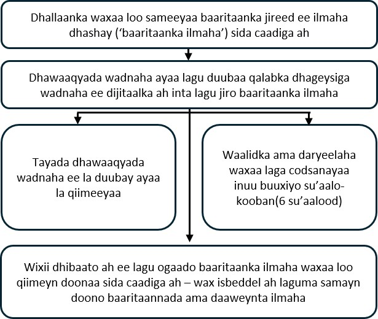

::: {style="text-align: center;"}
<b>Duubista dijitaalka ah ee dhawaaqyada wadnaha dhallaanka inta lagu jiro baaritaanka jireed ee ilmaha dhashay: daraasadda babyPHONO</b>

{width="50%" fig-align="center"} {width="50%" fig-align="center"}

{height="200px"}

 
:::

::: {style="text-align: left;"}
Waxaan jeclaan lahayn inaan adiga iyo ilmahaaga ku martiqaadno inaad ka qayb qaadataan daraasaddeenna cilmi-baarista. Ka hor intaadan go'aan gaarin, waxaan jeclaan lahayn inaad fahanto sababta cilmi-baaristan loo samaynayo iyo waxa ka qaybqaadashadu ku lug yeelan doonto.     Xubin ka tirsan kooxdayada ayaa macluumaadkan kula eegi doona oo ka jawaabi doona su'aalaha aad qabto. Na weydii haddii ay jiraan wax aan caddayn ama haddii aad rabto macluumaad dheeraad ah.     Waqti qaado si aad u go'aansato inaad rabto in ilmahaagu ka qayb qaato iyo in kale. Ka qaybqaadashadu gebi ahaanba waa ikhtiyaari.

<b>Maxaan u samaynaynaa cilmi-baaristan?</b>

Dhammaan dhallaanka waxaa loo soo bandhigaa ‘baaritaanka jireed ee ilmaha dhashay’, oo mararka qaarkood loo yaqaan ‘baaritaanka ilmaha’. Warqaddani waxay sharxaysaa cilmi-baaris aan samaynayno si aan u ogaano haddii aan baaritaankan ka dhigi karno mid si ka wanaagsan u ogaada dhibaatooyinka wadnaha.     In ka yar 1 ka mid ah 100-kii dhallaan ayaa qaba dhibaato ku saabsan qaab-dhismeedka wadnaha. Haddii aan goor hore ogaanno, waxaa suurtagal ah inaan si ka waxtar badan u daaweyno. Waxaan rabnaa inaan aragno haddii aan duubi karno dhawaaqyada wadnaha dhallaanka si ay uga caawiyaan ogaanshaha dhibaatooyinka wadnaha.     Waxaan rajaynaynaa inaan ugu yaraan 200 oo dhallaan oo ka socda Jessop Wing ku darno cilmi-baaristan. Haddii daraasaddani guulaysato, waxaan rajaynaynaa inay horseeddo daraasado kale oo mustaqbalka naga caawiya inaan si ka waxtar badan u ogaanno dhibaatooyinka wadnaha dhallaanka.
:::

::: {style="text-align: center;"}
{width="50%" fig-align="center"}
:::

::: {style="text-align: left;"}
<b>Ma khasab baa inaad ka qayb qaadato cilmi-baaristan?</b>

Maya. Go'aanka ka qaybqaadashadu adiga ayuu kuu yaallaa, ka qaybqaadasho la'aantuna ma saamayn doonto daryeelkaaga ama daryeelka ilmahaaga. Waad ka bixi kartaa daraasadda wakhti kasta, mana aha inaad sheegto sababta aad uga baxayso.  
:::

::: {style="text-align: left;"}
<b>Maxaa ku dhici doona adiga iyo ilmahaaga haddii aad ka qayb qaadataan cilmi-baaristan?</b>

Cilmi-baaristan waxay ujeeddadeedu tahay in la duubo dhawaaqyada wadnaha dhallaanka iyadoo la adeegsanayo qalabka dhageysiga wadnaha ee dijitaalka ah (stethoscope). Tani waxay naga caawinaysaa inaan ogaano haddii garaadka macmalka ah loo adeegsan karo in lagu ogaado dhibaatooyinka wadnaha iyadoo la adeegsanayo duubista.

Haddii aad go'aansato inaad ka qayb qaadato, waxaa lagaa codsan doonaa inaad saxiixdo foomka oggolaanshaha. Qofka baaraya ilmahaaga ayaa duubi doona dhawaaqyada wadnaha isagoo adeegsanaya qalabka dhageysiga wadnaha ee dijitaalka ah. Tani waxay dhici doontaa inta lagu jiro baaritaanka jireed ee dhammaystiran ee ilmaha dhashay. Marka baaritaanku dhammaado, waxaa lagaa codsan doonaa inaad buuxiso xog-ururin aad u gaaban oo ka kooban 6 su'aalood.

Daraasaddan cilmi-baarista ah gudaheeda, duubista dhawaaqyada wadnuhu ma beddeli doonto sida ilmahaaga loo daryeelo. Ilmahaagu wuxuu weli heli doonaa isla daryeelkii iyo wixii baaritaanno sawir-qaadis ama daaweyn ah ee lagama maarmaanka u ahaa ee uu heli lahaa haddii uusan daraasadda ku jirin. Dhallaanka intooda badan uma baahna baaritaanno sawir-qaadis ama daaweyn.
:::

::: {style="text-align: left;"}
<b>Soo koobidda waxa ku dhacaya ka qaybgalayaasha daraasaddan:</b>
:::

::: {style="text-align: center;"}
{width="80%" fig-align="center"}
:::

::: {style="text-align: left;"}
  <b>Waa maxay khataraha cilmi-baaristan?</b> Qalabka dhageysiga wadnaha ee dijitaalka ah wuxuu aad ugu eg yahay kan caadiga ah, mana keenayo wax khatar ah oo ilmahaaga soo gaarta. Tuubbada qalabka waxaa ku xiran aalad dijitaal ah oo qabata dhawaaqa. Dhawaaqa waxaa si bilaa fiilo ah loogu gudbiyaa taleefan gacanta ah ama tablet. Duubista ayaa markaas lagu kaydiyaa internetka, meel loo yaqaan ‘daruurta’ (cloud), iyadoo la adeegsanayo server kombiyuutar oo ku yaal Maraykanka. Hay'adda Nidaaminta Daawooyinka iyo Alaabooyinka Daryeelka Caafimaadka (MHRA) ayaa qalabkan u oggolaatay in lagu isticmaalo Boqortooyada Midowday (UK).

Ka qaybqaadashada cilmi-baaristan waxay keeni kartaa in baaritaanka ilmaha uu qaato qiyaastii 2 ilaa 5 daqiiqo oo dheeraad ah. Buuxinta xog-ururinta baaritaanka ka dib iyo ka jawaabidda wicitaan taleefan hal sano ka dib waxay sidoo kale qaadan doonaan waqti yar. Waxaa jirta khatar ah in shaqaalaha caafimaadku si kama' ah ugu qoraan macluumaad shakhsiyeed barnaamijka qalabka dhageysiga wadnaha ee dijitaalka ah. Si khatartan looga hortago, macluumaadka ku jira barnaamijka waxaa la eegi doonaa toddobaad kasta, kooxda cilmi-baaristuna waxay tirtiri doontaa wixii xog ah ee qof lagu aqoonsan karo.
:::

::: {style="text-align: center;"}
{width="50%" fig-align="center"}
:::

::: {style="text-align: left;"}
<b>Waa maxay faa'iidada ka qaybqaadashada cilmi-baaristan?</b>

Ka qaybqaadashada cilmi-baaristu si toos ah faa'iido uguma keenayso adiga ama ilmahaaga. Si kastaba ha ahaatee, waxaan rajaynaynaa in cilmi-baaristani ay caawin doonto dhallaanka mustaqbalka dhalan doona, iyadoo dhakhaatiirta ka caawinaysa inay dhibaatooyinka wadnaha ogaadaan xilli hore oo nolosha ah.

<b>Sideen u adeegsan doonnaa macluumaadka adiga iyo ilmahaaga idinku saabsan?</b>

Waxaan u baahan doonnaa inaan macluumaad adiga iyo ilmahaaga idinku saabsan u adeegsanno mashruucan cilmi-baarista.

Macluumaadkani wuxuu ka koobnaan doonaa magacaaga iyo faahfaahinta lagala soo xiriiri karo. Waxa kale oo ku jiri doona lambarkaaga NHS iyo lambarkaaga isbitaalka, iyo sidoo kale lambarradaas ilmahaaga. Dadka ay khusayso waxay macluumaadkan u adeegsan doonaan inay cilmi-baarista sameeyaan ama ay diiwaannadaada hubiyaan si loo xaqiijiyo in cilmi-baarista si sax ah loo wado.

Dadka aan u baahnayn inay ogaadaan qofka aad tahay ma arki doonaan magacaaga ama faahfaahinta lagala soo xiriiri karo. Halkii, xogtaada waxaa lagu calaamadin doonaa lambar kood ah. Duubista dijitaalka ah ee dhawaaqyada wadnaha iyo sawirrada ka soo baxa baaritaan kasta oo echocardiogram ah (baaritaanka wadnaha ee ultrasound-ka) waxaa la kaydin doonaa iyagoo aan magacyo lahayn. Sidaas darteed, keliya dadka garanaya qofka lambarka koodka cilmi-baaristu u taagan yahay ayaa ogaan kara qofka ay ka yimaadeen.

Jaamacadda Sheffield (The University of Sheffield) ayaa ah hay'adda mas'uulka ka ah cilmi-baaristan (sponsor). Jaamacadda Sheffield ayaa mas'uul ka ah ilaalinta macluumaadkaaga. Macluumaadkaaga la xiriira mashruucan cilmi-baarista waxaan la wadaagi doonnaa noocyadan hay'adaha:

• Hay'adaha adeegyada caafimaadka ee NHS ee ku lug leh daraasaddan cilmi-baarista.

Waxaan dhammaan macluumaadkaaga ku ilaalin doonnaa badbaado iyo ammaan annagoo:

• Magacaaga, faahfaahinta lagala soo xiriiri karo iyo lambarrada isbitaalka ku hayna jadwal kombiyuutar (spreadsheet) oo furaha sirta ah lagu ilaaliyo, kuna jira nidaamyada kombiyuutarka ee ammaan ah ee Isbitaalka Jessop Wing. Waxaa si gooni ah looga hayn doonaa xogta lagu ururiyo daraasadda.

• U oggolaanayna oo keliya xubnaha kooxda cilmi-baarista inay galaan jadwalkaas furaha sirta ah lagu ilaaliyo.

<b>Gudbinta xogta ee caalamiga ah</b>

Waxaan xogta ilmahaaga la wadaagi karnaa dad ama hay'ado ka baxsan UK ama waxaan u oggolaan karnaa inay helaan, ujeeddooyin la xiriira cilmi-baarista awgood. Duubista dhawaaqyada wadnaha, macluumaadka da'da ilmahaaga iyo wixii mustaqbalka laga ogaado ee dhibaatooyinka wadnaha waxaa laga saari doonaa faahfaahinta aqoonsiga.

Waxaan xogtaada la wadaagi karnaa dad ama hay'ado ka baxsan UK ama waxaan u oggolaan karnaa inay helaan, ujeeddooyin la xiriira cilmi-baarista awgood, si:

• Loogu isticmaalo cilmi-baaris mustaqbalka ah.

• Looga caawiyo samaynta barnaamijyada kombiyuutarka ee qalabka caafimaadka.

Haddii aan wadaagno xogta cilmi-baaristan, waxaan wadaagi doonnaa oo keliya xogta loo baahan yahay. Waxaan sidoo kale, intii suurtagal ah, hubin doonnaa inaan ilmahaaga laga aqoonsan karin xogta la wadaago. Tani waxaa laga yaabaa inaysan suurtagal ahayn xaaladaha qaarkood — tusaale ahaan, haddii ilmahaagu qabo cudur dhif ah, waxaa weli suurtagal noqon karta in la aqoonsado. Haddii xogta ilmahaaga lala wadaago dad ama hay'ado ka baxsan UK, waxay noqon doonaan noocyadan hay'adaha:

• Hay'adaha cilmi-baarista.

• Hay'adaha tignoolajiyada caafimaadka.

• Hay'adaha samaynta barnaamijyada kombiyuutarka.

Waxaan hubin doonnaa in xogta ilmahaaga la ilaaliyo. Qof kasta oo xogta ilmahaaga ka hela meel ka baxsan UK waa inuu raacaa tilmaamahayaga, si xogta ilmahaaga ay u hesho ilaalin u dhow tan sharciga UK bixiyo. Waxaan xogta ilmahaaga ku ilaalin doonnaa meelaha ka baxsan UK annagoo samaynayna waxyaabahan:

Qaar ka mid ah dalalka xogta ilmahaaga lala wadaagi doono waxaa laga gaaray go'aan rasmi ah oo sheegaya inay leeyihiin heer ku filan oo ilaalinta xogta ah (adequacy decision). Taas macnaheedu waa inaan ognahay in sharciyadoodu bixiyaan ilaalin u dhow tan sharciyada ilaalinta xogta ee UK.

Waxaan adeegsannaa heshiisyo gaar ah oo loo ansixiyey in lagu isticmaalo UK, kuwaas oo xogta shakhsiga ah siiya ilaalin la mid ah tan ay ku hesho UK. Faahfaahin dheeraad ah ka eeg bogga Xafiiska Guddoomiyaha Macluumaadka (ICO): <https://ico.org.uk/for-organisations/uk-gdpr-guidance-and-resources/international-transfers/>

Uma oggolaanayno kuwa xogta ilmahaaga ka hela meel ka baxsan UK inay u isticmaalaan ujeeddo aan ahayn tan ku qoran heshiiska qoraalka ah ee aan la galnay. Waxaan hay'adaha kale ka doonaynaa inay yeeshaan tallaabooyin ammaan oo ku habboon ilaalinta xogta ilmahaaga, kuwaas oo waafaqsan waajibaadkayaga ku saabsan amniga iyo sirta xogta. Tani waxaa ka mid ah tallaabooyin ku habboon oo xogtaada looga ilaalinayo inay si kama' ah u lunto ama iyada oo aan la oggolayn la helo, loo isticmaalo, loo beddelo ama loo wadaago. Waxaan leenahay habraacyo lagula tacaalo jebin kasta oo laga shakiyo oo ku timaadda amniga xogta shakhsiga ah. Haddii amniga xogta shakhsiga ah ee ilmahaaga la jebiyo, waxaan adiga iyo hay'adaha nidaaminta ee ay khusayso ku wargelin doonnaa marka sharcigu nagu waajibiyo. Faahfaahin dheeraad ah oo ku saabsan xeerarka UK ee soo sheegidda jebinta amniga xogta ka eeg bogga Xafiiska Guddoomiyaha Macluumaadka (ICO): <https://ico.org.uk/for-organisations/report-a-breach>

Macluumaadka qof lagu aqoonsan karo (oo ay ku jiraan magacyada iyo taariikhaha dhalashada) marnaba lama wadaagi doono qof aan ka tirsanayn kooxda cilmi-baarista ee Sheffield ama shaqaalaha caafimaadka ee daryeelaya adiga ama ilmahaaga. Weli waad ka qayb qaadan kartaa daraasadda haddii aad diiddo in xogta lala wadaago dhinacyo saddexaad; go'aankan waxaa si gaar ah loogu qori doonaa foomkaaga oggolaanshaha.

<b>Sideen u adeegsan doonnaa macluumaadkaaga marka daraasaddu dhammaato?</b>

Marka daraasaddu dhammaato, waxaan haysan doonnaa qayb ka mid ah xogta si aan u hubinno natiijooyinka. Warbixinnadayada waxaan u qori doonnaa qaab aan qofna ka ogaan karin in ilmahaagu daraasadda ka qayb qaatay. Waxaan xogtaada daraasadda hayn doonnaa ugu badnaan 5 sano. Intaas ka dib, xogta daraasadda waxaa gebi ahaanba laga saari doonaa faahfaahinta aqoonsiga, waxaana si ammaan ah loo kaydin doonaa ama loo baabi'in doonaa.

<b>Waa maxay doorashooyinkaaga ku saabsan sida macluumaadkaaga loo isticmaalo?</b>

Waxaad wakhti kasta joojin kartaa ka qaybqaadashadaada iyo tan ilmahaaga adigoon sabab sheegin, laakiin waxaan haysan doonnaa macluumaadkaaga aan hore u helnay. Waxaad xaq u leedahay inaad naga codsato inaad aragto xogta aan kaa hayno ee daraasadda loo isticmaalo, ama in xogtaas laga saaro, la beddelo ama la tirtiro. Waxaad sidoo kale diidi kartaa habaynta aan ku samaynayno xogtaada. Waxaa laga yaabaa inaanan mar walba fulin karin codsigaaga haddii ay taasi ka dhigan tahay inaanan xogtaada u isticmaali karin cilmi-baarista. Haddii ay sidaas noqoto, waxaan kuu sheegi doonnaa sababta aan u fulin karin. Haddii aad oggolaato inaad daraasaddan ka qayb qaadato, waxaad yeelan doontaa ikhtiyaarka inaad ka qayb qaadato cilmi-baaris mustaqbalka ah oo adeegsanaysa xogtaada laga kaydiyey daraasaddan.

Xaggee ayaad ka heli kartaa macluumaad dheeraad ah oo ku saabsan sida xogtaada loo isticmaalo? Waxaad wax dheeraad ah ka ogaan kartaa sida aan macluumaadkaaga u isticmaalno, oo ay ku jirto habka gaarka ah ee aan adeegsanno marka aan xogtaada shakhsiga ah u gudbinayno meel ka baxsan UK:

• Adigoo akhrinaya warqaddeenna macluumaadka: <https://www.hra.nhs.uk/patientdataandresearch>

• Adigoo weydiinaya xubin ka tirsan kooxda cilmi-baarista.

• Adigoo iimayl u diraya: [sth.babyphono\@nhs.net](mailto:sth.babyphono@nhs.net){.email}

• Adigoo naga soo wacaya: +447729849599

<b>Maxaan sameeyaa haddii aan qabo su'aalo kale oo ku saabsan cilmi-baarista?</b>

Haddii aad qabto su'aalo ku saabsan daraasadda, waxaad nala soo xiriiri kartaa adigoo adeegsanaya cinwaanka iimaylka ama lambarka taleefanka ee ku yaal dhabarka warqaddan. Waxa kale oo aad su'aalo weydiin kartaa cilmi-baaaraha kuu yimaada si uu kaaga codsado inaad saxiixdo foomka oggolaanshaha.

<b>Maxaan sameeyaa haddii aan qabo su'aal ama cabasho ku saabsan daryeelka caafimaad ee aan helay?</b>

Xog-ururin kasta oo lagaa codsado inaad buuxiso inta daraasaddu socoto looma adeegsan karo soo sheegidda walaacyo caafimaad oo ku saabsan daryeelkaaga ama kan ilmahaaga. Haddii aad qabto su'aal ama cabasho ku saabsan daryeelkaaga caafimaad, fadlan la hadal shaqaalaha caafimaadka ee ku daryeelaya ama weydii faahfaahinta adeegga talo-siinta iyo xiriirinta bukaanka (PALS).

<b>Maxaan sameeyaa haddii aan cabasho ka qabo cilmi-baarista?</b>

Haddii aadan ku qanacsanayn oo aad rabto inaad cabasho gudbiso, fadlan marka hore la xiriir Dr Alys Griffiths ([alys.griffiths\@sheffield.ac.uk](mailto:alys.griffiths@sheffield.ac.uk){.email}). Haddii aad dareento inaan cabashadaada si ku qancisa loo maareyn, waxaad la xiriiri kartaa Professor Heather Mortiboys oo aad kala xiriiri karto [h.mortiboys\@sheffield.ac.uk](mailto:h.mortiboys@sheffield.ac.uk){.email} ama 0114 222 2290.

Haddii cabashadu ku saabsan tahay sida xogtaada shakhsiga ah loo maareeyey, waxaad macluumaad ku saabsan sida cabasho loo gudbiyo ka heli kartaa Ogeysiiska Asturnaanta ee Jaamacadda: <https://www.sheffield.ac.uk/govern/data-protection/privacy/general>.

Haddii aad rabto inaad soo sheegto walaac ama dhacdo la xiriirta ka faa'iidaysi, xadgudub ama waxyeello suurtagal ah oo ka dhalatay ka qaybqaadashadaada mashruucan, fadlan la xiriir qofka loo magacaabay arrimaha ka ilaalinta waxyeellada, Dr Haris Stavroulakis ([t.stavroulakis\@sheffield.ac.uk](mailto:t.stavroulakis@sheffield.ac.uk){.email}). Haddii walaacaagu sii jiro, fadlan la xiriir Maareeyaha Anshaxa iyo Hufnaanta Cilmi-baarista, Lindsay Unwin ([l.v.unwin\@sheffield.ac.uk](mailto:l.v.unwin@sheffield.ac.uk){.email}).

<b>Cilmi-baaristan ma ansixiyey guddi anshax?</b>

Cilmi-baaristan waxaa dib u eegay Guddiga Anshaxa Cilmi-baarista ee Koonfur-bari Scotland 1 (South East Scotland Research Ethics Committee 1). Lambarka tixraaca cilmi-baaristu waa: 358145.

Waad ku mahadsan tahay inaad ka fikirayso ka qaybqaadashada cilmi-baaristan.

Wixii macluumaad dheeraad ah oo ku saabsan daraasaddan cilmi-baarista, fadlan nala soo xiriir:

Iimayl:\
[sth.babyphono\@nhs.net](mailto:sth.babyphono@nhs.net){.email}\
Lambarka taleefanka daraasadda:\
+447729849599

Daraasaddan cilmi-baarista waxay ka socotaa: Isbitaalka Jessop Wing Hospital, Tree Root Walk, Broomhall, Sheffield, S10 2SF.  
:::

::: {style="text-align: center;"}
{width="50%" fig-align="center"}
:::

::: {style="text-align: left;"}
    Hay'adda mas'uulka ka ah daraasaddan cilmi-baarista (sponsor) waa: Jaamacadda Sheffield (The University of Sheffield), Western Bank, Sheffield, S10 2TN.

Sarkaalka ilaalinta xogta:\
Luke Thompson\
[dataprotection\@sheffield.ac.uk](mailto:dataprotection@sheffield.ac.uk){.email}\
+44 114 222 1117  
:::

::: {style="text-align: center;"}
{width="50%" fig-align="center"}  
:::

::: {style="text-align: left;"}
Daraasaddan cilmi-baarista waxaa maalgelisa: hay'adda samafalka ee Sheffield Children’s Hospital Charity, 4 Marlborough Rd, Sheffield, S10 1DB.  
:::

::: {style="text-align: center;"}
{width="50%" fig-align="center"}  
:::
