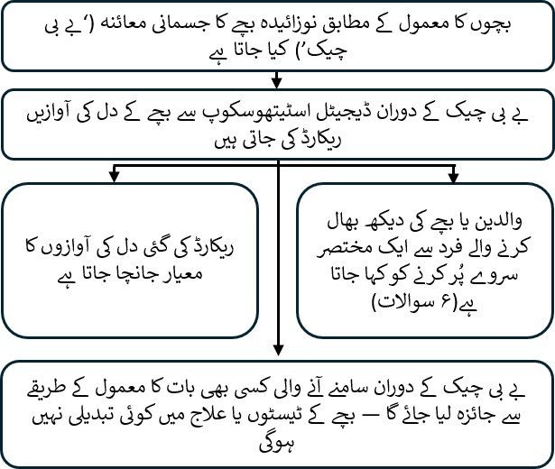

::: {dir="rtl" style="text-align: center;"}
<b>نوزائیدہ بچے کے جسمانی معائنے کے دوران بچوں کے دل کی آوازوں کی ڈیجیٹل ریکارڈنگ: babyPHONO مطالعہ</b>

  

  

  

  

 
:::

::: {dir="rtl" style="text-align: right;"}
ہم آپ کو اور آپ کے بچے کو اپنے تحقیقی مطالعے میں حصہ لینے کی دعوت دینا چاہتے ہیں۔ فیصلہ کرنے سے پہلے، ہم چاہتے ہیں کہ آپ سمجھ لیں کہ یہ تحقیق کیوں کی جا رہی ہے اور اس میں کیا کچھ شامل ہوگا۔     ہماری ٹیم کا ایک رکن آپ کے ساتھ ان معلومات پر بات کرے گا اور آپ کے سوالات کے جواب دے گا۔ اگر کوئی بات واضح نہ ہو یا آپ مزید معلومات چاہتے ہوں تو ہم سے پوچھیں۔     یہ فیصلہ کرنے کے لیے وقت لیں کہ آپ اپنے بچے کو اس مطالعے میں شامل کرنا چاہتے ہیں یا نہیں۔ حصہ لینا مکمل طور پر رضاکارانہ ہے۔

<b>ہم یہ تحقیق کیوں کر رہے ہیں؟</b>

تمام بچوں کو «نوزائیدہ بچے کا جسمانی معائنہ» کروانے کی پیشکش کی جاتی ہے، جسے بعض اوقات «بچے کا چیک اپ» کہا جاتا ہے۔ اس پرچے میں اس تحقیق کی وضاحت کی گئی ہے جو ہم یہ جاننے کے لیے کر رہے ہیں کہ آیا دل کے مسائل کی نشاندہی کے لیے اس معائنے کو مزید بہتر بنایا جا سکتا ہے۔     ہر 100 بچوں میں سے ایک سے بھی کم بچے کو دل کی ساخت کا کوئی مسئلہ ہوتا ہے۔ اگر اس کا جلد پتا چل جائے تو ہم اس کا زیادہ مؤثر علاج کر سکتے ہیں۔ ہم یہ جاننا چاہتے ہیں کہ آیا بچوں کے دل کی آوازیں ریکارڈ کر کے دل کے مسائل کا پتا لگانے میں مدد حاصل کی جا سکتی ہے۔     ہمیں امید ہے کہ جیسپ وِنگ (Jessop Wing) سے کم از کم 200 بچے اس تحقیق میں شامل ہوں گے۔ اگر یہ مطالعہ کامیاب رہا تو ہمیں امید ہے کہ اس کی بنیاد پر مزید مطالعات کیے جائیں گے، جو مستقبل میں بچوں کے دل کے مسائل زیادہ مؤثر طریقے سے معلوم کرنے میں مدد دیں گے۔
:::

::: {dir="rtl" style="text-align: center;"}
{width="50%" style="max-width: 650px; height: auto;" fig-align="center"}
:::

::: {dir="rtl" style="text-align: right;"}
<b>کیا آپ کے لیے اس تحقیق میں حصہ لینا ضروری ہے؟</b>

نہیں، حصہ لینے کا فیصلہ آپ کا ہے، اور حصہ نہ لینے سے آپ یا آپ کے بچے کی نگہداشت پر کوئی اثر نہیں پڑے گا۔ آپ کسی بھی وقت مطالعے سے الگ ہو سکتے ہیں اور اس کے لیے کوئی وجہ بتانا ضروری نہیں۔  
:::

::: {dir="rtl" style="text-align: right;"}
<b>اگر آپ اس تحقیق میں حصہ لیتے ہیں تو آپ اور آپ کے بچے کے ساتھ کیا ہوگا؟</b>

اس تحقیق کا مقصد ڈیجیٹل اسٹیتھوسکوپ کے ذریعے بچوں کے دل کی آوازیں ریکارڈ کرنا ہے۔ اس سے ہم یہ جاننا چاہتے ہیں کہ آیا ان ریکارڈنگز کی مدد سے دل کے مسائل معلوم کرنے کے لیے مصنوعی ذہانت استعمال کی جا سکتی ہے۔

اگر آپ حصہ لینے کا فیصلہ کرتے ہیں تو آپ سے رضامندی کے فارم پر دستخط کرنے کو کہا جائے گا۔ آپ کے بچے کا معائنہ کرنے والا شخص ڈیجیٹل اسٹیتھوسکوپ سے دل کی آوازیں ریکارڈ کرے گا۔ یہ ریکارڈنگ نوزائیدہ بچے کے مکمل جسمانی معائنے کے دوران کی جائے گی۔ معائنہ مکمل ہونے کے بعد آپ سے 6 سوالات پر مشتمل ایک نہایت مختصر سوالنامہ پُر کرنے کو کہا جائے گا۔

اس تحقیقی مطالعے میں دل کی آوازیں ریکارڈ کرنے سے آپ کے بچے کی نگہداشت کے طریقے میں کوئی تبدیلی نہیں آئے گی۔ بچے کو وہی نگہداشت اور ضرورت کے مطابق وہی اسکین یا علاج ملیں گے جو اسے اس مطالعے میں شامل نہ ہونے کی صورت میں ملتے۔ زیادہ تر بچوں کو کسی اسکین یا علاج کی ضرورت نہیں ہوتی۔
:::

::: {dir="rtl" style="text-align: right;"}
<b>اس مطالعے میں حصہ لینے والوں کے ساتھ کیا ہوتا ہے، اس کا خلاصہ:</b>
:::

::: {dir="rtl" style="text-align: center;"}
{width="80%" style="max-width: 650px; height: auto;" fig-align="center"}
:::

::: {dir="rtl" style="text-align: right;"}
  <b>اس تحقیق کے کیا خطرات ہیں؟</b> ڈیجیٹل اسٹیتھوسکوپ عام اسٹیتھوسکوپ سے بہت ملتا جلتا ہے اور آپ کے بچے کے لیے کوئی خطرہ نہیں رکھتا۔ اسٹیتھوسکوپ کی نلکی کے ساتھ ایک ڈیجیٹل آلہ لگا ہوتا ہے جو آواز ریکارڈ کرتا ہے۔ یہ آواز وائرلیس طریقے سے موبائل فون یا ٹیبلٹ پر منتقل ہوتی ہے۔ پھر ریکارڈنگ انٹرنیٹ پر «کلاؤڈ» میں محفوظ کی جاتی ہے، جس کے لیے ریاستہائے متحدہ امریکہ میں موجود کمپیوٹر سرور استعمال ہوتا ہے۔ ادویات اور صحت کی نگہداشت کی مصنوعات کی نگران ایجنسی (MHRA) نے اس آلے کو برطانیہ میں استعمال کے لیے منظور کیا ہے۔

اس تحقیق میں حصہ لینے کی وجہ سے بچے کے چیک اپ میں تقریباً 2 سے 5 منٹ اضافی لگ سکتے ہیں۔ اس کے بعد سوالنامہ پُر کرنے اور ایک سال بعد فون کال کا جواب دینے میں بھی آپ کا تھوڑا سا وقت لگے گا۔ اس بات کا خطرہ ہے کہ طبی عملہ غلطی سے ڈیجیٹل اسٹیتھوسکوپ کی ایپ میں ذاتی معلومات درج کر دے۔ اس خطرے سے بچاؤ کے لیے ایپ میں موجود معلومات کا ہر ہفتے جائزہ لیا جائے گا اور تحقیقی ٹیم کسی بھی ایسے ڈیٹا کو حذف کر دے گی جس سے کسی فرد کی شناخت ہو سکتی ہو۔
:::

::: {dir="rtl" style="text-align: center;"}
{width="50%" style="max-width: 650px; height: auto;" fig-align="center"}
:::

::: {dir="rtl" style="text-align: right;"}
<b>اس تحقیق میں حصہ لینے کا کیا فائدہ ہے؟</b>

اس تحقیق میں حصہ لینے سے آپ یا آپ کے بچے کو براہِ راست کوئی فائدہ نہیں ہوگا۔ تاہم، ہمیں امید ہے کہ یہ تحقیق ڈاکٹروں کو زندگی کے ابتدائی عرصے میں دل کے مسائل معلوم کرنے میں مدد دے گی اور یوں مستقبل میں پیدا ہونے والے بچوں کو فائدہ ہوگا۔

<b>ہم آپ اور آپ کے بچے کی معلومات کیسے استعمال کریں گے؟</b>

اس تحقیقی منصوبے کے لیے ہمیں آپ اور آپ کے بچے سے متعلق معلومات استعمال کرنے کی ضرورت ہوگی۔

ان معلومات میں آپ کا نام اور رابطے کی تفصیلات شامل ہوں گی۔ ان میں آپ کے اور آپ کے بچے کے NHS نمبر اور ہسپتال نمبر بھی شامل ہوں گے۔ یہ معلومات تحقیق کرنے یا آپ کے ریکارڈ کی جانچ کے لیے استعمال کی جائیں گی، تاکہ اس بات کو یقینی بنایا جا سکے کہ تحقیق صحیح طریقے سے کی جا رہی ہے۔

جن لوگوں کو آپ کی شناخت جاننے کی ضرورت نہیں، وہ آپ کا نام یا رابطے کی تفصیلات نہیں دیکھ سکیں گے۔ اس کے بجائے آپ کے ڈیٹا کو ایک کوڈ نمبر دیا جائے گا۔ دل کی آوازوں کی ڈیجیٹل ریکارڈنگز اور کسی بھی ایکوکارڈیوگرام (دل کے الٹراساؤنڈ) کی تصاویر ناموں کے بغیر محفوظ کی جائیں گی۔ اس طرح صرف وہ لوگ جان سکیں گے کہ یہ ریکارڈنگز یا تصاویر کس کی ہیں، جو جانتے ہیں کہ تحقیق کا کوڈ نمبر کس شخص سے متعلق ہے۔

یونیورسٹی آف شیفیلڈ اس تحقیق کی سرپرست ہے۔ آپ کی معلومات کی حفاظت کی ذمہ داری یونیورسٹی آف شیفیلڈ پر ہے۔ ہم اس تحقیقی منصوبے سے متعلق آپ کی معلومات درج ذیل قسم کے اداروں کے ساتھ شیئر کریں گے:

• NHS کے وہ صحت کی خدمات فراہم کرنے والے ادارے جو اس تحقیقی مطالعے میں شامل ہیں۔

ہم آپ کی تمام معلومات کو محفوظ رکھنے کے لیے درج ذیل اقدامات کریں گے:

• آپ کا نام، رابطے کی تفصیلات اور ہسپتال نمبر جیسپ وِنگ ہسپتال کے محفوظ کمپیوٹر سسٹمز پر پاس ورڈ سے محفوظ اسپریڈشیٹ میں رکھے جائیں گے۔ یہ معلومات مطالعے میں جمع کیے گئے ڈیٹا سے الگ رکھی جائیں گی۔

• پاس ورڈ سے محفوظ اسپریڈشیٹ تک رسائی صرف تحقیقی ٹیم کے ارکان کو دی جائے گی۔

<b>بین الاقوامی سطح پر ڈیٹا کی منتقلی</b>

ہم تحقیق سے متعلق مقاصد کے لیے آپ کے بچے کا ڈیٹا برطانیہ سے باہر شیئر کر سکتے ہیں یا اس تک رسائی دے سکتے ہیں۔ ریکارڈ کی گئی دل کی آوازوں، آپ کے بچے کی عمر سے متعلق معلومات اور مستقبل میں دل کے کسی مسئلے کی تشخیص سے متعلق معلومات میں سے شناخت ظاہر کرنے والی تفصیلات ہٹا دی جائیں گی۔

ہم تحقیق سے متعلق مقاصد کے لیے آپ کا ڈیٹا برطانیہ سے باہر شیئر کر سکتے ہیں یا اس تک رسائی دے سکتے ہیں، تاکہ:

• اسے مستقبل کی تحقیق میں استعمال کیا جا سکے۔

• طبی آلات کے لیے سافٹ ویئر تیار کرنے میں مدد مل سکے۔

اگر ہم اس تحقیق کا ڈیٹا شیئر کرتے ہیں تو صرف اتنا ہی ڈیٹا شیئر کریں گے جتنا ضروری ہو۔ جہاں ممکن ہو، ہم یہ بھی یقینی بنائیں گے کہ شیئر کیے گئے ڈیٹا سے آپ کے بچے کی شناخت نہ ہو سکے۔ بعض حالات میں یہ ممکن نہیں ہوگا؛ مثلاً اگر آپ کے بچے کو کوئی نایاب بیماری ہو تو پھر بھی اس کی شناخت ممکن ہو سکتی ہے۔ اگر آپ کے بچے کا ڈیٹا برطانیہ سے باہر شیئر کیا جاتا ہے تو یہ درج ذیل قسم کے اداروں کے ساتھ ہوگا:

• تحقیقی ادارے۔

• طبی ٹیکنالوجی کے ادارے۔

• سافٹ ویئر تیار کرنے والے ادارے۔

ہم آپ کے بچے کے ڈیٹا کی حفاظت کو یقینی بنائیں گے۔ برطانیہ سے باہر آپ کے بچے کے ڈیٹا تک رسائی حاصل کرنے والے ہر شخص کو ہماری ہدایات پر عمل کرنا ہوگا، تاکہ آپ کے بچے کے ڈیٹا کو برطانوی قانون کے تحت ملنے والے تحفظ جیسا تحفظ حاصل ہو۔ ہم برطانیہ سے باہر آپ کے بچے کا ڈیٹا محفوظ رکھنے کے لیے درج ذیل اقدامات کریں گے:

جن ممالک کے ساتھ آپ کے بچے کا ڈیٹا شیئر کیا جائے گا، ان میں سے بعض کے بارے میں باضابطہ فیصلہ موجود ہے کہ ان کا ڈیٹا کے تحفظ کا معیار مناسب ہے (adequacy decision)۔ اس کا مطلب ہے کہ ہم جانتے ہیں کہ ان کے قوانین برطانیہ کے ڈیٹا کے تحفظ کے قوانین جیسی سطح کا تحفظ فراہم کرتے ہیں۔

ہم ایسے مخصوص معاہدے استعمال کرتے ہیں جو برطانیہ میں استعمال کے لیے منظور شدہ ہیں اور ذاتی ڈیٹا کو وہی تحفظ دیتے ہیں جو اسے برطانیہ میں حاصل ہے۔ مزید تفصیلات کے لیے انفارمیشن کمشنر آفس (ICO) کی ویب سائٹ ملاحظہ کریں: <https://ico.org.uk/for-organisations/uk-gdpr-guidance-and-resources/international-transfers/>

ہم برطانیہ سے باہر آپ کے بچے کے ڈیٹا تک رسائی حاصل کرنے والوں کو اس کے کسی ایسے استعمال کی اجازت نہیں دیتے جو ان کے ساتھ ہمارے تحریری معاہدے میں شامل نہ ہو۔ ہم دوسرے اداروں سے تقاضا کرتے ہیں کہ آپ کے بچے کے ڈیٹا کی حفاظت کے لیے مناسب حفاظتی اقدامات کریں، جو ڈیٹا کی حفاظت اور رازداری کے بارے میں ہماری ذمہ داریوں کے مطابق ہوں۔ اس میں آپ کے ڈیٹا کو حادثاتی طور پر ضائع ہونے اور غیر مجاز رسائی، استعمال، تبدیلی یا شیئر کیے جانے سے بچانے کے مناسب اقدامات شامل ہیں۔ ذاتی ڈیٹا کی حفاظت کی کسی مشتبہ خلاف ورزی سے نمٹنے کے لیے ہمارے پاس طریقۂ کار موجود ہے۔ جب قانون کے تحت ضروری ہوگا تو ہم آپ کے بچے کے ذاتی ڈیٹا کی حفاظت کی خلاف ورزی ہونے پر آپ کو اور متعلقہ نگران اداروں کو اطلاع دیں گے۔ برطانیہ میں ایسی خلاف ورزیوں کی اطلاع دینے کے قواعد کی مزید تفصیلات کے لیے انفارمیشن کمشنر آفس (ICO) کی ویب سائٹ ملاحظہ کریں: <https://ico.org.uk/for-organisations/report-a-breach>

شناخت ظاہر کرنے والی ذاتی معلومات (بشمول نام اور تاریخِ پیدائش) شیفیلڈ کی تحقیقی ٹیم یا آپ اور آپ کے بچے کی نگہداشت کرنے والے طبی عملے کے علاوہ کسی کے ساتھ کبھی شیئر نہیں کی جائیں گی۔ اگر آپ تیسرے فریق کے ساتھ ڈیٹا شیئر کرنے سے انکار کریں، تب بھی آپ اس مطالعے میں حصہ لے سکتے ہیں۔ آپ کے اس فیصلے کو رضامندی کے فارم پر الگ سے درج کیا جائے گا۔

<b>مطالعہ ختم ہونے کے بعد ہم آپ کی معلومات کیسے استعمال کریں گے؟</b>

مطالعہ ختم ہونے کے بعد ہم کچھ ڈیٹا اپنے پاس رکھیں گے تاکہ نتائج کی جانچ کر سکیں۔ ہم اپنی رپورٹیں اس طرح لکھیں گے کہ کوئی شخص یہ معلوم نہ کر سکے کہ آپ کے بچے نے مطالعے میں حصہ لیا تھا۔ ہم مطالعے کا آپ سے متعلق ڈیٹا زیادہ سے زیادہ 5 سال تک رکھیں گے۔ اس کے بعد اس میں سے شناخت ظاہر کرنے والی تمام معلومات ہٹا دی جائیں گی اور اسے محفوظ طریقے سے ریکارڈ میں محفوظ کر دیا جائے گا یا تلف کر دیا جائے گا۔

<b>آپ کی معلومات کے استعمال کے بارے میں آپ کے پاس کیا اختیارات ہیں؟</b>

آپ کسی بھی وقت، کوئی وجہ بتائے بغیر، اپنی اور اپنے بچے کی مطالعے میں شرکت ختم کر سکتے ہیں، لیکن آپ کے بارے میں جو معلومات ہمارے پاس پہلے سے موجود ہیں، ہم انہیں اپنے پاس رکھیں گے۔ آپ کو حق حاصل ہے کہ مطالعے کے لیے آپ کے بارے میں ہمارے پاس موجود ڈیٹا تک رسائی، اسے ہٹانے، تبدیل کرنے یا حذف کرنے کی درخواست کریں۔ آپ اپنے ڈیٹا پر ہماری کارروائی پر بھی اعتراض کر سکتے ہیں۔ اگر ایسا کرنے سے ہم آپ کے ڈیٹا کو تحقیق کے لیے استعمال نہ کر سکیں تو ہم ہمیشہ آپ کی درخواست پر عمل نہیں کر پائیں گے۔ ایسی صورت میں ہم آپ کو اس کی وجہ بتائیں گے۔ اگر آپ اس مطالعے میں حصہ لینے پر رضامند ہوتے ہیں تو آپ کے پاس اس مطالعے سے محفوظ کیے گئے اپنے ڈیٹا کو استعمال کرتے ہوئے مستقبل کی تحقیق میں حصہ لینے کا اختیار ہوگا۔

آپ کی معلومات کیسے استعمال کی جاتی ہیں، اس بارے میں مزید کہاں سے جان سکتے ہیں؟ آپ ہماری طرف سے آپ کی معلومات کے استعمال کے بارے میں مزید جان سکتے ہیں، بشمول اس مخصوص طریقے کے جس کے ذریعے ہم آپ کا ذاتی ڈیٹا برطانیہ سے باہر منتقل کرتے ہیں:

• ہمارا معلوماتی پرچہ پڑھ کر: <https://www.hra.nhs.uk/patientdataandresearch>

• تحقیقی ٹیم کے کسی رکن سے پوچھ کر۔

• اس پتے پر ای میل بھیج کر: [sth.babyphono\@nhs.net](mailto:sth.babyphono@nhs.net){.email dir="ltr"}

• اس نمبر پر ہمیں فون کر کے: [+447729849599]{dir="ltr"}

<b>اگر تحقیق کے بارے میں میرے مزید سوالات ہوں تو کیا کروں؟</b>

اگر آپ کے مطالعے کے بارے میں کوئی سوالات ہوں تو اس پرچے کے پچھلے حصے پر موجود ای میل پتے یا فون نمبر کے ذریعے رابطہ کر سکتے ہیں۔ آپ اس محقق سے بھی سوالات پوچھ سکتے ہیں جو رضامندی کے فارم پر دستخط کروانے کے لیے آپ کے پاس آئے۔

<b>اگر مجھے ملنے والی طبی نگہداشت کے بارے میں کوئی سوال یا شکایت ہو تو کیا کروں؟</b>

اس مطالعے کے دوران آپ سے جو بھی سوالنامہ پُر کرنے کو کہا جائے، اسے اپنی یا اپنے بچے کی طبی نگہداشت سے متعلق خدشات کی اطلاع دینے کے لیے استعمال نہ کریں۔ اگر اپنی طبی نگہداشت کے بارے میں آپ کا کوئی سوال یا شکایت ہو تو اپنی نگہداشت کرنے والے طبی عملے سے بات کریں، یا مریضوں کے لیے مشورے اور رابطے کی خدمت (PALS) کی تفصیلات مانگیں۔

<b>اگر مجھے تحقیق کے بارے میں کوئی شکایت ہو تو کیا کروں؟</b>

اگر آپ مطمئن نہیں ہیں اور شکایت کرنا چاہتے ہیں تو سب سے پہلے ڈاکٹر ایلس گرفتھس (Dr Alys Griffiths) سے رابطہ کریں: [alys.griffiths\@sheffield.ac.uk](mailto:alys.griffiths@sheffield.ac.uk){.email dir="ltr"}۔ اگر آپ کو لگے کہ آپ کی شکایت کو اطمینان بخش طریقے سے حل نہیں کیا گیا تو پروفیسر ہیدر مورٹی بوائز (Professor Heather Mortiboys) سے رابطہ کر سکتے ہیں: [h.mortiboys\@sheffield.ac.uk](mailto:h.mortiboys@sheffield.ac.uk){.email dir="ltr"} یا [0114 222 2290]{dir="ltr"}۔

اگر شکایت آپ کے ذاتی ڈیٹا کے ساتھ کیے گئے برتاؤ سے متعلق ہو تو یونیورسٹی کے رازداری کے نوٹس میں شکایت درج کرنے کے بارے میں معلومات مل سکتی ہیں: <https://www.sheffield.ac.uk/govern/data-protection/privacy/general>۔

اگر آپ اس منصوبے میں شرکت کے نتیجے میں ممکنہ استحصال، بدسلوکی یا نقصان سے متعلق کسی خدشے یا واقعے کی اطلاع دینا چاہتے ہیں تو تحفظ کے لیے نامزد رابطہ شخص ڈاکٹر ہارس اسٹاورولاکس (Dr Haris Stavroulakis) سے رابطہ کریں: [t.stavroulakis\@sheffield.ac.uk](mailto:t.stavroulakis@sheffield.ac.uk){.email dir="ltr"}۔ اگر آپ کے خدشات برقرار رہیں تو تحقیق کی اخلاقیات اور دیانت داری کی مینیجر لنڈسے اَن وِن (Lindsay Unwin) سے رابطہ کریں: [l.v.unwin\@sheffield.ac.uk](mailto:l.v.unwin@sheffield.ac.uk){.email dir="ltr"}۔

<b>کیا اس تحقیق کو اخلاقیات کی کمیٹی نے منظور کیا ہے؟</b>

اس تحقیق کا جائزہ جنوب مشرقی اسکاٹ لینڈ کی تحقیقی اخلاقیات کمیٹی 1 (South East Scotland Research Ethics Committee 1) نے لیا ہے۔ تحقیق کا حوالہ نمبر: 358145 ہے۔

اس تحقیق میں حصہ لینے پر غور کرنے کا شکریہ۔

اس تحقیقی مطالعے کے بارے میں مزید معلومات کے لیے رابطہ کریں:

ای میل:\
[sth.babyphono\@nhs.net](mailto:sth.babyphono@nhs.net){.email dir="ltr"}\
مطالعے کا فون نمبر:\
[+447729849599]{dir="ltr"}

یہ تحقیقی مطالعہ جیسپ وِنگ ہسپتال میں کیا جا رہا ہے، جس کا پتہ ہے: [Jessop Wing Hospital, Tree Root Walk, Broomhall, Sheffield, S10 2SF]{dir="ltr"}  
:::

::: {dir="rtl" style="text-align: center;"}
{width="50%" style="max-width: 650px; height: auto;" fig-align="center"}
:::

::: {dir="rtl" style="text-align: right;"}
    اس تحقیقی مطالعے کی سرپرست یونیورسٹی آف شیفیلڈ ہے، جس کا پتہ ہے: [The University of Sheffield, Western Bank, Sheffield, S10 2TN]{dir="ltr"}

ڈیٹا کے تحفظ کے افسر:\
لیوک تھامپسن (Luke Thompson)\
[dataprotection\@sheffield.ac.uk](mailto:dataprotection@sheffield.ac.uk){.email dir="ltr"}\
[+44 114 222 1117]{dir="ltr"}  
:::

::: {dir="rtl" style="text-align: center;"}
{width="50%" style="max-width: 650px; height: auto;" fig-align="center"}  
:::

::: {dir="rtl" style="text-align: right;"}
اس تحقیقی مطالعے کے لیے مالی وسائل شیفیلڈ چلڈرنز ہسپتال چیریٹی فراہم کرتی ہے، جس کا پتہ ہے: [Sheffield Children’s Hospital Charity, 4 Marlborough Rd, Sheffield, S10 1DB]{dir="ltr"}  
:::

::: {dir="rtl" style="text-align: center;"}
{width="50%" style="max-width: 650px; height: auto;" fig-align="center"}  
:::
